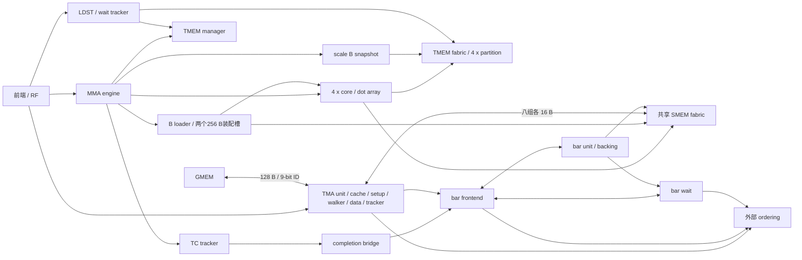

# blackwell_async_subsystem_top

## Description

本模块把一个 SM100a 单 CTA 的异步执行单元接到 warp 指令前端、RF、LSU、GMEM 和 ordering 服务。顶层负责联合接受、共享端口路由及 CTA 生命周期；外围负责解码、warp 收敛和程序序。入口命令见 [PTX 支持范围](../../proposals/supported_ptx.md)。

| 信号 / 通道 | 方向、类型 / 位宽 | 对端 | 握手或采样条件 |
| --- | --- | --- | --- |
| mma_cmd / tc_op_done | 入 [mma_cmd_t](../tensor_core/blackwell_tc_mma_engine.md#mma-command) / 出 [op_done_t](#identity) | warp 前端 | 三个命令记录的每次接受均与tracker.register_op原子登记；每个id仅完成一次 |
| tc_commit / tc_commit_done | 入 [tc_commit_t](../tensor_core/blackwell_tc_completion_tracker.md#commit-contract) / 出 op_done_t | warp 前端 | 捕获当前 issuer 的旧前缀，对目标本地对象提交一次 |
| tmem_manage / tmem_manage_rsp | 入/出 [tmem_manage_cmd_t](../tmem/blackwell_tmem_manager.md#management-types) / [tmem_manage_rsp_t](../tmem/blackwell_tmem_manager.md#management-types) | 管理前端 | 管理前端负责 ALLOC 的 [dst] 普通 SMEM 弱写与同址顺序 |
| tmem_alloc_credit | 出，1 bit 电平 | 管理前端的 warp 仲裁器 | 直连 manager.alloc_credit_o；仲裁器在驱动 tmem_manage.valid 前据此筛选 ALLOC，DEALLOC 可独立参选。[准入与归还沿](../tmem/blackwell_tmem_manager.md#alloc-admission) |
| tmem_ldst / tmem_ldst_done；rf_store / rf_load | 入/出 [tmem_ldst_cmd_t](../tmem/blackwell_tmem_ldst_engine.md#rf-types) / op_done_t；入/出 [rf_beat_t](../tmem/blackwell_tmem_ldst_engine.md#rf-types) | warp 前端、RF | 外部预留每个目标 RF，最后 load beat 接受后才可结算读依赖 |
| tmem_wait / tmem_wait_done | 入 [tmem_wait_cmd_t](../tmem/blackwell_tmem_wait_tracker.md#wait-types) / 出 op_done_t | warp 前端 | 软件 wait::st 截止前同 warp 的 store |
| tma_cmd / tma_rsp | 入 [tma_cmd_t](../tma/blackwell_tma_unit.md#command) / 出 [tma_rsp_t](../tma/blackwell_tma_unit.md#command) | warp 前端 | load、store、prefetch.tensormap、bulk group |
| bar_cmd / bar_rsp | 入 [bar_cmd_t](../mbarrier/blackwell_mbarrier_frontend.md#command) / 出 [bar_rsp_t](../mbarrier/blackwell_mbarrier_frontend.md#command) | warp 前端 | init、arrive、try_wait、inval 等及相应可见性 |
| smem_rd/rsp、smem_wr/ack [8] | 入请求/出返回，各自 SMEM atom 类型 | 外围 LSU | 外部 LSU client12；普通访问不得绕过活跃 barrier 的权威对象 |
| gmem_req / gmem_rsp | 出/入 [gmem_req_t](../tma/blackwell_tma_unit.md#gmem-types) / [gmem_rsp_t](../tma/blackwell_tma_unit.md#gmem-types) | GMEM | TMA 数据与 descriptor 共用 128 B 通道，9-bit ID 路由乱序回应，gmem_rsp_ready 独立于 gmem_req_ready |
| order_req / order_rsp | 出/入 [order_req_t](#ordering) / [order_rsp_t](#ordering) | ordering 服务 | release/acquire/proxy/init fence 与最终 CTA_CLOSE |
| close_req/rsp、open_req/rsp | 入事件/出 status；入 epoch16/出 status | CTA 控制器 | 完整关闭事务，隔离后打开新 epoch |
| lsu_quiescent、isolated | 入 bit | 外围 LSU、隔离控制 | 旧 LSU 工作及其可见性责任已完成；外部复位前响应已隔离 |
| epoch、stopped、drained、fault | 出 16/1/1/1 bit | CTA 控制器 | 当前 epoch、正常关闭、在途排空、运行终止（sticky）。 |
| clk、rst_n | 入，各 1 bit | 外围时钟与复位 | 上升沿采样，低有效同步复位。 |



## Functionality

<a id="common-protocol"></a>

### 公共协议、复位及状态码

#### 时钟与握手

- 单时钟 `clk`，上升沿采样；`rst_n` 为低有效**同步**复位。时序模块端口表可省略共有的时钟和复位。组合算术模块无时钟，SRAM 的数据和 Q 无复位端口。
- 表中的 `x : T` 是逻辑通道，展开为 `x_valid`、`x_ready`、`x_payload : T`。发送端输出 valid/payload，接收端输出 ready；数组通道每项独立握手。没有 payload 的事件仍有 valid/ready。
- `fire(t)=valid(t-) && ready(t-)`，`t-` 是边沿 t 前；寄存器新值在 t 后可见，最早在 t+1 被下游采样。组合函数没有隐藏寄存器。
- GMEM 外围提供可暂停的返回通道。gmem_rsp_valid 已置位而 ready=0 时，ID、1024-bit 数据和 status 必须稳定至 fire。接入无法暂停的 L2 时，适配器必须在发出每笔请求前为该笔返回取得可靠存储空间，耗尽 credit 时停发新请求；返回被 TMA 接收后归还 credit。每笔承诺须覆盖完整回应，实际可发数受适配器 credit 和空闲 tag 双重限制；适配器存储另计。新请求停发不得阻断已发事务返回、SMEM 写及其确认。[GMEM 类型与 class](../tma/blackwell_tma_unit.md#gmem-types)
- `valid && !ready` 时 valid 和全部 payload/tag 保持。发送端不能等待 ready 才产生 valid；ready 可依赖本地容量和下游 ready，但跨模块不得形成组合环。
- 单级暂停和 FIFO 满时同沿出入的状态方程分别见 [弹性寄存器](../base/blackwell_pipeline_reg.md) 与 [FIFO](../base/blackwell_fifo.md)。
- 多个通道需原子接受时，接收端仅在全部资源可预留时拉高 ready；不能先消费一侧再等待另一侧而丢失身份。顶层明确标出的原子接受组允许用另一端的容量ready限定valid，但必须证明ready不依赖本组valid且在joint fire前保留容量；该例外不适用于普通通道。

#### 身份、完成和复位

完整操作身份为 [async_id_t](blackwell_async_subsystem_top.md#identity)。`seq` 在一个 epoch 的同 issuer 内唯一且不回绕。存储返回按[完整存储身份](#memory-routing)匹配。

接受、源读取、目的写接受、实际写完成、ACK 退休、软件响应消费是不同事件。模块的 `done` 表示其全部必要副作用已经完成；输出背压可以延迟响应消费，不能撤销已经提交的副作用。

正常关闭的 `stop` 封闭新外部命令；内部响应、生产者完成与排空继续。`drained` 必须包括已接受命令、请求、返回、流水和 held response；静态缓存内容不等于在途操作。

复位清 valid、credit、live ID、allocation 和 cache 有效位，不清 payload RAM。复位前外部存储必须取消旧事务或保证不会再返回；顶层只在取得该隔离确认后允许新 epoch。正常 epoch 切换要求全部引擎 drained、dirty barrier 写回及 ordering 完成。epoch 不用于静默丢弃仍在途的有效工作。

授权换 epoch 时各模块清静态 cache/collector 有效位、allocation/permit 和本地序号，payload 保留。

各模块检测到活动事务的非 OK 存储或 ordering 返回、非法内部身份、重复返回或执行期协议违约时报告 fault。管理结果的 SMEM 弱写由外围 LSU 执行，其非 OK ACK 同样进入这条故障路径。顶层汇总为一个 sticky `fault`，其寄存电平作为执行控制模块共用的 1-bit `halt_i`（端口表可省略），并通知 CTA 控制器本次运行已终止。错误事件不得推进依赖它的写回、arrival、complete-tx、成功 done 或 close。已提交的写及已完成的握手保留；已展示的 valid/payload 按接口保持到握手或外部隔离复位。检测沿只阻止依赖错误事件的成功提交，独立接口按实际 fire 结算。`halt_i=1` 期间关闭新指令及派生工作，已展示通道正常握手后不再补入新项。恢复由外围隔离旧请求、响应和 RF/ordering 接口后整体同步复位，无需先取得 drained 或 close_rsp。

#### 状态码

公共接口的 `status_t` 为 4 bit。入口静态拒绝使用以下编码；执行中收到异常状态时按上述 fault 合同处理。

| 值 | 名称 | 含义 |
|---:|---|---|
| 0 | OK | 成功；wait 的未满足谓词仍可为 OK |
| 1 | UNSUPPORTED | 不属于本项目指令子集 |
| 2 | INVALID | 字段或组合非法 |
| 3 | RANGE | 地址、计数或大小越界 |
| 4 | MEMORY | 外部事务错误 |
| 5 | STALE | epoch/对象生命周期不匹配 |
| 6 | PROTOCOL | 非 live ID、重复响应或硬件协议顺序违约（不检查软件 collector 序列） |
| 7…15 | reserved | 不发出；接收时视为 PROTOCOL |

异步登记前的入口预检可按 UNSUPPORTED/INVALID/RANGE 拒绝非法命令。同步 TMEM 管理预检使用自己的响应槽。这些拒绝均无数据或同步副作用。只有取得 descriptor、对象或展开地址后才可发现的违约，若已登记命令则终止本次运行。合法的 tensor OOB、collector 物理 miss 和 wait 超时按各模块正常路径处理。

#### 配置与计容

物理配置固定为四核；TMEM 128×128×128 bit，SMEM 32×1824×32 bit。每个模块文档独占其资源深度、状态位宽和时序的定义；父模块只引用与汇总。实例数与每实例容量相乘，广播视图不算第二份存储。

数据字节、valid/tag/credit 等控制位、宏内读输出分别计量。每个新增 FIFO、暂存 payload 和格式流水均须列出，不能用“adapter”隐去存储。内部有限表满时背压，不能通过覆盖活跃项获得吞吐。

端口中 `T[N]` 是 N 条 T 元素通道或总线，是否独立握手须明确；`bits(T)` 由拥有者模块的字段之和计算。位向量按低索引元素占低位；字节地址递增对应 payload 的低位到高位。packed struct 按字段表从高位到低位排列，除非所属模块给出显式 bit/byte 编码。

<a id="identity"></a>

### 公共操作身份

| 类型/字段 | 位宽 | 定义 |
|---|---:|---|
| `async_id_t.epoch` | 16 | 当前单 CTA 生命周期；后端全部排空后才能更换 |
| `async_id_t.issuer` | 10 | CTA 线程号；`warp=issuer[9:5]`，`lane=issuer[4:0]` |
| `async_id_t.seq` | 32 | 外部命令使用0…0xfffffffe，递增、不回绕、不复用 |
| `async_id_t` | 58 | packed 顺序 `{epoch,issuer,seq}` |
| `op_done_t` | 62 | `{id:async_id_t,status:status_t}` |

同一 issuer 的所有命令共用递增 seq；不同 issuer 的 seq 不比较大小。调用者依每个发起线程的程序序提交TC 的 MMA/COMMIT。一次commit只覆盖当前epoch内**完整10bit issuer与自身相同**且在截止前接受的操作。同warp内不同lane各有独立集合。外部指令前端负责跨线程同步。

`{epoch,issuer=1023,seq=0xffffffff}`仅保留给顶层CTA关闭时的最终ordering，所有外部命令不得使用。其他issuer的seq=0xffffffff也不分配，避免保留号因入口差异而成为合法软件身份。

<a id="ordering"></a>

### Ordering 服务

`order_req_t={id:58, kind:3, scope:2, from_proxy:2, to_proxy:2, addr:64, bytes:32}` 共163bit；`order_rsp_t=op_done_t`。kind=0 RELEASE、1 ACQUIRE、2 PROXY_FENCE、3 保留、4 CTA_CLOSE、5 MBARRIER_INIT_RELEASE，其他非法。scope=0 CTA、1 GPU、2 SYS、3 CLUSTER（本 CTA 所在单 CTA cluster）；proxy=0 generic、1 async、2 tensormap，3保留。

请求按id匹配确认；同id至多一个ordering在途。除 CTA_CLOSE 外，bytes=0表示该scope下该issuer此前相关访问，非零表示半开区间[addr,addr+bytes)。加法用65bit检查溢出。

- CTA_CLOSE：保留关闭身份，scope=CTA、addr=bytes=0、async→generic。确认必须覆盖整个待关闭 epoch 的所有 issuer 及内部 backing 写回的有限前缀；保留 issuer 仅用于路由 ACK。
- RELEASE：对应先前写满足指定scope可见性后才确认，之后才可提交arrival等同步更新。
- ACQUIRE：相应wait已观察成功，再向外部请求acquire；其确认后才能返回软件成功wait。
- PROXY_FENCE：确认from_proxy的先前写可被to_proxy的后续访问观察。
- MBARRIER_INIT_RELEASE：先前该 issuer 在本 CTA 初始化的对象均已提交，再向单 CTA cluster 发布其初始化，匹配 ACK 后才能放行后继同步。

外部排序适配器不得无条件回OK。顶层测试环境须显式实现这些契约，或证明其单时钟内存模型已经满足后再确认。TMA copy 的隐式可见性由每笔目标写的成功 ACK 承诺。显式 proxy fence、barrier release/acquire 和 CTA_CLOSE 仍各自取得 ordering 确认。

<a id="memory-routing"></a>

### 公共存储身份与类型入口

`mem_tag_t={id:async_id_t,client:u4,token:u16}`，78bit。同一接口内，每个未交付的源读或未退休的写 ACK 都以完整 tag 区分。在同一 id、client 内，token 须保留到对应返回或 ACK 退休。不同命令可同时使用同一 client 和 token，返回仍归各自 id。

| client | 唯一用途 |
|---:|---|
| 0…3 | 四核TMEM访问及SMEM A |
| 4 | scale B snapshot，仅TMEM |
| 5 | RF LD/ST，仅TMEM |
| 6 | 共享B loader，仅SMEM |
| 7、10、13…15 | 保留 |
| 8 | TMA data |
| 9 | TMA descriptor的外部存储身份类别 |
| 11 | mbarrier backing |
| 12 | 外围普通SMEM LSU |

| 类型/语义 | 唯一拥有者 |
|---|---|
| TMEM地址、MMA布局、tmem_rd/wr请求与rsp/ack | [TMEM fabric](../tmem/blackwell_tmem_fabric.md#transactions) |
| SMEM地址、分离及联合smem_atom请求/返回 | [SMEM fabric](../smem/blackwell_smem_fabric.md#transactions) |
| GMEM 128 B请求/返回、gmem_id_t | [TMA unit](../tma/blackwell_tma_unit.md#gmem-types) |
| ordering请求/确认 | [本模块ordering](#ordering) |
| MMA命令/descriptor、B选择与驻留key | [MMA engine](../tensor_core/blackwell_tc_mma_engine.md#mma-command) |
| B load/data/result | [B loader](../tensor_core/blackwell_tc_b_loader.md#types) |
| RF命令/beat、wait及完成登记 | [LDST](../tmem/blackwell_tmem_ldst_engine.md#rf-types)、[wait tracker](../tmem/blackwell_tmem_wait_tracker.md#wait-types) |
| TMA context/segment/tag 事件 | [setup](../tma/blackwell_tma_setup.md#context)、[request generator](../tma/blackwell_tma_request_generator.md#segment)、[tracker](../tma/blackwell_tma_completion_tracker.md#transfer-types) |

帧数组的各atom独立valid/ready，不把整帧全ready作为通常条件。容量预留与部分接受不能复制已完成事务；未接受payload保持。物理SRAM、返回、ACK状态分别由fabric/partition拥有，父层只路由。缓存静态数据不等于在途工作；close时仍须结清三个命令记录、两个装配槽和部分分发和全部held结果。

### 内部连接及预留

| 产生 → 消费 | 通道、状态及其释放 |
|---|---|
| MMA cmd → engine + TC tracker | joint fire。令 re/rt 为与本组 valid 无关且为当前命令保留的 capacity ready。external_ready=re&&rt、engine_valid=v&&rt、register_valid=v&&re。engine_done 写预留操作行，不依赖软件 op_done.ready，发射切换不重登。 |
| TC tracker → bridge ↔ bar frontend | ready_commit 带 slot 和含 id/地址的 commit，bar_req/rsp 只提交一次。软件 commit_done 消费后 retire 才释放槽。commit 候选 addr 接 frontend.commit_candidate_addr，commit_blocked 时不登记；允许已登记事务继续。 |
| engine / LDST ↔ manager | 两来源公平仲裁 pin，保留 source/id 到响应交付。固定 user 对应 MMA rec 0…2、LD、ST。unpin 独立轮询，可在 pin_rsp 背压期间释放使用位。 |
| R_RF_ISSUE ↔ RF tracker → LDST | 外部 ldst 接受同沿分配 live 行，顶层持 cmd92，slot 返回后保存 slot5 并发 issue97，再释放。普通 done 终端不以 wait_done 为接收前提。 |
| engine → SMEM / TMEM fabric | live[3] 为按接受序排列的 {valid1,rec2,id58}，最老在前。SMEM 在 R_BREQ 入口用 live 比较同组 A 候选的年龄。TMEM 依据本地核请求的 token.kind 识别 C 读。各模块共用同一 epoch。 |
| TMA ↔ frontend | bind_req/rsp 先于首笔 load；producer_done/rsp 直接成对路由，不借用软件响应槽。每个成功绑定的 load 在正常执行中只提交一次 complete-tx。 |
| frontend ↔ unit ↔ backing；frontend ↔ wait | service_req/rsp 的 route/slot 预留；unit.change 无背压广播；wait.probe 经 frontend 查询，wait 与旧 commit 的同址 busy 供 INIT/INVAL 排他 gate 使用；写回与回填由 backing 唯一发起。 |
| 各执行模块 → top → CTA 控制器及各模块 | 本地运行故障汇总为终止电平，隔离复位优先于正常关闭。 |

前端负责程序序，MMA 交接及逐块同址依赖见 [MMA core](../tensor_core/blackwell_tc_mma_core.md)。bar.sync、线程同步和 RF 依赖仍按外部可见性、RF 写回和 fence 结算。

### 路由、时序与生命周期

TMEM client0…3=core、4=scale B、5=LDST，各有 128 条 lane 路由。SMEM client0…3=core A、6=B loader、8=TMA data、11=barrier backing、12=外围 LSU（含管理结果普通写）。每 client 按 group=(addr>>4)&7 选择 8 个 atom 口。TMA req[g] 固定接 client8 的组 g，按 write 分至 wr_req[8][g] 或 rd_req[8][g]。wr_ack[8][g]、rd_rsp[8][g] 复接该组的 rsp[g] 并保留方向与原 tag，八路 ready 独立。同组两类回应竞争时在可接收的候选间轮询，选中并展示后锁至 fire；其他组可同时退休。各 copy 的读写按组和 tag 区分。[client8 的 token](../tma/blackwell_tma_completion_tracker.md#transfer-types) 携事务 tag、组号和 phase，数据槽可在写请求接受后复用。backing 单口在候选组间轮询，已展示的回应保持。

ordering 来源为 TMA unit（含 proxy fence）、bar frontend（含 init-release fence）、wait 与最终 close。公平轮询，保存一个 held/source 和一个在途 source/id 到匹配 ACK。bar frontend 发 init release 前等待此前 init 对象实际提交；本地 singleton cluster 之外的访问拒绝。ordering ACK 的服务不得依赖后续软件 wait 消费。关闭时的保留 id 只作路由，kind=CTA_CLOSE 覆盖所有 issuer，包括内部 dirty backing 写。

| 生命周期 | 进入和退出条件 |
|---|---|
| CLOSED / OPEN_RESULT | 同步复位将状态置为 CLOSED、16-bit `epoch` 置为 0。在 CLOSED，首次和后续 open 都要求 `isolated && open.epoch != epoch`，因此首次可用值为 1…65535。open 握手沿锁存新 epoch，子模块在观察到新 epoch 时按各自规则初始化。open_rsp 消费后进入 RUN，首条命令最早在下一沿接受。 |
| RUN → DRAIN | 全部外部指令 valid 为 0、无 held 命令后接受 close，停止新指令；已接受的派生 issue、读写、RF、producer、done、ordering 继续。 |
| DRAIN → FLUSH | 全部已接受操作、tracker live 行、held 返回和外部 LSU 工作完成，lsu_quiescent 有效。 |
| FLUSH → ORDER | dirty 对象逐项写回并收到实际成功 ACK，随后发一次 CTA_CLOSE。 |
| ORDER → END | 收到匹配的成功 CTA_CLOSE ACK。 |
| END → CLOSED | manager 无 pin 或 held 响应时接受 epoch_end，清 allocation。消费最终 close_rsp 后保留旧 epoch 供下次 open 比较。 |

顶层保存 epoch/FSM、fault、仲裁 held/source、在途 ordering 与 pin 身份、R_RF_ISSUE、flush/close-order 握手状态及最终响应 valid。正常关闭的结果只在 END 后发布。

<a id="mma-nonempty-commit"></a>

### 跨 issuer 的非空 commit

同一 CTA、epoch、warp 的线程 5（A）先发普通 FP16 MMA 写 X，线程 6（B）随后发 MMA 写 Y。B 的 register_op 已 fire 且其 engine_done 尚未 fire 时，B 发 commit 到已初始化、只差一次 arrival 的独立 barrier。检查快照 pending 恰含 B 的操作。令 X/Y 列区间不相交、input_d=0，各源与目的没有跨指令别名。用普通 MMA 合法的 disable_lane_mask 让 A 只写 TMEM 分区 0，B 只写分区 1，避免扣住的 ACK 占用 B 所需的 bank 或 ACK 帧。

只扣住 A 最后一笔实际写的匹配 ACK，其余接口持续 ready。先观察 B 的全部实际写 ACK 和 unpin，再观察 engine_done(B).fire 及 B 的 barrier 原子 arrival。此时 A 仍未 done，两条 engine 记录仍占槽。再放行 A 的 ACK，观察 engine_done(A).fire，回收次序必须为 A、B；B 的通知和 arrival 各恰好一次。若 B 已收尾却必须放行 A 才能通知，则验收失败。另测 A 的末 ACK 返回 MEMORY，B 先前提交的成功结果和 arrival 保持，顶层置 fault，A 不得触发成功 arrival。

### 跨模块验收

- 按下述稳态窗口跟踪前三条 N128，检查预取、执行和写尾可同时推进。N256 原位换 B 时暂停一个核，检查已交付目的、该核消费水位及旧 ACK 的身份。
- 在上面的非空 commit 用例之外，覆盖独立空 commit、同址 INIT/INVAL 与新 commit 互斥、软件响应和 acquire 背压。
- 按 id 对齐传输、RF 写回与 mbarrier。两笔独立 load 绑定同一 phase 时，分别确认各自字节，消费 warp 等待全部 expect-tx 和 arrival 满足并取得 acquire 确认。验收数据槽满后的恢复、跨命令连续发读和第三条独立短 copy 的进展。[TMA 数据通路](../tma/blackwell_tma_data_path.md#peak) · [walker 交接用例](../tma/blackwell_tma_unit.md#copy-overlap)
- 分别在第二 phase、descriptor、末目标 ACK、dirty flush 和最终 ordering 注入正常背压，解除后检查原事务继续；另向末 ACK 注入 MEMORY，检查 fault 和隔离复位。

<a id="cycles"></a>
#### 连续 MMA 的周期边界

以 M0、M1 表示连续两条 N128 FP16→FP32 同址累加，启用全部写 lane。SMEM A/B 独立且各 4 KiB 对齐，K-major、无 swizzle、LBO=128 B、SBO=256 B。先检查/pin，分区选择及时，D 同址且四 cell 对齐，四核无背压，其他客户端无争用。布置每个 128 B 半块的八个 atom 分属八组，跨全部 32 个物理 bank。列块 j 含四个八行组，每条每核发 Q=N/2 片。表中均为握手沿，F=64i 为第 i 条 N128 的首 dot，S=F+4j；首条负数沿来自预热。

| 对象 | grant | ready 与消费 |
|---|---|---|
| B[j] 两个 128 B 半块 | S−10、S−9 | S−8、S−7 返回；S−6 分发；S−1 首 op_load。相邻块交替用两个装配槽。 |
| 每核 C[j] 两帧 | S−6、S−5 | S−3、S−2 返回；S−1 取首片。首 grant 可与前两块的末 op_load 同沿。 |
| 下一条 A[r] | g=F−64+16r+4c+h | c 为核 0…3，h=0/1。每 grant 读该核八行各 16 B，g+2 返回。组 r 最晚 F−49+16r 齐，第一次 op_load 为 F+r−1。 |

在前条首 dot 为 0 时，后条 C0 在 58/59 grant，61/62 返回，赶上 63 装首片。C1 在 62/63 grant、65/66 返回，赶上 67 装块 1 的首片。

| 以前条首 dot 为第 0 沿 | 验收观察 |
|---|---|
| 63 → 64 | 63 沿发 M0 末 dot 并装 M1 首片，64 沿发 M1 首 dot。 |
| 68 → 72 | 68 沿 M0 最后结果入 D，69/70 接受末两帧写，71 实写末帧，72 退休末 ACK。 |
| 73 → 75 | 服务及时，73 沿可接受 M0 的 local_done，74 归还剩余资源并发布 done，75 tracker 可接受。 |

单族连续、全写、对齐且服务及时的尾部通式为 L=F+Q−1、末 ACK=L+Ldot+5，其中 Ldot 为对应[算术族](../tensor_core/blackwell_tc_dot_array.md)的级数减一。首条冷装、WS 命中、跨族、全禁写和争用情形按接口事件取时间：全部核首组输入和 R_OP 空间沿前有效时可装 R_OP，首 dot 最早在下一沿。冷装首个源 R_BREQ 接受不代表所有其他输入已准备好。

| FP16，A/B 均从 SMEM 且每字只读一次 | N64 | N128 | N256 |
|---|---:|---:|---:|
| 后端每条唯一 A+B | 4+2 KiB | 4+4 KiB | 4+8 KiB |
| 至少需要的 SMEM 读拍 | 48 | 64 | 96 |
| dot 服务拍 | 32 | 64 | 128 |

<a id="mma-vectors"></a>
#### 连续累加的复算向量

八条 N128 FP16 同址累加，命令 i、行 m、列 n 和 K 坐标 k 从 0 开始。A、B 取 FP16 可精确表示的整数，C 为初始 FP32 累加值。

```text
A[i,m,k] = ((3*m + 2*k + i*(k+1)) mod 7) - 3
B[i,n,k] = ((n + 3*k + i*(n+2)) mod 9) - 4
C[m,n]   = m - 2*n
```

逐坐标独立计算初始 C 加上八条指令所有 k 项的乘积和，逐字节比对 65,536 B FP32 结果。记录每条首 dot、末写接受、实写、末 ACK 和 tracker 接受沿。在上述布局与服务条件下，八条首 dot 应依次为 0、64、128、192、256、320、384、448。

## Submodules

下列直接子模块每后端各一份，顶层负责联合接受、pin 仲裁、ordering 路由和关闭控制。

| 通路 | 直接子模块 |
| --- | --- |
| MMA 与 commit | [tc_mma_engine](../tensor_core/blackwell_tc_mma_engine.md)、[tc_completion_tracker](../tensor_core/blackwell_tc_completion_tracker.md)、[tc_async_completion](../tensor_core/blackwell_tc_async_completion.md) |
| TMEM 分配、访问与等待 | [tmem_manager](../tmem/blackwell_tmem_manager.md)、[tmem_fabric](../tmem/blackwell_tmem_fabric.md)、[tmem_ldst_engine](../tmem/blackwell_tmem_ldst_engine.md)、[tmem_wait_tracker](../tmem/blackwell_tmem_wait_tracker.md) |
| SMEM 与 TMA | [smem_fabric](../smem/blackwell_smem_fabric.md)、[tma_unit](../tma/blackwell_tma_unit.md) |
| mbarrier 对象与等待 | [mbarrier_frontend](../mbarrier/blackwell_mbarrier_frontend.md)、[mbarrier_unit](../mbarrier/blackwell_mbarrier_unit.md)、[mbarrier_wait](../mbarrier/blackwell_mbarrier_wait.md)、[mbarrier_backing](../mbarrier/blackwell_mbarrier_backing.md) |

<a id="module-index"></a>
### 模块索引

35 份规格按模块列出。同一模块的多个实例共用一份规格。

| 子系统 | 模块 |
|---|---|
| top | [blackwell_async_subsystem_top](../top/blackwell_async_subsystem_top.md) |
| tensor_core | [blackwell_tc_async_completion](../tensor_core/blackwell_tc_async_completion.md)、[blackwell_tc_b_loader](../tensor_core/blackwell_tc_b_loader.md)、[blackwell_tc_completion_tracker](../tensor_core/blackwell_tc_completion_tracker.md)、[blackwell_tc_dot_array](../tensor_core/blackwell_tc_dot_array.md)、[blackwell_tc_mma_core](../tensor_core/blackwell_tc_mma_core.md)、[blackwell_tc_mma_engine](../tensor_core/blackwell_tc_mma_engine.md)、[blackwell_tc_scale_b_snapshot](../tensor_core/blackwell_tc_scale_b_snapshot.md) |
| tmem | [blackwell_tmem_fabric](../tmem/blackwell_tmem_fabric.md)、[blackwell_tmem_ldst_engine](../tmem/blackwell_tmem_ldst_engine.md)、[blackwell_tmem_manager](../tmem/blackwell_tmem_manager.md)、[blackwell_tmem_partition](../tmem/blackwell_tmem_partition.md)、[blackwell_tmem_wait_tracker](../tmem/blackwell_tmem_wait_tracker.md) |
| smem | [blackwell_smem_fabric](../smem/blackwell_smem_fabric.md) |
| tma | [blackwell_tma_completion_tracker](../tma/blackwell_tma_completion_tracker.md)、[blackwell_tma_data_path](../tma/blackwell_tma_data_path.md)、[blackwell_tma_descriptor_cache](../tma/blackwell_tma_descriptor_cache.md)、[blackwell_tma_request_generator](../tma/blackwell_tma_request_generator.md)、[blackwell_tma_setup](../tma/blackwell_tma_setup.md)、[blackwell_tma_unit](../tma/blackwell_tma_unit.md) |
| mbarrier | [blackwell_mbarrier_backing](../mbarrier/blackwell_mbarrier_backing.md)、[blackwell_mbarrier_frontend](../mbarrier/blackwell_mbarrier_frontend.md)、[blackwell_mbarrier_unit](../mbarrier/blackwell_mbarrier_unit.md)、[blackwell_mbarrier_wait](../mbarrier/blackwell_mbarrier_wait.md) |
| dot | [blackwell_dot_align_fixed_rz](../dot/blackwell_dot_align_fixed_rz.md)、[blackwell_dot_emax_tree](../dot/blackwell_dot_emax_tree.md)、[blackwell_dot_fp32_pack](../dot/blackwell_dot_fp32_pack.md)、[blackwell_dot_signed_reduce_tree](../dot/blackwell_dot_signed_reduce_tree.md)、[blackwell_f16tf32_dot](../dot/blackwell_f16tf32_dot.md)、[blackwell_f4f6f8_dot](../dot/blackwell_f4f6f8_dot.md)、[blackwell_fp4_dot](../dot/blackwell_fp4_dot.md)、[blackwell_int8_dot](../dot/blackwell_int8_dot.md) |
| base | [blackwell_banked_sram](../base/blackwell_banked_sram.md)、[blackwell_fifo](../base/blackwell_fifo.md)、[blackwell_pipeline_reg](../base/blackwell_pipeline_reg.md) |
