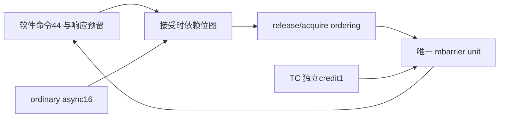

# blackwell_mbarrier_frontend

> 规范版本 v1.0

## 1. 模块概述

bar命令协议层，包含unit，管理release/acquire ordering、普通cp.async登记/完成、deferred arrival、report-on和TC完成入口。自身ordinary-async16、command44；unit配置cache4/wait32/writeback2、地址32、backing ID1、clock10ns/default-wait64，仅传递并实例化一次。TC默认一笔在途和一个独立响应槽，不保存TC命令payload副本。

子模块规范：[blackwell_mbarrier_unit](blackwell_mbarrier_unit.md)。

### 微架构与资源



command44=32个wait名额+8个普通状态/order名额+4个控制余量；TC独立1 route/rsp槽，ordinary async16；command44×BAR_CMD_W payload为1R1W索引RAM，结果字段分独立44×BAR_RSP_W响应RAM，valid/阶段位在寄存器。完整用户命令保存一次；软件unit内部tag仍为record索引。per-issuer seq为1024×64bit 1R1W RAM、独立seen/fault位图；读1拍、compare/forward1拍，软件准入II=1，seq验证失败进入已预留错误返回位置。

在command接受时仅比较该命令与已有记录，保存44bit predecessor及16bit ordinary-async集合；退休时清对应列。不逐拍进行44×44的完整身份/seq比较。unit请求选择只对ready位图使用平衡优先编码/有界轮询，索引回绕用一次比较/减法。

relaxed命令接受到unit接受最少2拍，加unit hit3拍及软件响应选择1拍，Lmin=6；release/acquire另加真实ordering RTT和相关前驱等待。软件外部bar_rsp反压只占该记录；TC/TMA返回槽独立。flush开始前require所有已接受deferred/async/order与producer请求退休；转发到unit，不建立barrier缓存镜像。

command RAM每条305bit、response RAM每条143bit，各44项1R1W同步1拍；返回位置属于对应command记录，unit完成后直接填该位置，消费软件响应后释放整笔记录。per-issuer RAM只存last_seq64；seen与sticky fault各1024个有效位，namespace切换只清seen；sticky fault仅全后端复位清除，RAM payload不复位。同地址读写及连续issuer接受使用最近合法seq旁路，非法seq不覆盖历史；前驱在接受时按live issuer和接受先后生成，退休时一次清mask。

command RAM的唯一读口服务unit发射，response RAM的唯一读口服务软件输出；紧凑路由identity/pred/control在metadata记录，不能为了恢复tag再并行读command RAM。unit软件返回是response RAM唯一payload写入源；ordering/async/本地错误只更新独立状态位，输出时组合诊断覆盖，不再竞争第二个payload写口。TC返回直接进独立槽。新命令RAM写、unit响应RAM写和各自1次读可以同拍；同地址读写按预留slot的阶段规则/旁路处理，slot未释放前不复用。

所有资源与时序的默认值见[微架构配置](../common/interfaces.md#微架构配置与性能约束)。周期从接受边沿计至结果首次有效；延迟式另加实际背压和外部响应等待。payload 不复位，valid、credit 和身份有效性复位；clock enable 随实际推进，SRAM 仅启用有效 bank。

## 2. 接口定义

全部握手、身份、完成、错误和复位遵循[公共规则](../common/interfaces.md#握手身份与生命周期)；表内位宽单位为 bit，符号见[公用位宽配置](../common/interfaces.md#公用位宽配置)，参数项注明默认配置。无握手的组合输出随输入变化；有握手的流水输出按所属通道保持。

软件 bar 命令、TC arrival、普通 async、report、ordering、TMA transaction 与 backing 通道采用[共享字段](../common/interfaces.md#tmabarrier-与-ordering-类型)。stop 禁止新的软件 bar 命令、普通 async 登记和 report；已接受命令、async 完成、TC arrival 与 TMA transaction 继续处理。

外部tag/issuer映射到command内部索引，恢复完整用户tag；接受时在该记录中预留响应位置，unit响应保存到同一记录，外部软件bar_rsp背压不阻止接收unit响应。记录及内部索引须在用户响应已消费且ordering／deferred内部工作全部退休后才释放；不能在CP_ASYNC_ARRIVE提交响应后提前复用。同issuer后来的状态命令不得越过未确认release。release先发ordering并等ack再提交unit；成功acquire wait先观察unit，再发ordering并等ack，最后返回success。失败ack/ID不符返回MEMORY且清成功wait/report谓词；relaxed不建立额外可见性。

ordinary async登记和完成独立，登记表满仍能接收释放资源的completion；seq递增，complete允许乱序。CP_ASYNC_ARRIVE捕获同issuer的seq小于命令seq的已登记前驱；无noinc先pending_inc，再在集合排空后arrival一次，noinc只做后者。提交响应表示接受了deferred工作，不表示arrival完成；之后不重复产生软件提交响应。producer失败保持issuer fault并走项目对象FAULT，不伪造payload report。

TC count1和TMA transaction bytes只经各自专用入口；producer completion不排在被其满足的软件wait之后。report-on独立8bit payload与tag response。idle要求unit及ordering无执行；drained还要求command表、ordinary async/deferred arrival、report、TC和全部held response为空。

### TC 完成入口

TC arrival由上游持有至unit.tc_cmd接受；tc_arrive_fire与unit.tc_cmd_fire同拍。仅在TC在途及响应槽均空时开放入口，valid由上游valid和可用TC credit产生，不等待软件command/wait credit。请求组合地构造内部tag=0x8000、ARRIVE count=1或项目FAULT、tx_bytes=0；不增加命令FIFO或流水保持槽。软件内部索引的tag bit15为0，外部软件用户tag仍可使用完整16bit。

接受时只保存用户tag/issuer路由元数据并预留TC响应槽。unit返回共享bar响应，按tag bit15分流；TC身份恢复前检查tc_live、内部tag=0x8000及issuer匹配，身份不符必须保留非零status或返回ASYNC_BAD_COMPLETION，不能被身份恢复掩盖。TC响应恢复用户tag/issuer，进入独立TC槽并保持到tc_arrive_rsp_fire，随后释放TC credit。软件响应进入其已预留command记录；unit响应接收能力不直接依赖外部软件bar_rsp_rdy。无对应live记录或重复响应按公共协议错误处理，不覆盖已有结果；错误响应退休对应记录，不更新其他事务。TMA tx仍使用unit独立tx入口。TC路径的状态及slot空闲由本模块统计，不维护unit对象或等待表镜像。

### Namespace 与 flush

ctx/epoch在请求接受时绑定，top只在旧namespace flush/invalidate及响应隔离后切换。flush是stop/回收控制路径，前提为此前TC、TMA、ordinary async、deferred arrival和ordering均已退休。unit逐个写回dirty对象，flush结果保持到握手；frontend/subsystem只运输该通道。INVAL软件命令针对单对象，flush针对全部驻留对象。flush失败不撤销过去cache提交；保留sticky fault，后续相关操作失败，正常context回收被拒绝。故障本身不计作在途，失败flush退休后drained仍可成立。

### 输入信号

| 接口名 | 位宽 | 说明 |
| --- | --- | --- |
| `clk` | 1 | 公共上升沿时钟。 |
| `rst_n` | 1 | 低有效异步复位，释放同步；控制状态与外部旧响应隔离见共享规则。 |
| `bar_cmd_vld_i` | 1 | `bar_cmd` 通道有效；握手通道遵循共享 vld/rdy 规则。 |
| `bar_cmd_i` | `BAR_CMD_W` | barrier 命令；TC 路径仅 count=1 ARRIVE 或 FAULT；packed `bar_cmd_t`，见[共享字段](../common/interfaces.md#barrier-命令与响应)。 |
| `tc_arrive_vld_i` | 1 | `tc_arrive` 通道有效；握手通道遵循共享 vld/rdy 规则。 |
| `tc_arrive_i` | `BAR_CMD_W` | barrier 命令；TC 路径仅 count=1 ARRIVE 或 FAULT；packed `bar_cmd_t`，见[共享字段](../common/interfaces.md#barrier-命令与响应)。 |
| `tc_arrive_rsp_rdy_i` | 1 | `tc_arrive_rsp` 通道接受能力；仅与对应 vld 同拍为 1 时接受。 |
| `bar_rsp_rdy_i` | 1 | `bar_rsp` 通道接受能力；仅与对应 vld 同拍为 1 时接受。 |
| `async_req_vld_i` | 1 | `async_req` 通道有效；握手通道遵循共享 vld/rdy 规则。 |
| `async_req_i` | `BW_ASYNC_REQ_W` | 普通 cp.async 登记/完成请求；packed `bw_async_req_t`，见[共享字段](../common/interfaces.md#普通-async-登记与完成)。 |
| `async_cpl_req_vld_i` | 1 | `async_cpl_req` 通道有效；握手通道遵循共享 vld/rdy 规则。 |
| `async_cpl_req_i` | `BW_ASYNC_REQ_W` | 普通 cp.async 独立完成入口，不受登记表满阻塞；packed `bw_async_req_t`，见[共享字段](../common/interfaces.md#普通-async-登记与完成)。 |
| `async_rsp_rdy_i` | 1 | `async_rsp` 通道接受能力；仅与对应 vld 同拍为 1 时接受。 |
| `report_req_vld_i` | 1 | `report_req` 通道有效；握手通道遵循共享 vld/rdy 规则。 |
| `report_req_i` | `BAR_REPORT_REQ_W` | 独立 report-on 请求；packed `bar_report_req_t`，见[共享字段](../common/interfaces.md#barrier-命令与响应)。 |
| `report_rsp_rdy_i` | 1 | `report_rsp` 通道接受能力；仅与对应 vld 同拍为 1 时接受。 |
| `order_req_rdy_i` | 1 | `order_req` 通道接受能力；仅与对应 vld 同拍为 1 时接受。 |
| `order_rsp_vld_i` | 1 | `order_rsp` 通道有效；握手通道遵循共享 vld/rdy 规则。 |
| `order_rsp_i` | `BW_ORDER_RSP_W` | ordering 确认，ID 精确匹配；packed `bw_order_rsp_t`，见[共享字段](../common/interfaces.md#内存属性与-ordering)。 |
| `tx_cpl_vld_i` | 1 | `tx_cpl` 通道有效；握手通道遵循共享 vld/rdy 规则。 |
| `tx_cpl_tag_i` | `ASYNC_TAG_W` | 请求 tag；响应原样恢复，不能单独作为跨 epoch 唯一身份。 |
| `tx_cpl_addr_i` | `ADDR_W`（默认 `SMEM_BYTE_ADDR_W`） | barrier 对象 byte 地址，8B 对齐；SMEM 范围检查后访问。 |
| `tx_cpl_bytes_i` | `BARRIER_TX_BYTES_W` | unsigned32 transaction 增减量，单位 byte；从逻辑总量检查可表示性后生成，不含容器 padding，也不是 mask popcount。 |
| `tx_rsp_rdy_i` | 1 | `tx_rsp` 通道接受能力；仅与对应 vld 同拍为 1 时接受。 |
| `mem_req_rdy_i` | 1 | `mem_req` 通道接受能力；仅与对应 vld 同拍为 1 时接受。 |
| `mem_rsp_vld_i` | 1 | `mem_rsp` 通道有效；握手通道遵循共享 vld/rdy 规则。 |
| `mem_rsp_data_i` | `SMEM_DATA_W` | memory 读返回行数据；data[8*j+:8] 对应请求 addr+j，未选读 byte 返回 0。 |
| `mem_rsp_status_i` | `MEM_STATUS_W` | memory 状态，0 成功、非 0 失败。 |
| `mem_rsp_id_i` | `MEM_ID_W`（默认 `BARRIER_MEM_ID_DEFAULT_W`） | 所属 memory 通道事务 ID；live ID 未退休前不复用，响应按 ID 匹配。 |
| `stop_i` | 1 | 置 1 停止新的外部命令或登记；已接受工作、生产者完成和响应继续推进。 |
| `ctx_i` | `CTX_ID_W` | 当前CTA SMEM namespace，切换前旧namespace须安全退休。 |
| `epoch_i` | `EPOCH_W` | namespace生命周期；同一请求/返回保存接受时身份。 |
| `flush_req_vld_i` | 1 | 生命周期flush请求；此前producer必须已退休。 |
| `flush_req_ctx_i` | `CTX_ID_W` | 要flush的namespace，须匹配当前绑定。 |
| `flush_req_epoch_i` | `EPOCH_W` | flush目标生命周期。 |
| `flush_req_invalidate_i` | 1 | 1在写回成功后失效cache；0保留干净驻留对象。 |
| `flush_rsp_rdy_i` | 1 | 接收flush最终状态；响应未消费前不重复接受。 |

### 输出信号

| 接口名 | 位宽 | 说明 |
| --- | --- | --- |
| `bar_cmd_rdy_o` | 1 | `bar_cmd` 通道接受能力；仅与对应 vld 同拍为 1 时接受。 |
| `tc_arrive_rdy_o` | 1 | `tc_arrive` 通道接受能力；仅与对应 vld 同拍为 1 时接受。 |
| `tc_arrive_rsp_vld_o` | 1 | `tc_arrive_rsp` 通道有效；握手通道遵循共享 vld/rdy 规则。 |
| `tc_arrive_rsp_o` | `BAR_RSP_W` | barrier 响应，成功 wait 还需 wait_complete=1；packed `bar_rsp_t`，见[共享字段](../common/interfaces.md#barrier-命令与响应)。 |
| `bar_rsp_vld_o` | 1 | `bar_rsp` 通道有效；握手通道遵循共享 vld/rdy 规则。 |
| `bar_rsp_o` | `BAR_RSP_W` | barrier 响应，成功 wait 还需 wait_complete=1；packed `bar_rsp_t`，见[共享字段](../common/interfaces.md#barrier-命令与响应)。 |
| `async_req_rdy_o` | 1 | `async_req` 通道接受能力；仅与对应 vld 同拍为 1 时接受。 |
| `async_cpl_req_rdy_o` | 1 | `async_cpl_req` 通道接受能力；仅与对应 vld 同拍为 1 时接受。 |
| `async_rsp_vld_o` | 1 | `async_rsp` 通道有效；握手通道遵循共享 vld/rdy 规则。 |
| `async_rsp_o` | `BW_ASYNC_RSP_W` | 普通 cp.async 请求响应；packed `bw_async_rsp_t`，见[共享字段](../common/interfaces.md#普通-async-登记与完成)。 |
| `report_req_rdy_o` | 1 | `report_req` 通道接受能力；仅与对应 vld 同拍为 1 时接受。 |
| `report_rsp_vld_o` | 1 | `report_rsp` 通道有效；握手通道遵循共享 vld/rdy 规则。 |
| `report_rsp_o` | `BAR_RSP_W` | barrier 响应，成功 wait 还需 wait_complete=1；packed `bar_rsp_t`，见[共享字段](../common/interfaces.md#barrier-命令与响应)。 |
| `order_req_vld_o` | 1 | `order_req` 通道有效；握手通道遵循共享 vld/rdy 规则。 |
| `order_req_o` | `BW_ORDER_REQ_W` | ordering 请求，确认须兑现对应 seq/proxy/scope 可见性；packed `bw_order_req_t`，见[共享字段](../common/interfaces.md#内存属性与-ordering)。 |
| `order_rsp_rdy_o` | 1 | `order_rsp` 通道接受能力；仅与对应 vld 同拍为 1 时接受。 |
| `tx_cpl_rdy_o` | 1 | `tx_cpl` 通道接受能力；仅与对应 vld 同拍为 1 时接受。 |
| `tx_rsp_vld_o` | 1 | `tx_rsp` 通道有效；握手通道遵循共享 vld/rdy 规则。 |
| `tx_rsp_tag_o` | `ASYNC_TAG_W` | 请求 tag；响应原样恢复，不能单独作为跨 epoch 唯一身份。 |
| `tx_rsp_status_o` | `STATUS_W` | 模块诊断状态，0 成功、非 0 失败；错误完成不得伪装成功。 |
| `tx_rsp_phase_o` | 1 | barrier phase；transaction 响应或诊断值，不代替 wait token。 |
| `mem_req_vld_o` | 1 | `mem_req` 通道有效；握手通道遵循共享 vld/rdy 规则。 |
| `mem_req_addr_o` | `ADDR_W`（默认 `SMEM_BYTE_ADDR_W`） | SMEM/backing byte 地址，32B 行对齐；禁止截断 overflow。 |
| `mem_req_data_o` | `SMEM_DATA_W` | memory 行数据；data[8*j+:8] 对应 addr+j，写 mask 为 0 的 byte 保持。 |
| `mem_req_byte_mask_o` | `SMEM_MASK_W` | memory byte mask；bit j 选择 addr+j 的实际访问，未选读 byte 返回 0。 |
| `mem_req_id_o` | `MEM_ID_W`（默认 `BARRIER_MEM_ID_DEFAULT_W`） | 所属 memory 通道事务 ID；live ID 未退休前不复用，响应按 ID 匹配。 |
| `mem_req_write_o` | 1 | 1 为 backing 写请求，0 为 backing 读请求；仅访问 mask 选择的对象 byte。 |
| `mem_rsp_rdy_o` | 1 | `mem_rsp` 通道接受能力；仅与对应 vld 同拍为 1 时接受。 |
| `idle_o` | 1 | 无本模块执行或在途访问；具体统计范围见本节规则。 |
| `drained_o` | 1 | 本模块已接受工作及请求、响应保持槽全部排空；具体范围见本节规则。 |
| `flush_req_rdy_o` | 1 | 停止新对象操作且旧访问退休后接受一次flush。 |
| `flush_rsp_vld_o` | 1 | 所有相关writeback退休后的最终返回。 |
| `flush_rsp_status_o` | `STATUS_W` | 0为成功；backing/身份失败为非0，drained不能替代此结果。 |

## 3. 伪代码

### 软件命令与顺序

```text
on bar_cmd_fire: allocate command record/index; save user identity; reserve result in record
if release: send required ordering; wait matching success; then issue unit command
else: issue unit command through software path
on software unit_response_fire: save result in reserved command record; restore user identity
if successful acquire wait:
    hold result; send acquire ordering; wait matching success before exposing wait_complete=1
else: publish response immediately
on any ordering error: publish error with wait_complete/report_predicate cleared
```

### 普通异步生产者

```text
on async_register_fire: require unique increasing issuer/seq; allocate table entry
on async_completion_fire:
    match issuer/seq; clear captured dependency bits; retain failure; free entry
on CP_ASYNC_ARRIVE_fire:
    capture prior same-issuer registered sequence set
    if !noinc: issue one pending_inc, preserving phase
    acknowledge submission once after registration/pending_inc
when captured set empty: issue one deferred arrival, or PROJECT_FAULT on producer failure
TMA bytes → dedicated unit tx entry; do not register in ordinary async table
report request → project REPORT operation; response matched separately
```

### TC arrival 与响应

```text
tc_available = !tc_live && !tc_response_held
unit.tc_vld = tc_arrive_vld && tc_available
unit.tc_cmd = normalize(tc_arrive, internal_tag=0x8000)   // 组合构造，无命令副本
tc_arrive_rdy = unit.tc_rdy && tc_available
on tc_arrive_fire: save user tag/issuer; reserve TC response; tc_live=1
on unit_response_fire:
    if tag.bit15:
        check live/reserved slot and exact internal tag/issuer before restoring identity
        preserve error status; otherwise identity mismatch sets ASYNC_BAD_COMPLETION
        restore TC identity; store result in reserved TC response slot once
    else: store result in matching software command record
on tc_arrive_rsp_fire: free TC response and route metadata; tc_live=0
on software response_fire: mark user response consumed
free command record/index only when user response consumed && its ordering/deferred work retired
idle=unit.idle && no ordering execution
drained=unit.drained && command/ordinary_async/deferred/report empty
        && !tc_live && !tc_response_held && no held ordering request/response
```

### 流水、资源与排空

```text
on accepted software command: reserve record and response position; read indexed issuer sequence
use pending-write bypass for consecutive same-issuer requests; reject non-increasing sequence with saved error
build predecessor/async bitmaps once on admission; retirement clears bits, never rebuild every pair each clock
select unit commands using eligible mask and bounded round-robin; producer ingress is independent
on namespace flush: wait all admitted ordering/deferred/report/ordinary work retired; forward request
on unit flush result: retain original status; return once; clear only transaction control on retirement
```
