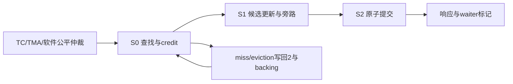

# blackwell_mbarrier_unit

> 规范版本 v1.0

## 1. 模块概述

唯一mbarrier对象状态机：对象cache、计数/phase更新、write-back、有限等待及TMA transaction completion。默认ADDR_W32/cache4/wait32/writeback2/MEM_ID_W1、CLOCK_PERIOD_NS10、WAIT_DEFAULT_CYCLES64；不实现通用cache coherence。

对象在本CTA SMEM中占64bit、8B对齐。同32B行的四个对象独立匹配。v0 expected/pending为20bit；v1为9bit；二者tx为signed21且范围为±(2^20−1)。layout、opaque token及report的项目编码（原文档已清理）保留；不能把它当NV内部对象格式。

### 微架构与资源


| 资源 | 组织与访问 | 容量与生命周期 |
| --- | --- | --- |
| 对象cache | 4个独立8B对象，fully associative；每项ctx/epoch/address、valid/dirty/lock/fault | 计数/phase/report唯一权威。canonical decoded状态80bit/entry，metadata≤80bit/entry。 |
| wait表 | 32条≤256bit记录；phase更新32路并行匹配，结果逐拍输出 | 保持完整对象身份/等待条件/timeout/响应身份；waiter存在不固定pin cache。 |
| 写回队列 | 2条，每条64bit backing快照+ctx/epoch/address/用途/状态≤128bit metadata | 一个backing事务在途＋一个已选victim；没有8条逐操作write-through记录。 |
| 返回位置 | software返回4槽、TMA返回4槽、TC独立1槽；slot保存对应结果 | 每类普通3级流水最多3笔潜在结果＋1held；TC1 credit来自frontend，响应消费后才重开。 |

cache hit relaxed更新无背压 L=3、服务 II=1；同对象S1/S2旁路使用最近已验证候选，失败候选不转发。一次只提交一个更新；phase翻转与counter/report重装原子发生。非INIT miss的L=5+Lread，dirty eviction另加2+Lwrite；Lread/Lwrite为请求接受至返回的外部往返，不含本地发射/fill/replay；backing端口读ID0/写ID1，仍一次一个在途，单次确认后释放victim锁。

TRY_WAIT进入wait表时把身份/期限运输到wait记录并释放临时software结果credit；唤醒后该记录保持结果直到返回，和普通software结果按轮询共享输出。waiter与返回队列各保存一种阶段状态；清phase时并行标记成功，成功优先于同拍timeout，software返回每拍最多1条。TC/TMA不申请software返回槽；命中同对象的producer可旁路已提交状态。资源空闲时三类更新公平轮询，满的输出只限制其自身来源；每类另1条miss重试记录，避免等待的software miss占据producer入口。

写回只在eviction、INVAL和flush执行。dirty eviction冻结victim，保存快照，写确认后才能失效/复用；失败保留faulted对象及sticky namespace fault，释放在途credit，不自动重发、不允许新的成功访问。正常waiter独立于cache驻留，可在对象重新填入或状态提交时观察phase。

cache每项decoded state为expected20+pending20+signed tx21+primary/conditional2+layout1+report/previous_report16=80bit，tag及valid/dirty/lock/fault等metadata预算80bit；只保留这一份状态，64bit backing编码在writeback时生成。waiter预算256bit，包括ctx5/epoch16/issuer10/seq64/tag16、地址32、已验证phase/selector条件、64bit deadline和返回标记；不再保存重复的opaque token。TC、TMA、software结果位置分别为1×143、4×32、4×143bit；S0预留位置，S2填入结果，held结果直接取该位置。

所有资源与时序的默认值见[微架构配置](../common/interfaces.md#微架构配置与性能约束)。周期从接受边沿计至结果首次有效；延迟式另加实际背压和外部响应等待。payload 不复位，valid、credit 和身份有效性复位；clock enable 随实际推进，SRAM 仅启用有效 bank。

## 2. 接口定义

全部握手、身份、完成、错误和复位遵循[公共规则](../common/interfaces.md#握手身份与生命周期)；表内位宽单位为 bit，符号见[公用位宽配置](../common/interfaces.md#公用位宽配置)，参数项注明默认配置。无握手的组合输出随输入变化；有握手的流水输出按所属通道保持。

bar_cmd 为扁平软件字段，tc_cmd 为专用生产者 `bar_cmd_t`，tx_cpl 为 TMA 专用入口。backing 为 32B masked 行，读写 mask 均为 `0xff << (addr[4:3]*8)`，只选择目标 8B 对象。backing 读 ID=0、写 ID=1，每次一个在途请求，响应精确匹配在途请求 ID。idle表示无在途状态访问/backing事务；drained还要求wait表、pipeline、miss重试、writeback及held响应均空。正常有效dirty cache和保留fault不计作在途；flush success单独报告。

INIT选择layout，INVAL在旧生产者排空后失效；ARRIVE/DROP减pending，DROP同时减expected但不得到0；EXPECT_TX/COMPLETE_TX加/减tx；combined先expect再一次arrival/drop。noComplete不得使pending=tx=0，不能仅因pending变0就拒绝。primary在pending与tx同时为0时翻转并重装pending；v1的conditional仅report=0时推进，保存上一primary report。

arrival返回操作前phase/pending的opaque token；PENDING_COUNT只接受v0 noComplete token且不访问memory；CHECK_LAYOUT返回独立predicate。TEST_WAIT未满足立即返回OK/false；TRY_WAIT按`ceil(time_hint/clock_ns)`有限等待，hint0用默认64cycle，成功优先于同拍timeout。report仅在对应成功wait有效，conditional与primary分开判断。

TC响应携带接受时的内部tag与issuer；该身份随对象访问流水、miss/INVAL记录及预留返回槽保存；eviction/flush保存独立对象快照，软件命令的unit issuer为0。响应反压期间身份与其他字段一起保持。状态变更响应在cache原子提交后发布；phase更新只在合法候选提交时可见。等待者不pin cache；被eviction/INVAL/flush锁定或尚有pipeline更新的项不可复用。TC arrival和TMA tx保留独立控制credit，wait CAM满不阻止满足等待的生产者。对同对象更新串行化，其他对象公平仲裁。memory错误poison相关更新，不回滚已确认写；错误/timeout/未满足/成功分别表示。对象重新INVAL/INIT不能清除上层issuer sticky fault。

软件wait CAM的credit只限制需要入队的等待命令；TC ARRIVE／FAULT及TMA transaction更新不申请wait项，不因wait表满失去接受资格。未满足的wait保存在CAM，不持续占有对象访问执行权；TC、TMA及软件状态访问按可用执行／write资源公平仲裁。共享bar响应由frontend预留的command记录或独立TC槽接收，不依赖软件外部响应ready。

### Namespace 与 flush

ctx/epoch在请求接受时绑定，top只在旧namespace flush/invalidate及响应隔离后切换。flush是stop/回收控制路径，前提为此前TC、TMA、ordinary async、deferred arrival和ordering均已退休。unit逐个写回dirty对象，flush结果保持到握手；frontend/subsystem只运输该通道。INVAL软件命令针对单对象，flush针对全部驻留对象。flush失败不撤销过去cache提交；保留sticky fault，后续相关操作失败，正常context回收被拒绝。故障本身不计作在途，失败flush退休后drained仍可成立。

### 输入信号

| 接口名 | 位宽 | 说明 |
| --- | --- | --- |
| `clk` | 1 | 公共上升沿时钟。 |
| `rst_n` | 1 | 低有效异步复位，释放同步；控制状态与外部旧响应隔离见共享规则。 |
| `bar_cmd_vld_i` | 1 | `bar_cmd` 通道有效；握手通道遵循共享 vld/rdy 规则。 |
| `bar_cmd_layout_i` | 1 | 对象 layout：0=v0，1=v1。 |
| `bar_cmd_no_complete_i` | 1 | noComplete 修饰；不得使 pending 与 tx 同时为 0。 |
| `bar_cmd_conditional_i` | 1 | v1 conditional 修饰，仅 report=0 时推进相应状态。 |
| `bar_cmd_report_i` | `BARRIER_REPORT_W` | 8 bit report payload，独立于 status 诊断。 |
| `bar_cmd_tag_i` | `ASYNC_TAG_W` | 请求 tag；响应原样恢复，不能单独作为跨 epoch 唯一身份。 |
| `bar_cmd_addr_i` | `ADDR_W`（默认 `SMEM_BYTE_ADDR_W`） | barrier 对象 byte 地址，8B 对齐；SMEM 范围检查后访问。 |
| `bar_cmd_opcode_i` | 5 | barrier 操作码，按 package 的 MBAR_OP_* 编码。 |
| `bar_cmd_arrive_count_i` | `BARRIER_COUNT_W` | arrival/expected 计数，含 INIT、ARRIVE、DROP 的规定增减量。 |
| `bar_cmd_tx_bytes_i` | `BARRIER_TX_BYTES_W` | unsigned32 transaction 增减量，单位 byte；从逻辑总量检查可表示性后生成，不含容器 padding，也不是 mask popcount。 |
| `bar_cmd_phase_token_i` | 1 | parity wait 的输入 phase；wait_parity=1 时使用。 |
| `bar_cmd_wait_parity_i` | 1 | 1 选择 phase_token 指定的 parity wait；0 使用 state 中的 opaque token。 |
| `bar_cmd_state_i` | `BARRIER_STATE_W` | 64 bit opaque barrier token；编码见本节项目定义，不能当作 NV 内部格式。 |
| `bar_cmd_time_hint_i` | `BARRIER_TIME_HINT_W` | 有限等待提示，单位 ns；0 使用 WAIT_DEFAULT_CYCLES。 |
| `bar_rsp_rdy_i` | 1 | `bar_rsp` 通道接受能力；仅与对应 vld 同拍为 1 时接受。 |
| `tc_cmd_vld_i` | 1 | `tc_cmd` 通道有效；握手通道遵循共享 vld/rdy 规则。 |
| `tc_cmd_i` | `BAR_CMD_W` | barrier 命令；TC 路径仅 count=1 ARRIVE 或 FAULT；packed `bar_cmd_t`，见[共享字段](../common/interfaces.md#barrier-命令与响应)。 |
| `tx_cpl_vld_i` | 1 | `tx_cpl` 通道有效；握手通道遵循共享 vld/rdy 规则。 |
| `tx_cpl_tag_i` | `ASYNC_TAG_W` | 请求 tag；响应原样恢复，不能单独作为跨 epoch 唯一身份。 |
| `tx_cpl_addr_i` | `ADDR_W`（默认 `SMEM_BYTE_ADDR_W`） | barrier 对象 byte 地址，8B 对齐；SMEM 范围检查后访问。 |
| `tx_cpl_bytes_i` | `BARRIER_TX_BYTES_W` | unsigned32 transaction 增减量，单位 byte；从逻辑总量检查可表示性后生成，不含容器 padding，也不是 mask popcount。 |
| `tx_rsp_rdy_i` | 1 | `tx_rsp` 通道接受能力；仅与对应 vld 同拍为 1 时接受。 |
| `mem_req_rdy_i` | 1 | `mem_req` 通道接受能力；仅与对应 vld 同拍为 1 时接受。 |
| `mem_rsp_vld_i` | 1 | `mem_rsp` 通道有效；握手通道遵循共享 vld/rdy 规则。 |
| `mem_rsp_data_i` | `SMEM_DATA_W` | memory 读返回行数据；data[8*j+:8] 对应请求 addr+j，未选读 byte 返回 0。 |
| `mem_rsp_status_i` | `MEM_STATUS_W` | memory 状态，0 成功、非 0 失败。 |
| `mem_rsp_id_i` | `MEM_ID_W`（默认 `BARRIER_MEM_ID_DEFAULT_W`） | 所属 memory 通道事务 ID；live ID 未退休前不复用，响应按 ID 匹配。 |
| `ctx_i` | `CTX_ID_W` | 当前CTA SMEM namespace，切换前旧namespace须安全退休。 |
| `epoch_i` | `EPOCH_W` | namespace生命周期；同一请求/返回保存接受时身份。 |
| `flush_req_vld_i` | 1 | 生命周期flush请求；此前producer必须已退休。 |
| `flush_req_ctx_i` | `CTX_ID_W` | 要flush的namespace，须匹配当前绑定。 |
| `flush_req_epoch_i` | `EPOCH_W` | flush目标生命周期。 |
| `flush_req_invalidate_i` | 1 | 1在写回成功后失效cache；0保留干净驻留对象。 |
| `flush_rsp_rdy_i` | 1 | 接收flush最终状态；响应未消费前不重复接受。 |

### 输出信号

| 接口名 | 位宽 | 说明 |
| --- | --- | --- |
| `bar_cmd_rdy_o` | 1 | `bar_cmd` 通道接受能力；仅与对应 vld 同拍为 1 时接受。 |
| `bar_rsp_vld_o` | 1 | `bar_rsp` 通道有效；握手通道遵循共享 vld/rdy 规则。 |
| `bar_rsp_pending_count_o` | `BARRIER_COUNT_W` | 计数查询返回值。 |
| `bar_rsp_predicate_o` | 1 | 布局/查询谓词，具体含义按 opcode。 |
| `bar_rsp_report_o` | `BARRIER_REPORT_W` | 8 bit report payload，独立于 status 诊断。 |
| `bar_rsp_report_predicate_o` | 1 | 成功 wait 的 report 有效谓词。 |
| `bar_rsp_state_o` | `BARRIER_STATE_W` | 64 bit opaque barrier token；编码见本节项目定义，不能当作 NV 内部格式。 |
| `bar_rsp_wait_complete_o` | 1 | wait 条件已成功满足；TEST_WAIT 未满足时可返回 OK 且本位为 0。 |
| `bar_rsp_tag_o` | `ASYNC_TAG_W` | 请求 tag；响应原样恢复，不能单独作为跨 epoch 唯一身份。 |
| `bar_rsp_issuer_o` | `ISSUER_ID_W` | TC响应返回接受时的issuer；软件命令返回0。与bar_rsp的valid/ready共用握手，背压时保持。 |
| `bar_rsp_status_o` | `STATUS_W` | 模块诊断状态，0 成功、非 0 失败；错误完成不得伪装成功。 |
| `bar_rsp_phase_o` | 1 | barrier phase；transaction 响应或诊断值，不代替 wait token。 |
| `bar_rsp_locked_o` | 1 | barrier 对象锁定状态。 |
| `tc_cmd_rdy_o` | 1 | `tc_cmd` 通道接受能力；仅与对应 vld 同拍为 1 时接受。 |
| `tx_cpl_rdy_o` | 1 | `tx_cpl` 通道接受能力；仅与对应 vld 同拍为 1 时接受。 |
| `tx_rsp_vld_o` | 1 | `tx_rsp` 通道有效；握手通道遵循共享 vld/rdy 规则。 |
| `tx_rsp_tag_o` | `ASYNC_TAG_W` | 请求 tag；响应原样恢复，不能单独作为跨 epoch 唯一身份。 |
| `tx_rsp_status_o` | `STATUS_W` | 模块诊断状态，0 成功、非 0 失败；错误完成不得伪装成功。 |
| `tx_rsp_phase_o` | 1 | barrier phase；transaction 响应或诊断值，不代替 wait token。 |
| `mem_req_vld_o` | 1 | `mem_req` 通道有效；握手通道遵循共享 vld/rdy 规则。 |
| `mem_req_addr_o` | `ADDR_W`（默认 `SMEM_BYTE_ADDR_W`） | SMEM/backing byte 地址，32B 行对齐；禁止截断 overflow。 |
| `mem_req_data_o` | `SMEM_DATA_W` | memory 行数据；data[8*j+:8] 对应 addr+j，写 mask 为 0 的 byte 保持。 |
| `mem_req_byte_mask_o` | `SMEM_MASK_W` | memory byte mask；bit j 选择 addr+j 的实际访问，未选读 byte 返回 0。 |
| `mem_req_id_o` | `MEM_ID_W`（默认 `BARRIER_MEM_ID_DEFAULT_W`） | 所属 memory 通道事务 ID；live ID 未退休前不复用，响应按 ID 匹配。 |
| `mem_req_write_o` | 1 | 1 为 backing 写请求，0 为 backing 读请求；仅访问 mask 选择的对象 byte。 |
| `mem_rsp_rdy_o` | 1 | `mem_rsp` 通道接受能力；仅与对应 vld 同拍为 1 时接受。 |
| `idle_o` | 1 | 无本模块执行或在途访问；具体统计范围见本节规则。 |
| `drained_o` | 1 | 本模块已接受工作及请求、响应保持槽全部排空；具体范围见本节规则。 |
| `flush_req_rdy_o` | 1 | 停止新对象操作且旧访问退休后接受一次flush。 |
| `flush_rsp_vld_o` | 1 | 所有相关writeback退休后的最终返回。 |
| `flush_rsp_status_o` | `STATUS_W` | 0为成功；backing/身份失败为非0，drained不能替代此结果。 |

## 3. 伪代码

### 对象更新

```text
eligible(TC/tx) depends on execution/write resources, not software wait CAM credit
on accepted object operation: validate full shared address/layout/unsigned32 operands; lookup or fetch 8B object
S0: lookup/fill object; reserve source-specific result position
S1: compute updates using committed cache and newest validated same-object forwarding
INIT: valid=1; expected=pending=count; tx=0; phases=0; reports=0
EXPECT_TX: tx+=bytes; COMPLETE_TX/TMA: tx-=bytes
ARRIVE: token=encode_old_state(); pending-=count
DROP: expected-=count; pending-=count; require expected>=1
combined: require count==1; tx+=bytes; then one ARRIVE or DROP
if pending==0 && tx==0:
    if noComplete: reject candidate; leave object unchanged; return error
    else: primary^=1; pending=expected
          conditional advances iff v0 or current_report==0
          remember previous report; current_report=0
compute tx candidate with signed intermediate of at least 34 bits before range check
check all candidate counter over/underflows before narrowing to signed21 or issuing any write
S2: if all checks passed: commit candidate atomically to cache; set dirty; generate response and waiter matches
    otherwise: leave object unchanged and return error
INVAL: require no old producer/access/waiter or held result for this object; serialize and write invalid object bytes to backing
       after ack invalidate cache/release sidecar; after failure return error and poison namespace
```

### 事务身份运输

```text
on TC command acceptance: capture internal tag and actual input issuer in the operation record
on software command acceptance: capture software tag and unit issuer=0
through S0/S1/S2 and the reserved result position: preserve the captured operation identity
miss/INVAL records retain that identity until completion; eviction/flush snapshots retain object namespace
ordinary cache commits have no per-operation backing transaction
on operation completion or error: publish the corresponding captured identity in bar response
while bar response is held: preserve identity and payload until response handshake
```

### 等待与report

```text
TEST_WAIT: inspect committed cache phase; respond immediately with independent completion predicate
TRY_WAIT not yet complete: reserve waiter; start finite hint timer after CAM admission
on committed phase/report update or timer expiry:
    success wins over timeout; return matching primary/conditional report only on success
REPORT: OR producer payload into current report; keep backend-error status separate
PENDING_COUNT: validate opaque token; return old pending without cache access
CHECK_LAYOUT: return layout comparison predicate without changing object
```

### 流水、资源与排空

```text
on producer/source arbitration: skip only sources lacking their own credit; rotate on actual acceptance
same-object forwarding: use latest legal preceding update; reject erroneous candidates without forwarding
on cache miss:
    retain requesting source in its dedicated retry record; allow other cache-hit sources to run
    choose unlocked victim by round-robin; if dirty reserve WB slot and freeze victim snapshot
    wait write ack before eviction; INIT supplies new state without reading uninitialized backing
    other object accesses fetch the selected 8B valid object; replay original operation once
on waiter admission: capture namespace/address/phase/report/timer; release object execution credit
on cache fill or state commit: compare waiters; latch successful results before considering timeout
emit software results fairly at <=1/cycle; producer results use their reserved independent slots
on flush_fire:
    block new object operations; require prior producers retired
    write each dirty object through the one live backing request; invalidate only after success if requested
    if write fails: retire request, keep sticky fault; do not loop/retry indefinitely
    hold flush_rsp(aggregate_status) until accepted
faulted dirty cache is not active work; no successful further operation or normal reuse
sticky namespace fault clears only by quiescent reset with old responses isolated and objects reinitialized
```
