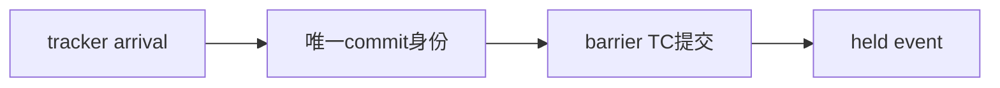

# blackwell_tc_async_completion

> 规范版本 v1.0

## 1. 模块概述

TC异步完成域，包含completion tracker和commit事务控制。tracker容量OPERATIONS=1、COMMITS=8；控制部分默认一个在途commit和一个event保持槽。完整commit身份只保存一次，event复用该身份。父模块为blackwell_async_subsystem_top；mbarrier对象状态由mbarrier unit持有。

子模块规范：[blackwell_tc_completion_tracker](blackwell_tc_completion_tracker.md)。

### 微架构与资源



tracker op1/commit8由子模块实例化一次；本层完整commit身份1份、arrival响应状态1份、event1槽。tracker arrival接受后下一拍最早发送bar，bar完成后下一拍最早发送event，Lbridge=2+Lbar（不含tracker等待）；event消费前不接受下一笔内部arrival。

成功event表示barrier缓存状态已原子提交，并非backing已写回。failed snapshot发项目FAULT，其状态/身份检查和返回错误仍与成功路径分开；held event不阻塞已登记执行操作的内部complete退休。

所有资源与时序的默认值见[微架构配置](../common/interfaces.md#微架构配置与性能约束)。周期从接受边沿计至结果首次有效；延迟式另加实际背压和外部响应等待。payload 不复位，valid、credit 和身份有效性复位；clock enable 随实际推进，SRAM 仅启用有效 bank。

## 2. 接口定义

全部握手、身份、完成、错误和复位遵循[公共规则](../common/interfaces.md#握手身份与生命周期)；表内位宽单位为 bit，符号见[公用位宽配置](../common/interfaces.md#公用位宽配置)，参数项注明默认配置。无握手的组合输出随输入变化；有握手的流水输出按所属通道保持。

register/complete/commit/event 的 packed 字段见[共享身份定义](../common/interfaces.md#身份与事件字段)。顶层只在MMA/CP/SHIFT实际接受时登记一次；complete直接来自执行模块的唯一完成槽，不在本层复制。stop阻止新的外部register/commit，已接受快照的arrival、bar响应和event继续推进；complete_rdy不取决于普通DONE ready。

### TC commit 事务

tracker的arrival握手把已满足前驱的commit及status交给本模块控制记录。控制状态为IDLE、SEND、WAIT_ACK、EVENT；EVENT消费前不接受下一笔内部arrival。record保存ctx、id、barrier、执行status，event的key引用同一记录，phase/status在bar响应接受后保存。

成功请求为ARRIVE，失败请求为项目FAULT；arrive_count=1、tx_bytes=0、内部relaxed，tag/issuer/seq取commit.id。barrier为本CTA SMEM byte地址、8B对齐；其余未用字段清零。字段构造为模块内组合逻辑。SEND期间bar valid/payload保持到握手，不因stop撤回。

WAIT_ACK时只接受本笔bar响应，检查tag/issuer。event.status优先保留执行错误，否则身份不符返回ASYNC_BAD_COMPLETION，否则使用bar响应status；value为1bit诊断phase，domain=TC。响应表示barrier缓存状态已原子提交，phase满足由独立mbarrier wait判断。event保持到event_fire；普通MMA/CP/SHIFT DONE由[唯一归属规则](../common/interfaces.md#状态登记与缓冲归属)指定模块保存。

idle直接取tracker.idle，表示无live数据操作；drained要求tracker.drained且控制状态为IDLE。父层不维护tracker表的镜像计数。

### 输入信号

| 接口名 | 位宽 | 说明 |
| --- | --- | --- |
| `clk` | 1 | 公共上升沿时钟。 |
| `rst_n` | 1 | 低有效异步复位，释放同步；控制状态与外部旧响应隔离见共享规则。 |
| `register_vld_i` | 1 | `register` 通道有效；握手通道遵循共享 vld/rdy 规则。 |
| `register_i` | `ASYNC_KEY_A1_W` | TC 操作登记，必须与外部命令接受同拍；packed `async_key_a1_t`，见[共享字段](../common/interfaces.md#身份与事件字段)。 |
| `complete_vld_i` | 1 | `complete` 通道有效；握手通道遵循共享 vld/rdy 规则。 |
| `complete_i` | `ASYNC_EVENT_A1_W` | TC 内部完成；packed `async_event_a1_t`，见[共享字段](../common/interfaces.md#身份与事件字段)。 |
| `commit_vld_i` | 1 | `commit` 通道有效；握手通道遵循共享 vld/rdy 规则。 |
| `commit_i` | `TC_COMMIT_A1_W` | TC commit；packed `tc_commit_a1_t`，见[共享字段](../common/interfaces.md#身份与事件字段)。 |
| `bar_rdy_i` | 1 | `bar` 通道接受能力；仅与对应 vld 同拍为 1 时接受。 |
| `bar_rsp_vld_i` | 1 | `bar_rsp` 通道有效；握手通道遵循共享 vld/rdy 规则。 |
| `bar_rsp_i` | `BAR_RSP_W` | barrier 响应，成功 wait 还需 wait_complete=1；packed `bar_rsp_t`，见[共享字段](../common/interfaces.md#barrier-命令与响应)。 |
| `event_rdy_i` | 1 | `event` 通道接受能力；仅与对应 vld 同拍为 1 时接受。 |
| `stop_i` | 1 | 置 1 停止新的外部命令或登记；已接受工作、生产者完成和响应继续推进。 |

### 输出信号

| 接口名 | 位宽 | 说明 |
| --- | --- | --- |
| `register_rdy_o` | 1 | `register` 通道接受能力；仅与对应 vld 同拍为 1 时接受。 |
| `complete_rdy_o` | 1 | `complete` 通道接受能力；仅与对应 vld 同拍为 1 时接受。 |
| `commit_rdy_o` | 1 | `commit` 通道接受能力；仅与对应 vld 同拍为 1 时接受。 |
| `bar_vld_o` | 1 | `bar` 通道有效；握手通道遵循共享 vld/rdy 规则。 |
| `bar_o` | `BAR_CMD_W` | barrier 命令；TC 路径仅 count=1 ARRIVE 或 FAULT；packed `bar_cmd_t`，见[共享字段](../common/interfaces.md#barrier-命令与响应)。 |
| `bar_rsp_rdy_o` | 1 | `bar_rsp` 通道接受能力；仅与对应 vld 同拍为 1 时接受。 |
| `event_vld_o` | 1 | `event` 通道有效；握手通道遵循共享 vld/rdy 规则。 |
| `event_o` | `ASYNC_EVENT_A1_W` | barrier 缓存状态提交后的 TC 通知；packed `async_event_a1_t`，见[共享字段](../common/interfaces.md#身份与事件字段)。 |
| `protocol_error_o` | 1 | 协议错误指示：未知/重复完成、身份或域不匹配；不得退休其他操作。 |
| `idle_o` | 1 | tracker无live数据操作；commit事务和event是否排空由drained表示。 |
| `drained_o` | 1 | 本模块已接受工作及请求、响应保持槽全部排空；具体范围见本节规则。 |

## 3. 伪代码

```text
register → tracker.register; complete → tracker.complete; commit → tracker.commit
arrival_rdy = state==IDLE                       // stop不阻止此前快照退休
on tracker.arrival_fire:
    capture one record(ctx,id,barrier,status); reserve event; state=SEND
while state==SEND:
    bar=build(ARRIVE if status==OK else PROJECT_FAULT, count=1, tx_bytes=0)
    hold bar valid/payload until bar_fire; then state=WAIT_ACK
on bar_response_fire in WAIT_ACK:
    status = execution_error else ASYNC_BAD_COMPLETION if tag/issuer mismatch else bar.status
    phase=bar.phase; state=EVENT                  // cache原子提交后发布
while state==EVENT:
    event.key=record.key; event.domain=TC; event.status=status; event.value=phase
    hold event until event_fire; then release record/slot; state=IDLE
on stop: keep complete, arrival, bar request/response and event progressing
idle=tracker.idle; drained=tracker.drained && state==IDLE
```
