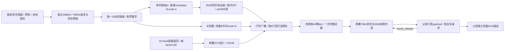

# blackwell_tc_core

> 规范版本 v1.0

## 1. 模块概述

[blackwell_tc_mma_engine](blackwell_tc_mma_engine.md)重复四次的访问／执行解耦core，`TC_INDEX=0..3`指定固定32逻辑行分区；仅`TC_INDEX<M/32`的实例被启动。共享命令由父层保持；core只持有本地访问游标、有限请求身份、操作数和结果。固定64个dot、固定8×8输出；dense和sparse每个输出均执行一次完整dot，旧D接dot的C端口。合法功能、collector与修饰见[共享规范](../common/interfaces.md#mma-合法组合)，数值按dot最终合同（原文档已清理）。

### 微架构与资源



| 阵列 | 每core实例数 / 每输出乘法项数 | 原生弹性流水 |
| --- | --- | --- |
| FP16/BF16/TF32 | 64；FP16/BF16为16，TF32为8 | Ldot=5，原生II=1 |
| F8/F6/F4（含MX） | 64；32 | Ldot=6，原生II=1 |
| FP4（MX/NV） | 64；64 | Ldot=5，原生II=1 |
| INT8 | 64；32 | Ldot=4，原生II=1 |

逻辑K在sparse下加倍，实际乘法项数不变。INT8在dot内以加宽的乘积和与旧D相加，最终一次饱和／回绕；浮点的scale_input_d也在一次dot内完成。无TC层部分和或累加器。同一指令只启用所属阵列，其余阵列关闭有效更新；四类物理阵列及原生流水分别计入面积与寄存器预算。

每个活动TC i固定拥有逻辑行`32*i+[0,32)`；M128/M64/M32分别启用TC0–3／TC0–1／TC0。先装入完整32行A及对应metadata、scale A并保留；以`n_base=0..N step8`为外层，每个N块依次执行`row_block=0..3`。同一8列B及32×8旧C供四个行块使用；最后一个行块实际dot_fire后释放B/C，推进N。dot j对应`(32*i+8*row_block+j[5:3], n_base+j[2:0])`。8条A广播到各行、8条完整B广播到各列；sparse选择发生在各dot入口，不能先按列统一压缩B。每tile固定64个输出，每活动TC共`4*(N/8)`次发射。先生成全局逻辑坐标再应用物理布局，TC编号不能替代D/E/F/G的lane分区编号。

未启动实例保持idle，所有请求／result／done valid为0，不预留credit、不填充payload、不更新算术有效流水；不因共享cmd、abort或release电平而生成事务。已有物理存储不缩减，也不借给活动实例。

| 数据存储 | 每core容量 | 组织、生产者／消费者与释放 |
| --- | --- | --- |
| 原始A | `8*4*256/8=1024B` | 8 bank×4行×256bit，bank=local_row%8，addr=local_row//8；1R1W、同步读1拍、32bit byte mask。回填写入全部32行源位模式，跨全部N复用。最后N消费且必要ashift读取完、无未退休写入该存储的请求后按组释放；物理容量与当拍预留占用分别计量。 |
| metadata | `32*64/8=256B` | 32行紧凑寄存器，每行最多16个PTX nibble；按字段写使能，一拍每行至多一个合并写；8行组合读被同一A同步输出级采样。不保存one-hot或完整物理容器。最后N消费者接受后释放。 |
| scale A | `32*32/8=128B` | 32行×4个有效byte寄存器；按data ID提取，行内字段写使能；8行读与A同步。保留原逻辑K的scale次序，最后N消费后释放。 |
| A同步读出级 | `8*(256+64+32)/8=352B` | 一个8行组，直接是上述存储读出级；供当前dot且反压保持，实际dot_fire后释放，可读下一行块。同一原A组在每个N块再次读取。ashift按16B视图使用同一级，最后snapshot_rsp_fire后释放，无额外返回payload槽。 |
| B双操作数槽与scale | `2*8*(512+32)/8=1088B` | 每槽8个列寄存器bank，每列512bit完整B与32bit有效scale；响应直接按字段mask装填，组合读广播，不另设raw或展开副本。两槽分别保存当前与下一N块，只交换槽角色，不搬运payload。槽仅绑定N，完整填充／scale返回退休后供四个行块复用；row_block=3实际dot_fire后释放。不另存行块身份、消费者计数或消费mask，不保存整N。 |
| 旧C预取槽 | `32*8*32/8=1024B` | 32个256bit行寄存器bank，每行有两个128bit半字写使能，32行可同时各写一个半字；8行组合读取供64个dot。两笔512B返回直写对应半字，不经过普通回填级，不另设拼接payload。完整块就绪后接C，四个行块依次消费，row_block=3实际dot_fire后释放。FP16有效数据512B、FP32/INT32为1024B；FP16精确提升在读取视图完成。input_d=0直接提供零，不读TMEM、不清payload；槽独立于结果。 |
| 结果／FP16状态共用槽 | `2*64*76/8=1216B` | 两个寄存器槽，每cell76bit；dot返回写原始最终状态或低32bit结果。provider读取原状态，返回后在同槽覆盖为结果；无第二份最终结果。result_release_fire后释放，写ACK不访问槽。 |
| 普通回填级 | `32B` | 一个SMEM32B／窄TMEM16B共用输入保持级，剩余字段位图属于控制。两来源公平仲裁；逐bank散写，写完／错误处理后才让下一个响应进入。不等待dot消费；宽C通道独立直写C槽。 |
| **数据合计** | **5120B** | 控制、请求/结果mask和原生dot流水另计；不包括父层共享scale B与唯一TMEM。 |

A backing仅保存一份参与计算与ashift的原始位模式，地址洞不入存储。FP16/BF16每行16×16bit，TF32为8×32bit，K32低精度为32个至多8bit容器，FP4为64×4bit；sparse的压缩A仍相同长度。SMEM低比特K-major保留所需packed位模式；MN-major以每个有效元素的原bit域收集到一个byte容器，不做数值展开或negate。一个字段落在同一16B atom内，所需源byte均在同一32B返回，统一回填级可一次拼齐并执行完整byte写，无跨响应residue或SRAM bit-RMW。容器坐标记录原字段位置，读取视图再重排／适配；SMEM A不参与ashift，不保存无效padding副本。TMEM A遵守kind专用packing；K32类TMEM E2M1的数值位为容器[5:2]，E3M2/E2M3为[5:0]，其余容器位仍保存在原始A中，native FP4则是每byte两个紧凑nibble；任一逻辑行最多256bit。transpose只改变来源映射，禁止以negate、展开值覆盖原始数据。E只保存有效索引；scale只保存有效字段；两者不参与ashift原字节写回。映射与上界见[父层布局表](blackwell_tc_mma_engine.md#源快照与布局容量)。

### 稀疏选择与scale

TF32每个逻辑两元素组的nibble只接受0x4、0xE，分别选择第0、1个32bit元素。普通2:4的nibble按`(idx0=code[1:0],idx1=code[3:2])`对应压缩A的先后两个元素，合法集合为`{0x4,0x8,0xC,0x9,0xD,0x6,0xE}`；包含0x6，禁止排序或当one-hot。FP4 v0的相同索引选择逻辑八元素组中的两个二元素对；对内保留低／高元素顺序，v1不接受。非法编码报告BAD_CMD并走错误排空，不以掩码修成合法值。

E selector先按PTX布局提取nibble，低逻辑K组在低有效位。完整B列最多512bit，每行A的metadata独立选择其对应项，仅选中的B进入乘法；未选NaN/Inf不进入数值单元。scale索引从所选元素的原逻辑K及data ID产生：`scale_index=floor(logical_k*scale_vec/logical_K)`；A压缩序号需经metadata恢复原逻辑位置再求索引，不能用压缩长度重设block边界。四个scale上界来自1X/2X/4X固定合法组合。

### 端口、credit与周期条件

访问游标为四个8行A组及两个B槽维护发射结束及未退休数量。请求fire前预留目标字段、活跃ID和所属组；发射结束且相关返回全部散写退休才置ready，不保存整份数据的逐bit有效镜像。四组A均驻留且metadata已检查后，本TC可开始计算；不要求其他TC或全M×N的B/结果就绪。A组与当前B之间有界轮询，空B槽可预取下一N块。受覆盖源的全局snapshot fence另行满足。

B槽、SMEM目标和scale返回的内部身份包含N块及槽位置；scale请求未消费期间不复用目标槽。B只在row_block=3的实际接受后释放，该有序边界证明四次消费完成，不复制行块进度。C槽保存N、两bit已发与两bit已返掩码；全部返回成功后ready，待返数量由掩码派生，不另设计数器或行块进度。下一N块C只在旧槽四次消费结束后预留；迟到、未知或重复返回必须报错，不能写入新槽。行块及N切换不等待独立结果ACK。

统一回填每拍每个目标bank最多一个地址写入。任一32B响应最多256个有效bit，保守逐byte/字段散写上限32拍；FP6跨byte字段在同一响应中组合，跨响应字段按bit写使能进入B/metadata寄存器，不增设residue；A SRAM只按完整byte写，若源packing会分开同一目标byte，按原始byte保存后读视图解包。每个响应的目标容量已预留，散写不申请dot／结果credit；即使两B槽满，已接受返回也能落入其预留位置。两来源轮询，下一响应只在本级可接受时fire；本地存储读写同word冲突先完成回填再读取，其他bank可并行。

A源仅装填一次；每个N块读取四个8行组，每次8 bank各1R、同步读1拍，再用1拍格式准备。sparse metadata在各组填满后经共享一拍检查级验证一次，共四组，不随N重复；读取metadata及scale仍随A视图计费。每个8×8额外用1拍完成按行稀疏选择与原逻辑K scale关联，准备阶段只更新控制，B选择值由稳定A/B广播产生，不保存64份B。B组合读供8列广播，下一槽装填可与当前四行块消费重叠；scale B每新N槽读取8列字段。C每请求接受必须已有完整目标槽，以两笔32-bank访问装填，独立于普通回填、dot和结果credit。算术发射原子预留一个空结果槽；最多两个算术／provider未退休票据，一份2项有序slot票据FIFO关联原生返回，provider另有一个slot票据，均不复制完整tile身份或payload。

无背压时原生dot可II=1；实际速率受A重复本地读取／准备、B服务、稀疏选择、C预取、两结果槽与写服务限制。令T=`4*N/8`，A源读取32行一次，本地读取`32*(N/8)`行、准备`2*T`拍；无掩码C物理读取`input_d*(N/8)*1024B`，FP16有效数据为其一半。B有效容器量为`N*logical_K*container_bits/8`，实际事务另计packing／对齐；scale B本地读取N个列容器/活动core。结果槽从dot_fire占用至result_release；资源下界为`2/(Ldot+Lprovider+L写请求接受)`，完成另等ACK。C无冲突服务上限512B/cycle/core、完整块两beat，仍共享唯一bank读口、read credit与稳定返回级。SMEM窗口16×32B，速率≤`min(32,512/RTT) B/cycle/core`；默认四路共享总32B/cycle。模型按事件依赖计算Lcore，不输入固定II。

## 2. 接口定义

位宽单位bit；公共定义见[共享接口](../common/interfaces.md)。TC_INDEX为物理实例索引，每实例固定32逻辑行、四个8行块，TC_DOT_LANES固定64。父层仅对active实例启动；未启动实例的preflight/snapshot/done有效状态保持0且不参与汇总。所有握手在vld/rdy接受，反压保持；复位只清控制。共享cmd从launch前保持至父层release；core局部done只交父层，不登记tracker。

src kind0为精确权限probe、kind1为单lane16B read。probe全部排空后进入read；父层按本core请求顺序返回，不依据全局grant路由。SMEM按本路ID可乱序；每个返回匹配当前命令生命周期及已预留位置。Flash服务每请求恰好返回一次，并在ID／epoch复用前隔离旧返回；线上的ID没有额外generation，已经复用的相同ID不能仅凭响应值识别延迟重复。scale请求每core最多一笔，返回直写已预留B槽字段。snapshot index是本core原始A的16B紧凑索引0..63；读同一A输出级，不能增设返回缓冲。

`c_req`是旧C的独立512B beat请求；N为8的倍数，word0/1分别对应当前N块的前／后四列。父层应用D/E/F/G生成32个物理bank地址，只有合并后的bank请求被接受才使本请求fire；每core每拍至多一个beat。`c_rsp`按原N/word返回，data中`[row*TMEM_WORD_W+:TMEM_WORD_W]`对应本TC逻辑行row的四个cell，row0在低位。仅匹配本命令已发且未返的word可接受；成功时32行各写一个128bit半字，失败只退休并报告fault。两word全部成功前不发射任何本N块dot；该通道不等待普通回填或结果空位。父层与bank保持payload至相应握手，不再复制512B返回级。

result_fire只转移(slot,n_base,row_block)引用，data/mask保持至匹配result_release_fire；slot当拍释放后可重新分配给另一tile，身份必须完整比较。正常释放表示最后D写请求已被bank接受，尚未证明写成功。父层保存旧route至ACK，错误只由父层广播abort；禁止以slot号匹配旧ACK。abort时仍保留已held请求引用，取消其他未发片段后以同一释放握手归还槽。core done覆盖本地访问、dot/provider、结果及释放通道；父层可在core done后继续等写ACK与ashift。idle还要求残留A保护与snapshot输出释放。

### 输入信号

| 接口名 | 位宽 | 说明 |
| --- | --- | --- |
| `clk` | 1 | 公共上升沿时钟。 |
| `rst_n` | 1 | 低有效异步复位，同步释放。 |
| `cmd_i` | `MMA_CMD_A1_W` | 父层唯一命令的稳定只读视图，不在core完整寄存。 |
| `launch_vld_i` | 1 | 本指令本core启动有效；仅TC_INDEX<M/32可启动，一次握手。 |
| `execute_i` | 1 | 仅已启动活动实例在全量预检及必需快照成功后开放计算/D写。 |
| `abort_i` | 1 | 父层sticky失败，停止新工作并排空已接受工作。 |
| `release_i` | 1 | 父层complete已接受且ashift结束，释放命令生命周期与残留snapshot；不得与launch同拍。 |
| `done_rdy_i` | 1 | 父层接受局部退休。 |
| `smem_req_rdy_i` | 1 | 本路SMEM接受能力。 |
| `smem_rsp_vld_i` | 1 | 本路返回有效，允许乱序。 |
| `smem_rsp_id_i` | `TENSOR_SMEM_ID_W` | 本路live ID0..15；端口编号由实例连接确定。 |
| `smem_rsp_data_i` | `SMEM_DATA_W` | 32B返回，未选byte为0。 |
| `smem_rsp_status_i` | `MEM_STATUS_W` | 0成功，非0失败。 |
| `c_req_rdy_i` | 1 | 父层已为本C beat取得共享bank读口及route；仅实际bank接受时握手。 |
| `c_rsp_vld_i` | 1 | 已接受C beat的直接返回有效，反压保持。 |
| `c_rsp_n_base_i` | 9 | 原请求N块，必须匹配当前独立C槽。 |
| `c_rsp_word_i` | 1 | 原请求前／后四列选择0/1，必须已发且未返。 |
| `c_rsp_data_i` | `32 * TMEM_WORD_W` | 32逻辑行×128bit，512B；每行四个32bit cell，行0位于低位。 |
| `c_rsp_status_i` | `STATUS_W` | 0成功，非0错误；失败不写C数据。 |
| `src_req_rdy_i` | 1 | 父层源/probe route可用。 |
| `src_rsp_vld_i` | 1 | 本core源/probe返回有效，按接受顺序。 |
| `src_rsp_data_i` | `TMEM_WORD_W` | 一个lane的16B word；probe时忽略。 |
| `src_rsp_status_i` | `STATUS_W` | bank或身份诊断。 |
| `scale_req_rdy_i` | 1 | 共享scale B read接受能力。 |
| `scale_rsp_vld_i` | 1 | 对应列、本core物理partition的scale容器有效。 |
| `scale_rsp_data_i` | `TMEM_CELL_W` | 本core的32bit scale容器，实际data ID/byte由命令规定。 |
| `snapshot_req_vld_i` | 1 | 父层ashift读取本core A快照。 |
| `snapshot_req_index_i` | 6 | 16B紧凑索引，0..63；不代表物理column。 |
| `snapshot_rsp_rdy_i` | 1 | 父层接收快照返回。 |
| `result_rdy_i` | 1 | 父层预留结果写route；result握手不释放payload。 |
| `result_release_vld_i` | 1 | 父层不再引用该结果payload；正常路径为最后写请求已被bank接受，错误路径须先撤销所有未发引用。 |
| `result_release_slot_i` | 1 | 被释放的本地结果slot，0或1。 |
| `result_release_n_base_i` | 9 | 与已登记结果完全匹配的N块起点；不匹配不得释放。 |
| `result_release_row_block_i` | 2 | 与已登记结果完全匹配的本地8行块编号。 |

### 输出信号

| 接口名 | 位宽 | 说明 |
| --- | --- | --- |
| `launch_rdy_o` | 1 | core空闲且局部控制可初始化。 |
| `preflight_done_o` | 1 | 本core全部精确范围probe完成，状态由preflight_status给出。 |
| `preflight_status_o` | `STATUS_W` | 0成功，非0失败；保持至父层退休。 |
| `snapshot_done_o` | 1 | 本core需保存的受覆盖源已全部有效。 |
| `fault_o` | 1 | 局部首次错误的sticky电平，立即通知父层停止所有active core新工作。 |
| `fault_status_o` | `STATUS_W` | 与fault同生命周期保持的错误码。 |
| `done_vld_o` | 1 | 本地算术/请求/结果全部退休；ashift源保留由父层继续控制。 |
| `done_status_o` | `STATUS_W` | 局部最终状态；父层汇总原指令错误。 |
| `idle_o` | 1 | 无执行、在途、held输出及仍被父层使用的snapshot。 |
| `smem_req_vld_o` | 1 | 独立SMEM请求有效。 |
| `smem_req_addr_o` | `SMEM_BYTE_ADDR_W` | 32B对齐byte地址，完整加宽检查。 |
| `smem_req_id_o` | `TENSOR_SMEM_ID_W` | 本路新预留ID，退休前不复用。 |
| `smem_req_byte_mask_o` | `SMEM_MASK_W` | 本行实际读取byte。 |
| `smem_rsp_rdy_o` | 1 | 统一回填级可接受本响应；只有一个32B级，不依赖dot消费。 |
| `c_req_vld_o` | 1 | 目标C槽已预留且本word尚未发出的512B读请求。 |
| `c_req_n_base_o` | 9 | 当前32×8旧C块的逻辑N起点，8的倍数。 |
| `c_req_word_o` | 1 | 0读取N起点后的前四列，1读取后四列；反压时保持。 |
| `c_rsp_rdy_o` | 1 | 对应C半字位置已预留，可直接接受；不依赖普通回填、dot或结果credit。 |
| `src_req_vld_o` | 1 | 本core源/probe请求有效。 |
| `src_req_kind_o` | 1 | 0=probe，1=单lane word read。 |
| `src_req_lane_o` | `clog2(TMEM_LANES)` | 完整物理lane，父层可合并兼容不同lane。 |
| `src_req_column_o` | `TMEM_COLUMN_FIELD_W` | 完整cell column；read按4cell对齐。 |
| `src_req_columns_o` | `TMEM_COLUMNS_COUNT_W` | probe连续精确范围长度；read固定4，权限检查覆盖完整bank word；来源快照只保存实际容器byte。 |
| `src_rsp_rdy_o` | 1 | 返回可回填或消费，不能复制父层宽holding。 |
| `scale_req_vld_o` | 1 | 共享scale B列读取有效，每core最多一笔未消费请求。 |
| `scale_req_n_o` | 9 | 逻辑N列0..255；根据共享命令选择所需scale容器。 |
| `scale_rsp_rdy_o` | 1 | 目标B槽中该列的scale字段已预留，可接受同步返回。 |
| `snapshot_req_rdy_o` | 1 | 对应A bank读端口可用。 |
| `snapshot_rsp_vld_o` | 1 | 同步读返回有效，反压保持。 |
| `snapshot_rsp_data_o` | `TMEM_WORD_W` | 原物理容器byte，禁止输出展开值代替。 |
| `result_vld_o` | 1 | 一个最终结果slot可登记写route。 |
| `result_slot_o` | 1 | 本次登记的slot0/1，未完成前不重复登记。 |
| `result_n_base_o` | 9 | 本tile逻辑起始列，8的倍数。 |
| `result_row_block_o` | 2 | 本TC内8行块编号，固定0..3；与slot/n_base同拍接受，父层路由保持至全部写ACK。 |
| `result_data_o` | `2 * TC_DOT_LANES * TMEM_CELL_W` | 两个本地结果slot只读视图；slot0低位，j[5:3]为tile行、j[2:0]为tile列；未引用slot可变化。 |
| `result_byte_mask_o` | `2 * TC_DOT_LANES * TMEM_CELL_W / BYTE_W` | 每结果cell四byte使能；FP16仅低两byte，高16bit保持。 |
| `result_release_rdy_o` | 1 | 接受匹配(slot,N块,行块)的释放；同拍可释放后分配，旧ACK不参与该通道。 |

## 3. 伪代码

### 启动、预检与访问

```text
on launch_fire:
    bind stable shared command and TC_INDEX; clear control/valid, not payload
    require validated M and TC_INDEX<M/32; own global logical rows32*TC_INDEX+[0,32)
    enumerate exact owned source/target footprints; probe before execution
for each source group eligible for access:
    reserve destination and ID/route before request_fire; advance cursor only on fire
on ordinary_response_fire:
    validate live identity/status; place selected bytes in the one32B ingress
    scatter only to reserved fields under actual bank write limits; then retire ID/group count
ready(group) = issued_all(group) && pending(group)==0 && no_group_fault
snapshot_done = all required protected sources ready; preflight_done = all probes retired
validate each filled sparse metadata group once through one1-cycle check stage
on c_req_fire: set issued[word]; keep target N and command live until response
on c_rsp_fire:
    require matching command/N and issued[word] && !returned[word]
    on success directly write32 row halfwords from bank's held data; on failure raise fault
    set returned[word]; no ingress payload copy
C_ready = live && issued==11 && returned==11 && no_fault
```

### 读取、单次运算与数据释放

```text
fill all32 original A rows+metadata+scale; validate metadata once, retain across N
for n_base=0..N step8:
    directly fill current B slot keyed(n_base), with8 full logical-K columns and scales
    prefetch next N into the other B slot; exchange roles without moving payload
    if input_d: reserve full32x8 C slot; issue both512B beats and wait complete success
    for row_block=0..3:
        synchronously read8 A rows+metadata+scale into the one output stage; adapt A
        hold this view and select8x8 old C, or zero, until actual dot acceptance
        sparse: select B per A row and associate scales using original logical-K positions
        wait execute, A/B/C ready, array input ready and a free result slot
        on dot_fire:
            reserve result(slot,n_base,row_block); enqueue only slot into native-return FIFO
            issue64 full dots, C=old D or0; apply scale_input_d/final integer mode once
            release the eight-row read view; retain resident A and current B/C
            if last N: release this source group unless a required ashift read remains
            if row_block==3: release current B/C after all fills/scale returns retired
retain protected original A until required ashift reads finish, with no pending fills
on dot_return:
    pop ordered slot ticket; write result32 or exact76bit state into its reserved union slot
on FP16 provider_fire/return:
    hold one slot ticket; reference that slot's76bit state; replace with low16 result in same slot
on result_fire: mark route_registered; keep payload stable
on matching result_release_fire: free payload/slot; no write ACK enters this state machine
```

### 错误、同拍与退休

```text
first collect errors/returned retirements; then apply matching releases; then allocate new work
on local error: hold fault/status; never free an unrelated identity or repeat a consumer
on abort:
    stop selecting new unheld work; keep stalled valid/payload stable
    drain issued reads/dot/provider, held requests and parent result-release references
    discard unreferenced results only after their arithmetic retires
local_done = launched && no local pending access/arithmetic/result/reference; hold done until accepted
unlaunched core remains idle; it does not publish preflight/snapshot/done or issue any request
retain protected A/snapshot state while parent needs ashift; release_i ends command lifecycle
parent, not core, waits every accepted write ACK before instruction complete
```
