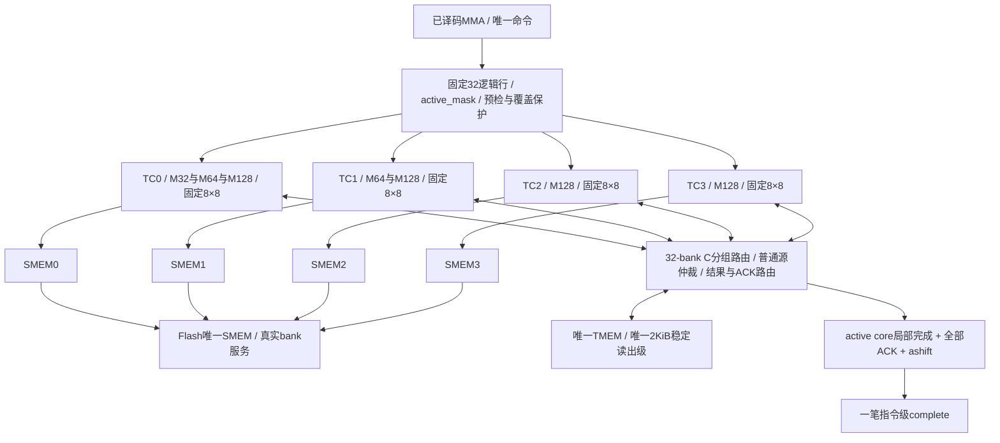

# blackwell_tc_mma_engine

> 规范版本 v1.0

## 1. 模块概述

一条SM100a单CTA MMA的协调层，实例化四个[TC core](blackwell_tc_core.md)。本层唯一持有完整命令、collector身份、全局预检／覆盖屏障、四路退休状态及首次错误；每core独立访问、执行一次完整dot并生成结果。一次仅接受一条MMA，按M启用4/2/1个core，活动core无锁步要求；合法组合见[共享规范](../common/interfaces.md#mma-合法组合)。

### 微架构与资源



固定`TC_COUNT=4`、`TC_DOT_LANES=64`，每core固定负责32个逻辑行。每core四类独立64-dot阵列，整个SM共1024实例；数组内按固定8×8广播。先检查M合法，再从父层稳定命令派生`active_count=M/32`、`active_mask=(1<<active_count)-1`；TC i仅在`i<active_count`时启动，负责`m=32*i..32*i+31`。本core完整32行A及metadata、scale A驻留后，以`n_base=0..N step8`为外层，内层依次执行`row_block=0..3`。同一8列B和32×8旧C供四个行块使用；另一B槽预取下一N块。dot j为`(32*i+8*row_block+j[5:3],n_base+j[2:0])`。每输出一次dot，无跨TC归约。dense/sparse的实际乘法项数分别为FP16/BF16=16、TF32=8、K32类=32、FP4=64；sparse逻辑K为其两倍，由metadata选择完整B而非增加执行次数。

| M | active_mask／启用实例 | 每活动TC逻辑行数 | 每N块内层8行块数 |
| --- | --- | --- | --- |
| 128 | 1111／TC0–TC3 | 32 | 4 |
| 64 | 0011／TC0–TC1 | 32 | 4 |
| 32（WS） | 0001／TC0 | 32 | 4 |

未启用core保持idle，不发launch/请求，不申请ID、route或结果credit，不产生局部done；操作数存储及算术流水不进行有效更新。四路物理SMEM连接保留，未启用端口的请求valid为0，不把闲置端口或结果槽转给活动core。MMA仍命令级互斥，闲置core不承接另一条MMA。

active_mask由唯一命令组合派生，不新增寄存镜像。已有四位launch/preflight/snapshot/done记录只更新活动位，未启用位保持0；所有屏障和完成检查使用`(record & active_mask)==active_mask`，不能要求记录等于1111，也不伪造未启用core的完成事件。

D/E/F/G及transpose仅改变物理映射，TC编号不等同TMEM的32-lane分区：M64/F的一个TC覆盖两个16有效行片段，WS E/G可随N片访问不同物理分区；A/D/E/scale均由全局逻辑坐标应用各自布局。A collector和四个WS B collector各保留一份身份，绑定ctx/epoch；use允许重读，lastuse在实际消费后失效，不因无额外payload缓存拒绝合法指令。

| 资源 | 容量、端口与唯一持有者 | 释放与用途 |
| --- | --- | --- |
| 完整命令 | 665bit一份，父层 | 接受至complete消费；core读取视图，无四份命令镜像。 |
| scale B快照 | 8 bank×128×32bit=4096B，1R1W、同步1拍、4bit byte mask | 最大N256×四partition×32bit物理容器；按有效data ID使用；覆盖保护所需字段预先保存，最后请求／读取退休后释放。 |
| scale B输出 | 8×32bit=32B唯一同步输出级，按bank保持与字段消费 | 每core最多一个未消费列，按`(n*4+core_index)%8`仲裁，bank冲突重放；直送对应B槽，不另复制payload。 |
| TMEM返回 | 引用bank自己的2KiB稳定读出级，父层无宽数据存储 | C直接向各core提供512B；普通16B片段交回填级或scale SRAM。每目的接受一次，全部交付才让bank rsp_fire。 |
| bank路由 | 3条653bit read union、2条probe；3个结果写route和3个ACK位置 | read由kind选择650bit普通逐lane路由或44bit C身份／待交付信息，二者共用存储。result route绑定core/slot/N/行块，payload释放后仍持有旧事务；ACK位置0..2指向D route，3指向指令级ashift；不按复用slot匹配。 |
| core数据 | 每物理core5120B，四份20480B | [core资源表](blackwell_tc_core.md#微架构与资源)规定端口与生命周期。加scale B及其输出共24608B；控制、dot流水和bank输出另计一次。 |

### 源快照与布局容量

A只保存原始源位模式一份，同时承担跨N复用及覆盖／ashift保护；普通路径同样装入完整32行。每次从驻留A读取一个8行视图，dot_fire后释放该视图；原数据在最后N消费者接受且必要ashift读取结束后按组释放。紧凑地址按逻辑行及行内原始容器索引重建，物理column空洞不保存。读取视图执行重排、negate、TF32/低精度适配，ashift读取未改变的原字节；transpose后按逻辑行定义副作用，禁止直接按物理lane平移。

| 来源／布局 | 无损保存规则 | 容量上界 |
| --- | --- | --- |
| FP16/BF16 A，dense K16／sparse逻辑K32 | 每行16×16bit源容器 | 32×32B=1024B/活动core |
| TF32 A，dense K8／sparse逻辑K16 | 每行8×32bit源容器 | 32×32B=1024B/活动core |
| F8/F6/F4及MX K32类A | 32个至多8bit源字段容器；TMEM byte含padding原样保留，SMEM MN-major只无损收集原字段bit，K-major保留packed来源视图，读视图适配 | 最多256bit/行；紧凑6bit/4bit不扩成另一份A |
| FP4 A，dense K64／sparse逻辑K128 | 64×4bit，byte内两元素顺序不变，native格式无transpose | 32B/行 |
| transpose、D/F物理源及half-offset | 对同一行内容器作一一置换，地址跨度不进入容量 | A仍32B/行；F的A/D/E alignment一致 |
| sparse E | selector按PTX子列提取后保存有效nibble，低逻辑组在低位；TF32/FP16为8个，K32类/FP4 v0为16个 | 每行32或64bit，最大256B/core，无重复one-hot |
| scale A | data ID提取1/2/4个有效byte，按原逻辑K block关联 | 最大128B/core；不保存无效容器padding |
| scale B | 物理快照保留四个32-lane partition，以免错误假定外部复制完全一致；B槽只取本core有效字段 | 共享4096B，输出32B；本地scale已计入B槽 |
| B，含transpose／WS／低bit packing | 每列完整逻辑K，转换后最多512bit；双槽各绑定N块，当前供四行块复用、另一槽预取下一N块；第四次实际消费后释放 | 双槽8列×512bit=1024B/core，加64B scale |
| ashift | 原A footprint内的完整源容器；跨core逻辑行读取，复用A同步输出级 | 引用四份A，无16B返回副本；snapshot返回只在对应bank写请求fire时接受，读取数据直接引用至该握手；最后源读取结束可释放数据，但最终完成等待写ACK |

每种packing的容器数量按PTX定义；数据ID、metadata子列、FP4 nibble顺序和必要padding都有可逆来源索引。A行读视图最多256bit，完整B列最多512bit；越界或不支持组合在预检拒绝，不能截断地址。A/E/scale与任何core D或ashift目标相交时，先保存全部会被覆盖的源；全局execute在所有active core的权限预检和必要快照完毕后开启。无覆盖时每core独立等待自己的完整32行A、当前B及完整32×8旧C，无需全M×N的B/结果就绪。旧D在独立1024B C槽预取，不与最终结果共槽。

权限probe仅覆盖真实footprint，按精确连续段发出，不包含地址洞或禁用lane；probe不读数据。普通core src为单lane16B读取，父层可合并不同lane请求；每core最多2个普通source route。C由独立接口给出N/word，父层根据D/E/F/G生成32个不同bank及列地址，映射结果直接连接稳定bank输出至C行半字写口。M128按连续32-bank直连；M64/F以16-lane片段置换并保留alignment；WS E/G按N片选择分区。不同TC可处于不同N，不要求锁步；每TC每拍至多一笔512B C beat，bank不冲突的请求可合成一次128-lane接受。完整32×8旧C用前／后四列两个beat，FP16 cell仍占32bit，不推导一次读完的紧凑packing。

C batch与普通源batch有界轮询，共享唯一读口和3个read credit；普通batch可合入最多4个共享scale源lane。read route的tagged union只保存一种路由：普通模式逐lane交付，C模式保存四个N/word及四bit待交付mask。C请求fire与bank接受同拍；返回N/word必须匹配core已预留槽。C通道每拍可向四个core各交付512B，彼此ready独立，不经过32B ingress；错误只退休、报fault。最后一个目的fire才拉高bank响应ready，其他目的不重复交付；反压延长唯一输出及read credit占用，无额外2KiB或512B holding。普通SMEM回填可与宽C写入并行。

共享scale B按bank直写，普通预取前沿不超过活动B槽的最远N组；覆盖屏障要求的字段可预先全取。每新B槽读取8个本地scale列，跨四个行块复用；当前组先于远端组，不能等整N快照就绪才处理普通命令。bank同lane同word读写冲突轮询，其他地址允许1R1W。

周期`L=全量预检 + 必要snapshot fence + 访问/执行事件 + 最后退休`，重叠项由真实事件图计算。TMEM各方向最多1个bank请求/拍；各read类内core轮询上界≤4次成功grant，类间竞争再计轮询及实际反压。无冲突SMEM服务下，M128/M64/M32的MMA请求上限分别为4/2/1笔32B每拍，默认共享总计32B/cycle。每活动core的A源读取一次、本地A准备4*(N/8)次、B装填N/8次；逐tile sparse选择、scale、C双beat、实际bank冲突、dot/provider及ACK分别计费。结果按8×8独立写回，其实际lane利用率计入模型，不承诺每次写满32 bank；结果仍受3个route与3个write credit限制。不得把2KiB总线当每core每拍2KiB吞吐。

## 2. 接口定义

位宽单位bit，公共[握手／身份规则](../common/interfaces.md#握手身份与生命周期)和[packed字段](../common/interfaces.md)适用。mma_cmd_a1_t及外部complete编码不变；普通DONE由顶层独立保存。未启用core的请求valid为0；其输入旧响应仍受live ID和生命周期隔离规则约束；无live身份的响应走公共身份错误路径，不启动core、不设置done位。下一指令在先前合法请求全部退休后才切换M/owner。四路SMEM端口i在`[i*W+:W]`，端口0最低；每路ID7bit、默认活跃0..15，匹配(端口,ID)及命令生命周期，不能跨端口合并身份。

SMEM遵循[canonical layouts](https://docs.nvidia.com/cuda/parallel-thread-execution/index.html#tcgen05-canonical-layouts)，支持合法start/LBO/SBO/base-offset、swizzle、16B和128B/32B atom及packing。默认逻辑A行／B列不等于物理线性地址。D布局M128为D、M64非WS为F、M64 WS为E、M32 WS为G；F lane=`32*(m//16)+m%16+alignment`，alignment=0或16。E/G按N分片映射，A/E/scale使用各自专用布局，禁止套用D统一寻址。

输入D=0不读取旧D；否则旧D进dot的C，FP16精确提升。scale_input_d仅在合法非WS f16/tf32一次dot内使用；整数同一次dot内最终饱和／回绕。FP16 D的编码、舍入和特殊值处理由dot数值合同负责；MMA接收完整76bit未编码最终状态，在相同结果槽完成provider返回，将低16bit写入cell并保持高16bit。禁用lane不写D，WS zero-column-mask只改变B读取视图。

稀疏metadata按[core规则](blackwell_tc_core.md#稀疏选择与scale)先验证再按行选择完整B，scale跟随原逻辑K。ashift只执行一次指令级副作用，覆盖所需原A预先保存；不能调用固定32×8 SHIFT替代全部A。首次错误停止新工作、排空已发请求、保留实际写入，无部分写回滚；BAD_CMD=10、BAD_SMEM=16，bank错误原样传播。不得伪造成功complete。

### 结果释放、响应分发与排空

result_fire捕获完整(core,slot,n_base,row_block)，只引用core结果。不含数据的write route持有已发/ACK计数及状态；正常路径最后一笔bank写请求fire后向core发送相同(slot,N,行块)的result_release。父层不再读取该槽后才允许释放握手，随后槽可复用；ACK仍关联原route位置，绝不以已复用slot寻址。每个route释放前等全部ACK、release握手及held引用退休，正常完成同时需要全片段发出与ACK。

错误时未发片段取消，但已经反压保持的写请求必须保持稳定直至接受；该请求引用解除前不release。写错误写入父层首次错误并广播abort，不再经已释放slot传回。core done只代表本地工作及payload引用结束；父层最后complete还须所有SMEM、probe/read分片、dot/provider、写ACK、release通道及ashift退休。bank各方向按接受顺序返回，相同命令tag由有限route FIFO位置匹配，不能把tag当事务序号。

### 输入信号

| 接口名 | 位宽 | 说明 |
| --- | --- | --- |
| `clk` | 1 | 公共上升沿时钟。 |
| `rst_n` | 1 | 低有效异步复位，释放同步；控制状态与外部旧响应隔离见共享规则。 |
| `cmd_vld_i` | 1 | `cmd` 通道有效；握手通道遵循共享 vld/rdy 规则。 |
| `cmd_i` | `MMA_CMD_A1_W` | MMA 命令；packed `mma_cmd_a1_t`，见[共享字段](../common/interfaces.md#mma-命令)。 |
| `complete_rdy_i` | 1 | `complete` 通道接受能力；仅与对应 vld 同拍为 1 时接受。 |
| `smem_req_rdy_i` | `TC_COUNT * 1` | 四路独立切片，端口0位于低位；`smem_req` 通道接受能力；仅与对应 vld 同拍为 1 时接受。 |
| `smem_rsp_vld_i` | `TC_COUNT * 1` | 四路独立切片，端口0位于低位；`smem_rsp` 通道有效；握手通道遵循共享 vld/rdy 规则。 |
| `smem_rsp_data_i` | `TC_COUNT * SMEM_DATA_W` | 四路独立切片，端口0位于低位；memory 读返回行数据；data[8*j+:8] 对应请求 addr+j，未选读 byte 返回 0。 |
| `smem_rsp_id_i` | `TC_COUNT * TENSOR_SMEM_ID_W` | 四路独立切片，端口0位于低位；所属 memory 通道事务 ID；live ID 未退休前不复用，响应按 ID 匹配。 |
| `smem_rsp_status_i` | `TC_COUNT * MEM_STATUS_W` | 四路独立切片，端口0位于低位；memory 状态，0 成功、非 0 失败。 |
| `tmem_rd_rdy_i` | 1 | `tmem_rd` 通道接受能力；仅与对应 vld 同拍为 1 时接受。 |
| `tmem_rd_rsp_vld_i` | 1 | `tmem_rd_rsp` 通道有效；握手通道遵循共享 vld/rdy 规则。 |
| `tmem_rd_rsp_data_i` | `TMEM_DATA_W` | 128 lane × 128 bit TMEM word 数据；低位为 lane0，word 内低位为低地址 byte。 |
| `tmem_rd_rsp_status_i` | `STATUS_W` | 模块诊断状态，0 成功、非 0 失败；错误完成不得伪装成功。 |
| `tmem_wr_rdy_i` | 1 | `tmem_wr` 通道接受能力；仅与对应 vld 同拍为 1 时接受。 |
| `tmem_wr_rsp_vld_i` | 1 | `tmem_wr_rsp` 通道有效；握手通道遵循共享 vld/rdy 规则。 |
| `tmem_wr_rsp_status_i` | `STATUS_W` | 模块诊断状态，0 成功、非 0 失败；错误完成不得伪装成功。 |
| `tmem_probe_rdy_i` | 1 | probe请求接受能力。 |
| `tmem_probe_rsp_vld_i` | 1 | 对应probe已完成；失败时不得执行目标写。 |
| `tmem_probe_rsp_status_i` | `STATUS_W` | 完整范围权限检查结果。 |

### 输出信号

| 接口名 | 位宽 | 说明 |
| --- | --- | --- |
| `cmd_rdy_o` | 1 | `cmd` 通道接受能力；仅与对应 vld 同拍为 1 时接受。 |
| `complete_vld_o` | 1 | `complete` 通道有效；握手通道遵循共享 vld/rdy 规则。 |
| `complete_o` | `ASYNC_EVENT_A1_W` | TC 内部完成，domain=TC；packed `async_event_a1_t`，见[共享字段](../common/interfaces.md#身份与事件字段)。 |
| `smem_req_vld_o` | `TC_COUNT * 1` | 四路独立切片，端口0位于低位；`smem_req` 通道有效；握手通道遵循共享 vld/rdy 规则。 |
| `smem_req_addr_o` | `TC_COUNT * SMEM_BYTE_ADDR_W` | 四路独立切片，端口0位于低位；SMEM/backing byte 地址，32B 行对齐；禁止截断 overflow。 |
| `smem_req_id_o` | `TC_COUNT * TENSOR_SMEM_ID_W` | 四路独立切片，端口0位于低位；所属 memory 通道事务 ID；live ID 未退休前不复用，响应按 ID 匹配。 |
| `smem_req_byte_mask_o` | `TC_COUNT * SMEM_MASK_W` | 四路独立切片，端口0位于低位；memory byte mask；bit j 选择 addr+j 的实际访问，未选读 byte 返回 0。 |
| `smem_rsp_rdy_o` | `TC_COUNT * 1` | 四路独立切片，端口0位于低位；`smem_rsp` 通道接受能力；仅与对应 vld 同拍为 1 时接受。 |
| `tmem_rd_vld_o` | 1 | `tmem_rd` 通道有效；握手通道遵循共享 vld/rdy 规则。 |
| `tmem_rd_ctx_o` | `CTX_ID_W` | 物理 context 槽编号；与 epoch 共同检查权限。 |
| `tmem_rd_epoch_o` | `EPOCH_W` | context 生命周期编号；须与 live context 及 owner 记录匹配。 |
| `tmem_rd_lane_mask_o` | `TMEM_LANE_MASK_W` | 128 个 TMEM lane 的读使能；bit j 选择 lane j。 |
| `tmem_rd_column_o` | `TMEM_COLUMN_BUS_W` | 128 × 16 bit TMEM word 起始 column；低位对应 lane0，各有效 lane 按 4 column 对齐。 |
| `tmem_rd_tag_o` | `ASYNC_TAG_W` | 请求 tag；响应原样恢复，不能单独作为跨 epoch 唯一身份。 |
| `tmem_rd_rsp_rdy_o` | 1 | `tmem_rd_rsp` 通道接受能力；仅与对应 vld 同拍为 1 时接受。 |
| `tmem_wr_vld_o` | 1 | `tmem_wr` 通道有效；握手通道遵循共享 vld/rdy 规则。 |
| `tmem_wr_ctx_o` | `CTX_ID_W` | 物理 context 槽编号；与 epoch 共同检查权限。 |
| `tmem_wr_epoch_o` | `EPOCH_W` | context 生命周期编号；须与 live context 及 owner 记录匹配。 |
| `tmem_wr_column_o` | `TMEM_COLUMN_BUS_W` | 128 × 16 bit TMEM word 起始 column；低位对应 lane0，各有效 lane 按 4 column 对齐。 |
| `tmem_wr_data_o` | `TMEM_DATA_W` | 128 lane × 128 bit TMEM word 数据；低位为 lane0，word 内低位为低地址 byte。 |
| `tmem_wr_byte_mask_o` | `TMEM_BYTE_MASK_W` | 128 × 16 bit TMEM byte mask；bit 16*l+b 选择 lane l 的 word byte b，0 保持。 |
| `tmem_wr_tag_o` | `ASYNC_TAG_W` | 请求 tag；响应原样恢复，不能单独作为跨 epoch 唯一身份。 |
| `tmem_wr_rsp_rdy_o` | 1 | `tmem_wr_rsp` 通道接受能力；仅与对应 vld 同拍为 1 时接受。 |
| `idle_o` | 1 | 无本模块执行或在途访问；具体统计范围见本节规则。 |
| `tmem_probe_vld_o` | 1 | probe 请求有效。 |
| `tmem_probe_ctx_o` | `CTX_ID_W` | 对象context身份，随请求保存。 |
| `tmem_probe_epoch_o` | `EPOCH_W` | 对象生命周期，与bank live身份精确比较。 |
| `tmem_probe_lane_mask_o` | `TMEM_LANE_MASK_W` | 启用lane位图；禁用lane不访问也不报其地址错误。 |
| `tmem_probe_column_o` | `TMEM_COLUMN_BUS_W` | 各lane完整16bit起始column；probe允许非word对齐。 |
| `tmem_probe_columns_o` | `TMEM_COLUMNS_COUNT_W` | 每个enabled lane的连续column数量，1..512；先加宽检查末地址。 |
| `tmem_probe_tag_o` | `ASYNC_TAG_W` | 原命令tag，随probe响应运输。 |
| `tmem_probe_rsp_rdy_o` | 1 | 接收probe响应；身份由parent核对，顺序按已接受probe队列。 |

### Core 内部连接

四份cmd_i直接读父层唯一命令；仅active core的launch各握手一次，execute_i仅向已启动活动实例开放全局权限／覆盖屏障，abort_i是sticky首次错误。inactive保持idle且done_vld=0，不因abort或release生成事件。src/probe连接普通有限路由，c_req/c_rsp连接32-bank分组路由；四路SMEM原样接core，scale接共享SRAM，snapshot接ashift；[core端口](blackwell_tc_core.md#2-接口定义)逐项对应。core按N块外层／四行块内层独立推进，B/C完整就绪后复用至第四次dot_fire；父层scale返回始终引用预留N槽。result与result_release的slot/N/行块成组握手；局部done不连接tracker。RF subsystem对MMA返回保持透明、owner稳定直至complete，不能提前吸收并复制bank held数据。

## 3. 伪代码

### 接受、预检与覆盖屏障

```text
on cmd_fire:
    save command once; reserve one complete; initialize core flags/error/routes
    validate full legal tuple/descriptor/layout and all exact source/target footprints
    if invalid: hold one error without launching a core or writing a target; stop setup
    derive active_count=M/32 and low-bit active_mask from the validated shared command
    clear existing four-bit records; launch only active cores, once per launch_fire
    inactive cores remain idle with no requests, credits or done events
    collector identities remain unique
probe actual ranges owned by active cores; request all source snapshots that overlap any target or feed ashift
execute = all_active_launched && all_active_preflight_ok && all_active_required_snapshots_saved && !first_error
```

### 共享读取与一次Dot

```text
for each independently advancing active core:
    forward its SMEM channel; reserve src/probe or C route before bank request_fire
read arbitration alternates eligible C batches and ordinary source batches
for C batch:
    map each core's N/word through D/E/F/G into32 distinct bank words
    merge disjoint core bank sets; c_req_fire coincides with aggregate bank acceptance
    save C identities/delivery mask in the same read-route union, no payload
on bank read response held valid:
    check oldest accepted route
    ordinary: deliver undelivered16B slices to reserved ingress/scale destinations
    C: directly permute32 words/core into its reserved row halfwords, one512B beat/core
    on slice_fire mark delivered once; on last slice_fire also accept complete upstream response
    no parent copy of bank data; keep remaining bits and route until full retirement
scale B: arbitrate actual8 banks, retain synchronous output until destination B field accepts
core execution order: retain full32-row A; n_base step8 outer, row_block=0..3 inner
each B slot binds N only, four ordered dot consumers; another slot prefetches next N
old C uses two512B beats and releases at the fourth actual dot, independently of results
old D is its C input; sparse selection uses metadata from that A row and complete B column
```

### Payload释放、ACK与最终完成

```text
on result_fire:
    reserve one of3 write routes(core,slot,n_base,row_block); payload stays in core union slot
for referenced result:
    map each j by D/E/F/G; arbitrate compatible lane words, replay conflicts
    bank_write_fire: advance sent count; reserve ACK position pointing to this route
    after final required request_fire: hold result_release(slot,N,row_block) until core accepts
on bank write ACK:
    pop accepted request position; update its retained route, not the core slot
    status failure: latch first_error, broadcast abort
    free route only when sent_closed && all_ACKs_retired && release_consumed && no_held_reference
on abort:
    stop unheld new work, drain held valid/accepted work; close canceled unsent fragments
    release core payload only after last reference is gone; drain issued dot/provider/reads/ACKs
if ashift and no error:
    after relevant D writes, read original A across cores using their same sync output stage
    write exact A-footprint side effect once; data read completion and write ACK are separate
on active local_done_fire: save one retired flag/status, do not register tracker
when (done_mask & active_mask)==active_mask && all parent routes/held work/ACKs retired && ashift retired:
    hold one complete(original key, first_error); finish collectors at their actual last use
on complete_fire: release launched cores and shared owner/command; ordinary DONE belongs to top
```
