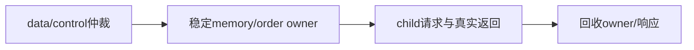

# blackwell_tma_copy_engine

> 规范版本 v1.0

## 1. 模块概述

仲裁TMA data engine与map control，共用GMEM/SMEM/order通道。向data engine传递queue8/cache4/MSHR16、地址64/32、ID5/4，仅由子模块实例化一次。本层只保存后端owner和仲裁控制，不增加命令FIFO或响应payload槽。普通数据继续排队，控制命令必须在此前copy完成后进入独占区；后续data不能越过该控制命令。

子模块规范：[blackwell_tma_data_engine](blackwell_tma_data_engine.md)、[blackwell_tma_map_control](blackwell_tma_map_control.md)。

### 微架构与资源



本层保存一个data/control owner、一个尚未被子层接受的grant索引；payload仍由发送方或已接受ticket保存。正常dispatch为组合路由，空闲data通路L=0、II=1；data执行与map control互斥。control等待时间=前序data全部退休时间，owner在控制响应被parent接收且cache失效完成后释放。

进入control窗口前，data需退掉active和next setup槽，包括预取descriptor live ID；cache失效只在该窗口执行，重新dispatch最少1拍。没有独立FIFO/cache/响应数据副本。

所有资源与时序的默认值见[微架构配置](../common/interfaces.md#微架构配置与性能约束)。周期从接受边沿计至结果首次有效；延迟式另加实际背压和外部响应等待。payload 不复位，valid、credit 和身份有效性复位；clock enable 随实际推进，SRAM 仅启用有效 bank。

## 2. 接口定义

全部握手、身份、完成、错误和复位遵循[公共规则](../common/interfaces.md#握手身份与生命周期)；表内位宽单位为 bit，符号见[公用位宽配置](../common/interfaces.md#公用位宽配置)，参数项注明默认配置。无握手的组合输出随输入变化；有握手的流水输出按所属通道保持。

命令及响应、desc/source 事件、memory/order 与 transaction 完成通道按下表定义。stop 禁止新的外部接受，已接受 data 和控制命令继续执行；父 engine 已接受 ticket 的 dispatch 不受 stop 屏蔽。parent ticket tag 原样传递，不使用外部 tag 直接识别 MSHR。idle/drained聚合data、map control和owner／held grant；子模块响应直接mux到parent ticket，不保存第二份响应payload。

map control在data queue、active、MSHR、ordering、bar tx和child response都排空后占用后端；完成后失效descriptor cache，再恢复data dispatch。若control未被接受，caller保持valid，但data engine须继续收response以释放资源。响应mux按实际owner路由，不能在held response中途切换owner。desc/source pulse只来自data并透传。

### 输入信号

| 接口名 | 位宽 | 说明 |
| --- | --- | --- |
| `clk` | 1 | 公共上升沿时钟。 |
| `rst_n` | 1 | 低有效异步复位，释放同步；控制状态与外部旧响应隔离见共享规则。 |
| `tma_cmd_vld_i` | 1 | `tma_cmd` 通道有效；握手通道遵循共享 vld/rdy 规则。 |
| `tma_cmd_i` | `TMA_CMD_W` | TMA/descriptor 控制命令；packed `tma_cmd_t`，见[共享字段](../common/interfaces.md#tma-命令与响应)。 |
| `gmem_req_rdy_i` | 1 | `gmem_req` 通道接受能力；仅与对应 vld 同拍为 1 时接受。 |
| `smem_req_rdy_i` | 1 | `smem_req` 通道接受能力；仅与对应 vld 同拍为 1 时接受。 |
| `tma_order_req_rdy_i` | 1 | `tma_order_req` 通道接受能力；仅与对应 vld 同拍为 1 时接受。 |
| `tma_order_rsp_vld_i` | 1 | `tma_order_rsp` 通道有效；握手通道遵循共享 vld/rdy 规则。 |
| `tma_order_rsp_i` | `BW_ORDER_RSP_W` | ordering 确认，ID 精确匹配；packed `bw_order_rsp_t`，见[共享字段](../common/interfaces.md#内存属性与-ordering)。 |
| `tma_rsp_rdy_i` | 1 | `tma_rsp` 通道接受能力；仅与对应 vld 同拍为 1 时接受。 |
| `gmem_rsp_vld_i` | 1 | `gmem_rsp` 通道有效；握手通道遵循共享 vld/rdy 规则。 |
| `gmem_rsp_data_i` | `GMEM_DATA_W` | memory 读返回行数据；data[8*j+:8] 对应请求 addr+j，未选读 byte 返回 0。 |
| `gmem_rsp_status_i` | `MEM_STATUS_W` | memory 状态，0 成功、非 0 失败。 |
| `gmem_rsp_id_i` | `GMEM_ID_W`（默认 `GMEM_ID_DEFAULT_W`） | 所属 memory 通道事务 ID；live ID 未退休前不复用，响应按 ID 匹配。 |
| `smem_rsp_vld_i` | 1 | `smem_rsp` 通道有效；握手通道遵循共享 vld/rdy 规则。 |
| `smem_rsp_data_i` | `SMEM_DATA_W` | memory 读返回行数据；data[8*j+:8] 对应请求 addr+j，未选读 byte 返回 0。 |
| `smem_rsp_status_i` | `MEM_STATUS_W` | memory 状态，0 成功、非 0 失败。 |
| `smem_rsp_id_i` | `SMEM_ID_W`（默认 `TMA_SMEM_ID_DEFAULT_W`） | 所属 memory 通道事务 ID；live ID 未退休前不复用，响应按 ID 匹配。 |
| `tx_cpl_rdy_i` | 1 | `tx_cpl` 通道接受能力；仅与对应 vld 同拍为 1 时接受。 |
| `tx_rsp_vld_i` | 1 | `tx_rsp` 通道有效；握手通道遵循共享 vld/rdy 规则。 |
| `tx_rsp_tag_i` | `ASYNC_TAG_W` | 请求 tag；响应原样恢复，不能单独作为跨 epoch 唯一身份。 |
| `tx_rsp_status_i` | `STATUS_W` | 模块诊断状态，0 成功、非 0 失败；错误完成不得伪装成功。 |
| `tx_rsp_phase_i` | 1 | barrier phase；transaction 响应或诊断值，不代替 wait token。 |
| `stop_i` | 1 | 置 1 停止新的外部命令或登记；已接受工作、生产者完成和响应继续推进。 |

### 输出信号

| 接口名 | 位宽 | 说明 |
| --- | --- | --- |
| `tma_cmd_rdy_o` | 1 | `tma_cmd` 通道接受能力；仅与对应 vld 同拍为 1 时接受。 |
| `gmem_req_vld_o` | 1 | `gmem_req` 通道有效；握手通道遵循共享 vld/rdy 规则。 |
| `gmem_req_attr_o` | `BW_MEM_ATTR_W` | 内存访问属性，随请求保持；packed `bw_mem_attr_t`，见[共享字段](../common/interfaces.md#内存属性与-ordering)。 |
| `gmem_req_addr_o` | `ADDR_W`（默认 `GMEM_ADDR_W`） | GMEM byte 地址，128B 对齐；禁止截断 overflow。 |
| `gmem_req_data_o` | `GMEM_DATA_W` | memory 行数据；data[8*j+:8] 对应 addr+j，写 mask 为 0 的 byte 保持。 |
| `gmem_req_byte_mask_o` | `GMEM_MASK_W` | memory byte mask；bit j 选择 addr+j 的实际访问，未选读 byte 返回 0。 |
| `gmem_req_id_o` | `GMEM_ID_W`（默认 `GMEM_ID_DEFAULT_W`） | 所属 memory 通道事务 ID；live ID 未退休前不复用，响应按 ID 匹配。 |
| `gmem_req_write_o` | 1 | 1 为写请求，0 为读请求；访问语义同时受 attr.kind 约束。 |
| `smem_req_vld_o` | 1 | `smem_req` 通道有效；握手通道遵循共享 vld/rdy 规则。 |
| `smem_req_attr_o` | `BW_MEM_ATTR_W` | 内存访问属性，随请求保持；packed `bw_mem_attr_t`，见[共享字段](../common/interfaces.md#内存属性与-ordering)。 |
| `smem_req_addr_o` | `SMEM_ADDR_W`（默认 `SMEM_BYTE_ADDR_W`） | SMEM/backing byte 地址，32B 行对齐；禁止截断 overflow。 |
| `smem_req_data_o` | `SMEM_DATA_W` | memory 行数据；data[8*j+:8] 对应 addr+j，写 mask 为 0 的 byte 保持。 |
| `smem_req_byte_mask_o` | `SMEM_MASK_W` | memory byte mask；bit j 选择 addr+j 的实际访问，未选读 byte 返回 0。 |
| `smem_req_id_o` | `SMEM_ID_W`（默认 `TMA_SMEM_ID_DEFAULT_W`） | 所属 memory 通道事务 ID；live ID 未退休前不复用，响应按 ID 匹配。 |
| `smem_req_write_o` | 1 | 1 为写请求，0 为读请求；访问语义同时受 attr.kind 约束。 |
| `tma_order_req_vld_o` | 1 | `tma_order_req` 通道有效；握手通道遵循共享 vld/rdy 规则。 |
| `tma_order_req_o` | `BW_ORDER_REQ_W` | ordering 请求，确认须兑现对应 seq/proxy/scope 可见性；packed `bw_order_req_t`，见[共享字段](../common/interfaces.md#内存属性与-ordering)。 |
| `tma_order_rsp_rdy_o` | 1 | `tma_order_rsp` 通道接受能力；仅与对应 vld 同拍为 1 时接受。 |
| `desc_done_o` | 1 | descriptor 取得并验证成功的单拍事件；无 ready，父层每拍接收，失败不发成功事件。 |
| `source_done_o` | 1 | 全部源读取成功结束的单拍事件；无 ready，父层每拍接收，失败不发成功事件。 |
| `event_tag_o` | `ASYNC_TAG_W` | desc_done/source_done 对应的父层 ticket ID。 |
| `tma_rsp_vld_o` | 1 | `tma_rsp` 通道有效；握手通道遵循共享 vld/rdy 规则。 |
| `tma_rsp_tag_o` | `ASYNC_TAG_W` | 请求 tag；响应原样恢复，不能单独作为跨 epoch 唯一身份。 |
| `tma_rsp_status_o` | `STATUS_W` | 模块诊断状态，0 成功、非 0 失败；错误完成不得伪装成功。 |
| `tma_rsp_bytes_o` | `BYTE_COUNT_W` | 规定的 transaction/payload 字节数；不含容器 padding，也不是总线 mask popcount。 |
| `gmem_rsp_rdy_o` | 1 | `gmem_rsp` 通道接受能力；仅与对应 vld 同拍为 1 时接受。 |
| `smem_rsp_rdy_o` | 1 | `smem_rsp` 通道接受能力；仅与对应 vld 同拍为 1 时接受。 |
| `tx_cpl_vld_o` | 1 | `tx_cpl` 通道有效；握手通道遵循共享 vld/rdy 规则。 |
| `tx_cpl_tag_o` | `ASYNC_TAG_W` | 请求 tag；响应原样恢复，不能单独作为跨 epoch 唯一身份。 |
| `tx_cpl_addr_o` | `SMEM_ADDR_W`（默认 `SMEM_BYTE_ADDR_W`） | barrier 对象 byte 地址，8B 对齐；SMEM 范围检查后访问。 |
| `tx_cpl_bytes_o` | `BARRIER_TX_BYTES_W` | unsigned32 transaction 增减量，单位 byte；从逻辑总量检查可表示性后生成，不含容器 padding，也不是 mask popcount。 |
| `tx_rsp_rdy_o` | 1 | `tx_rsp` 通道接受能力；仅与对应 vld 同拍为 1 时接受。 |
| `idle_o` | 1 | 无本模块执行或在途访问；具体统计范围见本节规则。 |
| `drained_o` | 1 | 本模块已接受工作及请求、响应保持槽全部排空；具体范围见本节规则。 |

## 3. 伪代码

```text
data command: accept only when no control barrier is pending and child queue has credit
on pending control: stop accepting later data; continue earlier data until fully drained
when earlier copies drained: accept control and lock shared backend to map_control
route memory/order request and response using locked backend owner
when control rsp retires: pulse descriptor invalidation; release owner
data desc/source events and tx requests always pass through from data_engine
idle = data idle && map idle
drained = data.drained && map.drained && no locked owner/held backend grant
```

### 流水、资源与排空

```text
control pending: block later data dispatch but drain already accepted data and next setup/prefetch
when data drained: grant map-control exclusively
when map-control response consumed: invalidate raw descriptor cache; resume data after invalidate edge
```
