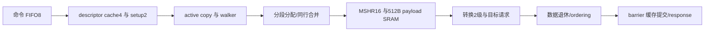

# blackwell_tma_data_engine

> 规范版本 v1.0

## 1. 模块概述

执行TMA数据复制：命令FIFO、descriptor cache、clocked setup/walker、MSHR、格式转换、memory访问、ordering和transaction完成。默认ADDR_W64/SMEM_ADDR_W32、queue8/cache4/MSHR16、GMEM_ID_W5/SMEM_ID_W4；一条active copy，多段memory响应允许乱序。

linear/tensor load/store、prefetch、合法reduction/multimem和同CTA shared-copy项目扩展由本模块生成访问；原子/缓存/多目标访问由外部后端兑现属性。

子模块规范：[blackwell_tma_tensor_map](blackwell_tma_tensor_map.md)。

### 微架构与资源


| 资源 | 组织与访问 | 容量与生命周期 |
| --- | --- | --- |
| 排队、descriptor、setup | FIFO8×TMA_CMD_W；cache4×1024bit，fully associative，tag为完整desc_ptr；setup两槽 | FIFO控制头尾更新，payload为1R1W；cache为512B使能寄存器。命中仍执行命令相关setup。 |
| 片段payload | 4bank×4deep×256bit，1R1W、32bit byte mask；bank=slot%4 | 512B；metadata每slot≤512bit；一个slot存≤32B有效传输，退休后释放。 |
| GMEM合并记录 | 最多16 leader记录，每记录16bit child bitmap及128bit offset/length映射 | 不复制payload；每组≤4 child且分布于不同payload bank；ID为leader slot，descriptor ID=16。 |
| 转换与总线保持 | 2级32B转换流水；GMEM一个128B出口槽，SMEM一个32B出口槽 | 转换每拍1片段；返回128B只取选中字节，不为每个MSHR存128B。 |

资源下界按ceil(fragment_rate*fragment_RTT)计算。默认普通copy的低延迟服务profile：GMEM响应1拍、SMEM确认1拍、walk3拍、转换2拍，片段窗口需求≤8，16槽另覆盖在途出入口保持及随机延迟。长延迟吞吐≤16*32/RTT B/cycle，不能保持32B/cycle时不扩充逻辑容量伪造测量。1条active copy、1条next setup，FIFO其他命令等待。

普通无packing/reduction/multimem/atomic128、同地址行与相同attr的片段可合并为GMEM请求；部分组最多等待3拍或到边界立即发出。leader ID保持到group响应被消费，child slot保持到目标确认；合并响应按child mask分写四bank。store在完整child源读取后组合GMEM数据。reduction/multimem/atomic128不跨操作合并，atomic128最大16B；packed以完整转换组分段，最大源和目标各32B；缺片需1个16B容器残留槽，逻辑byte计数不含padding。连续普通copy II=1片段、最多32B/cycle；packed/reduction按实际片段尺寸与转换占用计算，OOB不读取非法GMEM。

整体 Lcopy=Lsetup+Lwalk/fetch/convert/window+Ltargets+Lorder+Lbar_commit；包含source_done与desc_done独立边界。所有slot的stage、ID、mask在发请求前分配，响应仅按live记录推进。

GMEM source返回先进入唯一128B response holding槽，按最多4个子片段分拍送32B转换流水；该槽未腾空时反压新的GMEM response。普通store的128B出口行组装从最多4个不同payload bank读取，使用唯一128B request寄存器；两者分别服务读返回与写请求，不复制MSHR payload。32B SMEM出口有一个请求保持槽，均在实际握手后释放。

所有资源与时序的默认值见[微架构配置](../common/interfaces.md#微架构配置与性能约束)。周期从接受边沿计至结果首次有效；延迟式另加实际背压和外部响应等待。payload 不复位，valid、credit 和身份有效性复位；clock enable 随实际推进，SRAM 仅启用有效 bank。

## 2. 接口定义

全部握手、身份、完成、错误和复位遵循[公共规则](../common/interfaces.md#握手身份与生命周期)；表内位宽单位为 bit，符号见[公用位宽配置](../common/interfaces.md#公用位宽配置)，参数项注明默认配置。无握手的组合输出随输入变化；有握手的流水输出按所属通道保持。

命令采用 `tma_cmd_t`，响应给出 tag/status/bytes；GMEM128B、SMEM32B、byte masks、memory attributes、ordering 及 tx_cpl/rsp 定义见[共享接口](../common/interfaces.md)。invalidate 为 copy parent 在此前 copies和setup/预取排空后发出的 cache 失效单拍脉冲。stop 只阻止新命令入队，已入队工作继续。

desc_done/source_done为单周期内部事件，event_tag16是parent ticket ID；无ready，parent必须每拍接收，事件仅发一次。desc_done表示该copy所需tensor map已取得并验证（cache命中也发）；source_done表示该copy全部源读取成功结束，尚不表示目标写入或barrier完成。事件没有status，错误不发送成功desc/source pulse，而由error response终止对应ticket边界。prefetch不写SMEM、不通知barrier、完整response bytes=0。

分段可包含多个完整dtype元素；在GMEM128B、SMEM32B、swizzle连续atom/行、packing转换组、OOB属性或atomic128边界处分割。load OOB生成规定填充且不读GMEM，store OOB不写GMEM；被cp_mask/ignore_oob屏蔽的byte不访问。TF32 load按项目RNE转换，普通copy位保持；packed按map输出重新组装，padding保持mask0。

每MSHR保存logical cursor、源/目标ID、长度、mask和状态；成功响应须匹配live ID及期待阶段，在途ID不可重用。source_done包括本条copy对应的全部源响应；完整完成必须等所有目标确认、必要async→generic release，再执行mbar complete_tx缓存原子提交或返回bulk完成。load的release为合法cluster scope，仍是本CTA对象。

transaction bytes取map的total_payload_bytes或linear_bytes，不是总线mask popcount、容器padding或multicast后的网络流量。后端/release错误不发成功complete_tx；停止新段、排空已发段、返回一次错误，已写数据不回滚。barrier更新错误以TMA_MBARRIER返回。idle包括queue/active/MSHR/order/tx，drained还包括held response。

total/cursor/response bytes 保留 unsigned64；选择 mbarrier completion 时先检查 total 可表示为 unsigned32 增减量，失败按 OVERFLOW 完成且不发 complete_tx。该检查在数据发射前完成；对象的 signed tx 候选范围由 barrier unit 检查。

### 输入信号

| 接口名 | 位宽 | 说明 |
| --- | --- | --- |
| `clk` | 1 | 公共上升沿时钟。 |
| `rst_n` | 1 | 低有效异步复位，释放同步；控制状态与外部旧响应隔离见共享规则。 |
| `invalidate_i` | 1 | 父层在此前复制排空后发出的 descriptor cache 失效单拍脉冲。 |
| `tma_cmd_vld_i` | 1 | `tma_cmd` 通道有效；握手通道遵循共享 vld/rdy 规则。 |
| `tma_cmd_i` | `TMA_CMD_W` | TMA/descriptor 控制命令；packed `tma_cmd_t`，见[共享字段](../common/interfaces.md#tma-命令与响应)。 |
| `gmem_req_rdy_i` | 1 | `gmem_req` 通道接受能力；仅与对应 vld 同拍为 1 时接受。 |
| `smem_req_rdy_i` | 1 | `smem_req` 通道接受能力；仅与对应 vld 同拍为 1 时接受。 |
| `tma_order_req_rdy_i` | 1 | `tma_order_req` 通道接受能力；仅与对应 vld 同拍为 1 时接受。 |
| `tma_order_rsp_vld_i` | 1 | `tma_order_rsp` 通道有效；握手通道遵循共享 vld/rdy 规则。 |
| `tma_order_rsp_i` | `BW_ORDER_RSP_W` | ordering 确认，ID 精确匹配；packed `bw_order_rsp_t`，见[共享字段](../common/interfaces.md#内存属性与-ordering)。 |
| `tma_rsp_rdy_i` | 1 | `tma_rsp` 通道接受能力；仅与对应 vld 同拍为 1 时接受。 |
| `gmem_rsp_vld_i` | 1 | `gmem_rsp` 通道有效；握手通道遵循共享 vld/rdy 规则。 |
| `gmem_rsp_data_i` | `GMEM_DATA_W` | memory 读返回行数据；data[8*j+:8] 对应请求 addr+j，未选读 byte 返回 0。 |
| `gmem_rsp_status_i` | `MEM_STATUS_W` | memory 状态，0 成功、非 0 失败。 |
| `gmem_rsp_id_i` | `GMEM_ID_W`（默认 `GMEM_ID_DEFAULT_W`） | 所属 memory 通道事务 ID；live ID 未退休前不复用，响应按 ID 匹配。 |
| `smem_rsp_vld_i` | 1 | `smem_rsp` 通道有效；握手通道遵循共享 vld/rdy 规则。 |
| `smem_rsp_data_i` | `SMEM_DATA_W` | memory 读返回行数据；data[8*j+:8] 对应请求 addr+j，未选读 byte 返回 0。 |
| `smem_rsp_status_i` | `MEM_STATUS_W` | memory 状态，0 成功、非 0 失败。 |
| `smem_rsp_id_i` | `SMEM_ID_W`（默认 `TMA_SMEM_ID_DEFAULT_W`） | 所属 memory 通道事务 ID；live ID 未退休前不复用，响应按 ID 匹配。 |
| `tx_cpl_rdy_i` | 1 | `tx_cpl` 通道接受能力；仅与对应 vld 同拍为 1 时接受。 |
| `tx_rsp_vld_i` | 1 | `tx_rsp` 通道有效；握手通道遵循共享 vld/rdy 规则。 |
| `tx_rsp_tag_i` | `ASYNC_TAG_W` | 请求 tag；响应原样恢复，不能单独作为跨 epoch 唯一身份。 |
| `tx_rsp_status_i` | `STATUS_W` | 模块诊断状态，0 成功、非 0 失败；错误完成不得伪装成功。 |
| `tx_rsp_phase_i` | 1 | barrier phase；transaction 响应或诊断值，不代替 wait token。 |
| `stop_i` | 1 | 置 1 停止新的外部命令或登记；已接受工作、生产者完成和响应继续推进。 |

### 输出信号

| 接口名 | 位宽 | 说明 |
| --- | --- | --- |
| `tma_cmd_rdy_o` | 1 | `tma_cmd` 通道接受能力；仅与对应 vld 同拍为 1 时接受。 |
| `gmem_req_vld_o` | 1 | `gmem_req` 通道有效；握手通道遵循共享 vld/rdy 规则。 |
| `gmem_req_attr_o` | `BW_MEM_ATTR_W` | 内存访问属性，随请求保持；packed `bw_mem_attr_t`，见[共享字段](../common/interfaces.md#内存属性与-ordering)。 |
| `gmem_req_addr_o` | `ADDR_W`（默认 `GMEM_ADDR_W`） | GMEM byte 地址，128B 对齐；禁止截断 overflow。 |
| `gmem_req_data_o` | `GMEM_DATA_W` | memory 行数据；data[8*j+:8] 对应 addr+j，写 mask 为 0 的 byte 保持。 |
| `gmem_req_byte_mask_o` | `GMEM_MASK_W` | memory byte mask；bit j 选择 addr+j 的实际访问，未选读 byte 返回 0。 |
| `gmem_req_id_o` | `GMEM_ID_W`（默认 `GMEM_ID_DEFAULT_W`） | 所属 memory 通道事务 ID；live ID 未退休前不复用，响应按 ID 匹配。 |
| `gmem_req_write_o` | 1 | 1 为写请求，0 为读请求；访问语义同时受 attr.kind 约束。 |
| `smem_req_vld_o` | 1 | `smem_req` 通道有效；握手通道遵循共享 vld/rdy 规则。 |
| `smem_req_attr_o` | `BW_MEM_ATTR_W` | 内存访问属性，随请求保持；packed `bw_mem_attr_t`，见[共享字段](../common/interfaces.md#内存属性与-ordering)。 |
| `smem_req_addr_o` | `SMEM_ADDR_W`（默认 `SMEM_BYTE_ADDR_W`） | SMEM/backing byte 地址，32B 行对齐；禁止截断 overflow。 |
| `smem_req_data_o` | `SMEM_DATA_W` | memory 行数据；data[8*j+:8] 对应 addr+j，写 mask 为 0 的 byte 保持。 |
| `smem_req_byte_mask_o` | `SMEM_MASK_W` | memory byte mask；bit j 选择 addr+j 的实际访问，未选读 byte 返回 0。 |
| `smem_req_id_o` | `SMEM_ID_W`（默认 `TMA_SMEM_ID_DEFAULT_W`） | 所属 memory 通道事务 ID；live ID 未退休前不复用，响应按 ID 匹配。 |
| `smem_req_write_o` | 1 | 1 为写请求，0 为读请求；访问语义同时受 attr.kind 约束。 |
| `tma_order_req_vld_o` | 1 | `tma_order_req` 通道有效；握手通道遵循共享 vld/rdy 规则。 |
| `tma_order_req_o` | `BW_ORDER_REQ_W` | ordering 请求，确认须兑现对应 seq/proxy/scope 可见性；packed `bw_order_req_t`，见[共享字段](../common/interfaces.md#内存属性与-ordering)。 |
| `tma_order_rsp_rdy_o` | 1 | `tma_order_rsp` 通道接受能力；仅与对应 vld 同拍为 1 时接受。 |
| `desc_done_o` | 1 | descriptor 取得并验证成功的单拍事件；无 ready，父层每拍接收，失败不发成功事件。 |
| `source_done_o` | 1 | 全部源读取成功结束的单拍事件；无 ready，父层每拍接收，失败不发成功事件。 |
| `event_tag_o` | `ASYNC_TAG_W` | desc_done/source_done 对应的父层 ticket ID。 |
| `tma_rsp_vld_o` | 1 | `tma_rsp` 通道有效；握手通道遵循共享 vld/rdy 规则。 |
| `tma_rsp_tag_o` | `ASYNC_TAG_W` | 请求 tag；响应原样恢复，不能单独作为跨 epoch 唯一身份。 |
| `tma_rsp_status_o` | `STATUS_W` | 模块诊断状态，0 成功、非 0 失败；错误完成不得伪装成功。 |
| `tma_rsp_bytes_o` | `BYTE_COUNT_W` | 规定的 transaction/payload 字节数；不含容器 padding，也不是总线 mask popcount。 |
| `gmem_rsp_rdy_o` | 1 | `gmem_rsp` 通道接受能力；仅与对应 vld 同拍为 1 时接受。 |
| `smem_rsp_rdy_o` | 1 | `smem_rsp` 通道接受能力；仅与对应 vld 同拍为 1 时接受。 |
| `tx_cpl_vld_o` | 1 | `tx_cpl` 通道有效；握手通道遵循共享 vld/rdy 规则。 |
| `tx_cpl_tag_o` | `ASYNC_TAG_W` | 请求 tag；响应原样恢复，不能单独作为跨 epoch 唯一身份。 |
| `tx_cpl_addr_o` | `SMEM_ADDR_W`（默认 `SMEM_BYTE_ADDR_W`） | barrier 对象 byte 地址，8B 对齐；SMEM 范围检查后访问。 |
| `tx_cpl_bytes_o` | `BARRIER_TX_BYTES_W` | unsigned32 transaction 增减量，单位 byte；从逻辑总量检查可表示性后生成，不含容器 padding，也不是 mask popcount。 |
| `tx_rsp_rdy_o` | 1 | `tx_rsp` 通道接受能力；仅与对应 vld 同拍为 1 时接受。 |
| `idle_o` | 1 | 无本模块执行或在途访问；具体统计范围见本节规则。 |
| `drained_o` | 1 | 本模块已接受工作及请求、响应保持槽全部排空；具体范围见本节规则。 |

## 3. 伪代码

### Descriptor和数据

```text
on cmd_fire: enqueue complete payload/tag
when execution free: dequeue; validate command
tensor: cache lookup(desc_ptr); on miss read128B v3 map
        validate decoded map; on success emit exactly one desc_done, including cache hit
linear: validate16B address/size alignment and masks; total=linear_bytes
if completion==mbarrier: require total fits unsigned32 before narrowing or any data issue
for each logical payload cursor while a MSHR is free:
    map position; choose legal segment and selected byte masks
    load OOB: synthesize fill; otherwise issue masked source read
    on source response: match ID; convert/pack; emit source_done only at final successful source ack with no earlier source error
    issue target masked write/reduce with original dtype/scope/atomic attributes
    on target response: retire matching segment
prefetch: issue hint requests only; no target writes or tx completion
```

### 完成与错误

```text
when generation finished && all segment requests retired:
    if failed or prefetch: respond(error or OK, prefetch?0:total)
    else: request release(async→generic,issuer,seq,scope,range); wait matching successful ack
    if release failed: respond(ORDER_ERROR); do not submit complete_tx
    else if completion==MBAR:
        submit complete_tx(barrier,total); wait matching cache-commit response
        respond(bar_status mapped to TMA status,total)
    else: respond(OK,total)
on execution error: stop new segments; drain live IDs; suppress success notification
on invalidate pulse: require data drained; invalidate matching descriptor cache entries
```

### 流水、资源与排空

```text
allocate active ticket's setup slot and optionally prepare one queued successor
activate walker only for active copy; on successful active setup emit desc_done once
for each accepted step:
    save logical/src/dst lengths and OOB/padding mask; allocate <=16 live fragment slots
    ordinary same GMEM line/attr: form leader+child bitmap, max4 distinct payload banks
    send partial group after boundary/end or3cycles; ID16 remains descriptor-only
on GMEM response: check live leader and stage; compact selected bytes into child slots once
on source response/OOB fill: convert through2 stages; issue target from ready child; preserve held payload
on target confirmation: retire matching child; source_done when all required source responses succeeded
full success: all data requests retired -> order ack -> complete_tx cache commit ack -> response
on error: stop new generation; drain already sent IDs and held walk outputs; retire both setup slots
invalidate: require copy/next setup/prefetch/output drained; invalidate descriptor cache before later setup
```
