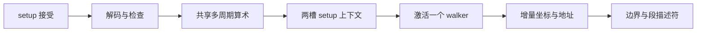

# blackwell_tma_tensor_map

> 规范版本 v1.0

## 1. 模块概述

有时钟的setup与增量坐标/布局模块，解释项目128B v3 tensor map，按顺序payload遍历返回GMEM/SMEM位置、总完成字节数及合法性。支持rank1..5 tiled、gather4/scatter4、interleave、im2col/wide、swizzle和packed格式；不发memory请求，不更新barrier。

### 微架构与资源



setup 上下文2槽，每槽最多1536bit decoded 参数，另256bit walker游标（5个9bit计数器+GMEM64+SMEM32+remaining64+packing/flags≤51bit），均控制使能寄存器；descriptor128B仅在解码期间保留一份输入槽。每命令一次 decode/check，1个64×64→128多周期乘法器（4拍）和1个64/64除法器（64拍）；窄常量乘法和power-of-two除法为移位/加法。每次宽乘后检查结果是否可表示，拒绝超界后再执行下一乘法；合法量进入除法器前已验证≤64bit。稳态walker不得调用通用除法。

setup 延迟 Lsetup=4+4*Nmul+64*Ndiv。令 R=rank，tile: Nmul=2R、Ndiv=R-1；gather/scatter: Nmul=4、Ndiv=1；interleave: Nmul=2R+2、Ndiv=R；im2col: Nmul=2R+3、Ndiv=R；wide/W128: Nmul=2R+4、Ndiv=R+1。这是共享单元调用次数上限；具体解码运算清单跳过移位/常量特例，实际延迟按调用次数计费，不能为常量特例空转64拍。

setup调用预算的来源：tile覆盖各维start×stride与extent×stride（各≤R次乘），以及初始非power-of-two游标/radix转换（≤R-1次除）；gather/scatter覆盖四行start×stride；interleave另含C-outer与slice基址；im2col另含pixel/row/batch增量；wide/W128另含halo和主pixel分区起点。小box/step的ceil-radix以9×4bit查表或有界移位计算；游标为0及常量路径跳过除法。decoded槽保存实际调用清单；并行可用单元也按上述保守串行上界计费。S0在当前增量地址低位、连续区间剩余长度及group边界中选择精确段长；S1/S2不回改段长，发现范围错误则停止后续新段并排空held输出。

一条walk激活后有3级弹性流水：坐标推进、地址/范围、分段/输出。segment II=1、无背压延迟3拍；下一setup可与当前walk推进重叠。准备好的下一槽在旧walk全部输出及retire握手完成前不能替换active槽。

所有资源与时序的默认值见[微架构配置](../common/interfaces.md#微架构配置与性能约束)。周期从接受边沿计至结果首次有效；延迟式另加实际背压和外部响应等待。payload 不复位，valid、credit 和身份有效性复位；clock enable 随实际推进，SRAM 仅启用有效 bank。

## 2. 接口定义

全部握手、身份、完成、错误和复位遵循[公共规则](../common/interfaces.md#握手身份与生命周期)；表内位宽单位为 bit，符号见[公用位宽配置](../common/interfaces.md#公用位宽配置)，参数项注明默认配置。无握手的组合输出随输入变化；有握手的流水输出按所属通道保持。

desc1024为项目v3编码（原文档已清理），mode3、store1、coord160=5×s32、im2col80={wOffset16,wHalo16,offsetD16,offsetH16,offsetW16}、smem_base32、walk从payload位置0开始，仅在step请求握手时预留下一段，输出握手才将该段交给caller；不是含padding的SMEM偏移。step_limit约束下一段逻辑payload及源/目标物理字节均不超过32B。

setup输出total_bytes64（完整逻辑payload）、elem_bytes4（普通元素byte宽；packed按1B生成）、gmem_addr64、smem_addr32、packed_shift3（packed store组装位偏移）、in_bounds和address_valid。status8判断descriptor/组合合法性；OOB不是error，地址overflow与OOB分别表示；address_valid只检查实际访问的物理地址，load OOB不检查或访问未使用的GMEM位置，SMEM填充目标仍完整检查。setup失败时不允许激活walk；step的status非零或address_valid=0时caller不得发memory访问；此时地址/长度仅作诊断。

普通非interleave：dim0连续且忽略step0，高维radix=`ceil(box/step)`。dim size1..2^32、box1..256、step1..8，较高维stride为16B倍数、<2^40、可容纳前维。load负/超界坐标走填充；store起始坐标非负，尾部OOB跳过。gather/scatter限定rank2、box1=1、无interleave，coord1..4指定四行。

interleave把C分16/32B切片，rank3..5；SMEM顺序C-inner/W/H/D/C-outer/N。im2col逐pixel/channel遍历空间和batch，加入offset后检查OOB；wide按W/N遍历，W128为128主pixel和四组halo。合法corner、halo、swizzle、dtype联合约束沿用字段行为定义（原文档已清理），采用项目v3表示。

packed组：b4x16每16元素8B；b4x16_p64为8B payload/16B SMEM容器，仅load；b6x16_p32为12B payload/16B容器，store从每byte低6bit重打包。padding不计transaction bytes。SW32/64 span采用16B atom；SW128支持16/32/64B atom及合法flip8；使用绝对SMEM地址参与XOR。

### 分段与上下文握手

setup_rsp携带setup_slot/setup_status/total_bytes/elem_bytes；step_rsp携带status/gmem_addr/smem_addr/in_bounds/address_valid/packed_shift/step_bytes/gmem_bytes/smem_bytes/step_last。两通道独立保持，不共用valid。setup失败的槽仍等待parent retire，不能被后续命令覆盖。step请求握手时唯一walker预留该段并推进生成游标；parent在step响应握手时保存段描述符，不再次推进游标；在memory错误时继续接收已发step输出并抑制访问，然后retire，不撤回held valid。next setup只取得参数，不发该copy的数据请求、不发送成功desc_done直到对应ticket成为active。

### 输入信号

| 接口名 | 位宽 | 说明 |
| --- | --- | --- |
| `clk` | 1 | 公共上升沿时钟。 |
| `rst_n` | 1 | 复位setup/walk有效状态，不清decoded参数payload。 |
| `desc_i` | `TENSOR_MAP_BYTES * BYTE_W` | 项目 v3 tensor map，128B packed 小端字段，见本节编码链接。 |
| `mode_i` | 3 | TMA 坐标模式，编码见共享 tma_cmd_t。 |
| `store_i` | 1 | 1 为 store，0 为 load。 |
| `coord_i` | `TENSOR_COORD_VECTOR_W` | 5 × signed32 坐标，低 32 bit 为 coord0。 |
| `im2col_i` | `IM2COL_W` | {wOffset,wHalo,offsetD,offsetH,offsetW}，各 16 bit。 |
| `smem_base_i` | `SMEM_BYTE_ADDR_W` | SMEM 起始 byte 地址。 |
| `setup_vld_i` | 1 | desc/mode/store/coord/im2col/smem_base组成一次setup。 |
| `setup_rsp_rdy_i` | 1 | 接收setup_slot、setup_status、total_bytes、elem_bytes。 |
| `walk_vld_i` | 1 | 将已setup成功且未active的槽激活为唯一walker。 |
| `walk_slot_i` | 1 | 选择槽0/1；须已通过setup返回。 |
| `step_vld_i` | 1 | 请求active walker下一段；每次只推进一段。 |
| `step_limit_i` | 6 | 1..32的逻辑及源/目标byte上限；packed时还满足完整转换组。 |
| `step_rsp_rdy_i` | 1 | 接收段描述符；反压期间地址/长度/status/last不变。 |
| `retire_vld_i` | 1 | parent结束/失败后释放一个setup/walk槽。 |
| `retire_slot_i` | 1 | 待释放槽0/1；有held setup/step输出时不能回收。 |


### 输出信号

| 接口名 | 位宽 | 说明 |
| --- | --- | --- |
| `packed_shift_o` | `clog2(BYTE_W)` | packed store 组装 bit 偏移。 |
| `status_o` | `STATUS_W` | 模块诊断，0 成功，非 0 失败。 |
| `total_bytes_o` | `BYTE_COUNT_W` | 完整逻辑 payload 字节数，不含 padding。 |
| `elem_bytes_o` | 4 | 普通元素 byte 宽度；packed 按 1B 生成。 |
| `gmem_addr_o` | `GMEM_ADDR_W` | GMEM byte 地址。 |
| `smem_addr_o` | `SMEM_BYTE_ADDR_W` | SMEM byte 地址。 |
| `in_bounds_o` | 1 | 逻辑坐标在 tensor 范围内；OOB 不等于 error。 |
| `address_valid_o` | 1 | 生成地址未 overflow；为 0 时禁止发 memory 请求。 |
| `setup_rdy_o` | 1 | 有free setup槽且算术调度可启动。 |
| `setup_rsp_vld_o` | 1 | setup结果有效；失败也返回槽身份与非零状态。 |
| `setup_slot_o` | 1 | 本次分配的槽号，直到retire握手保留。 |
| `setup_status_o` | `STATUS_W` | 本次descriptor/命令检查结果。 |
| `walk_rdy_o` | 1 | 无active walker/held旧输出且所选槽setup成功。 |
| `step_rdy_o` | 1 | walker有效且3级弹性流水有credit。 |
| `step_rsp_vld_o` | 1 | status/地址/in_bounds/packing及新增长度字段有效。 |
| `step_bytes_o` | 6 | 本段逻辑payload字节，1..32，不含SMEM容器padding。 |
| `gmem_bytes_o` | 6 | 本段GMEM物理访问span，1..32。 |
| `smem_bytes_o` | 6 | 本段SMEM物理访问span，1..32。 |
| `step_last_o` | 1 | 该段被接受后已遍历完整逻辑payload。 |
| `retire_rdy_o` | 1 | 所选槽无在途setup运算/held输出，可释放。 |

## 3. 伪代码

```text
on setup_fire: reserve one free slot; capture descriptor and command-dependent parameters once
decode v3; check all rank/type/stride/box/step/mode/swizzle/interleave/packing constraints
schedule shared wide multiplication/division; retain overflow bits before narrowing
save dimension counters, row/slice strides, payload total, packed group state and mode parameters
hold setup_rsp(slot,status,total_bytes,elem_bytes); keep slot until retire_fire
on walk_fire: require successful selected slot and no old active/held output; set logical cursor=0
on step_fire:
    S0: determine exact complete-element/group span from low-address/boundary counters and step_limit
        reserve this span and advance the one generation cursor once on request fire
    S1: form checked GMEM/SMEM addresses by incremental stride additions; compute OOB/overflow
    S2: verify the reserved span and emit step(status,addresses,in_bounds,packing,lengths,last)
        range failure marks the segment erroneous; do not silently shrink a previously reserved span
    update traversal counters once for each accepted step request; preserve emitted result under backpressure
tile: increment dim0; wrap by radix/step, reset lower coordinates and add higher stride
gather/scatter: advance row selector among the four supplied rows
interleave: nested C-inner/W/H/D/C-outer/N counters
im2col/wide: pixel/channel/spatial/batch counters with configured offsets/halo and OOB transitions
packed: advance complete 16-element group plus retained container position; exclude padding from payload
swizzle: XOR bit-slice network using absolute SMEM address; valid flip8 toggles specified row bit
on retire_fire: require no held setup/step or pending math; free slot and clear active if matching
```
