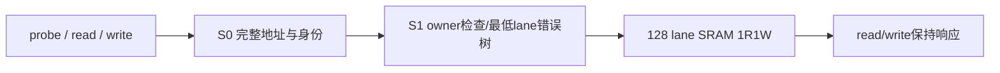

# blackwell_tmem_bank

> 规范版本 v1.0

## 1. 模块概述

唯一物理 TMEM：128 lane × 512 column × 32bit，共256KiB；底层为128个lane bank，每bank深128、word128bit、1R1W。由 RF subsystem 持有；MMA、LD/ST、CP、SHIFT共用，禁止再复制TMEM或内部RF SRAM。

CONTEXTS=32、TAG_W=16；owner以32-column单位记录ctx/epoch。管理包含create/destroy、alloc、free、relinquish。allocation列数32/64/128/256/512，起点按大小对齐，选择最低空闲区；同context后续申请不得增大。free允许释放完整拥有、按32-column对齐的合法列区间，不要求匹配历史一次alloc记录；relinquish仅撤销后续申请许可。

### 微架构与资源



物理容量=128*128*128bit=256KiB；bank=lane、SRAM address=column//4、byte位置=4*(column%4)+byte。数据读写各2级permission检查及1级SRAM动作，Lrd=Lwr=3，无冲突/背压时各II=1；probe不触碰SRAM，Lprobe=2、II=1。read、write各3条流水metadata credit，probe2条；write data只在2级检查段保存，写后ACK级不复制payload；SRAM输出寄存器是唯一read held data槽，写/探测各1个held响应，反压使相应elastic流水停止，不复制多份16Kbit读响应。

ctx状态32项，owner按16个32-column allocation unit保存、共享于128lane；epoch/live/permit由bank唯一维护。128lane权限比较并行，最低错误lane使用7层优先树，原status优先级不变。probe检查完整16bit column和非零10bit span的加宽末地址；每个enabled lane覆盖起始column..起始+span-1，不要求word对齐。

管理操作预留1个控制响应；alloc/free owner位图使用16位并行候选测试与低位优先编码。管理必须在所有三个数据流水及响应退休后执行，Lmanagement=2+held response；有效allocation不计作在途。

所有资源与时序的默认值见[微架构配置](../common/interfaces.md#微架构配置与性能约束)。周期从接受边沿计至结果首次有效；延迟式另加实际背压和外部响应等待。payload 不复位，valid、credit 和身份有效性复位；clock enable 随实际推进，SRAM 仅启用有效 bank。

## 2. 接口定义

全部握手、身份、完成、错误和复位遵循[公共规则](../common/interfaces.md#握手身份与生命周期)；表内位宽单位为 bit，符号见[公用位宽配置](../common/interfaces.md#公用位宽配置)，参数项注明默认配置。无握手的组合输出随输入变化；有握手的流水输出按所属通道保持。

管理 `ctx/alloc/free/relinquish` 输入返回统一 `ctrl_rsp`；create建立live/epoch/permit及last_size=512，destroy只允许已排空且无owned列。alloc返回column base；free的base单位为column。无空闲区时alloc反压，不锁住可释放资源的free。合法PTX dealloc须满足先前allocation、合法列数及完整地址前提；Flash检查原始操作数，bank检查当前权限及生命周期。物理free口保留较宽范围，不建立分配历史镜像。

`rd/wr`及响应遵循[bank word接口](../common/interfaces.md#tmemrfcp-与内存通道)。一次请求先检查全部有效lane的完整column、ctx/epoch和owner；任一失败则整拍不触碰SRAM，返回原tag及错误。读只使用lane_mask，写只使用byte_mask。同lane同word读写冲突按轮询一次服务一方；不冲突允许1R1W同拍，返回数据不定义为写优先旁路。

管理仅在相关bank请求和响应已退休时执行。response持有期间保持tag/data/status，ownership变更不得越过它。复位清owner/live/permit及响应控制，storage不清零；新allocation的数据值未初始化。

MMA可直接分片消费本bank的稳定read输出：父层仅保持交付位图；普通源以16B交付，旧C以32个不同bank的512B组合交付，最多四个core各接受一个组合。N和word选择按D/E/F/G路由，M128直接对应四组32-bank，其他布局允许片段置换。各目的接受一次，最后交付时才使完整rd_rsp握手；此前data/tag/status及owner保持，不复制2KiB或512B返回槽。C写入core预留行半字，不经过窄回填级。输出占用计入read credit和drained，接口宽度不承诺持续峰值。

bank唯一持有live/epoch/permit、allocation owner及访问状态；父层只保留命令身份和路由信息。idle/drained由已接受请求、SRAM操作和响应状态直接计算，不把未握手管理valid或已分配列当作在途操作。

### Probe 与数据冲突

probe仅检查namespace/live/epoch、非零span、完整column范围及owner，不改变storage/owner。所有probe结果按接受顺序保持tag/status。读/写同时同lane同word时轮询服务一方；一个请求的128lane是整体接受，不能先访问部分lane再返回错误。probe与data只读权限状态，可同时检查；管理等待全部probe/read/write流水退休后才改变owner。

### 输入信号

| 接口名 | 位宽 | 说明 |
| --- | --- | --- |
| `clk` | 1 | 公共上升沿时钟。 |
| `rst_n` | 1 | 低有效异步复位，释放同步；控制状态与外部旧响应隔离见共享规则。 |
| `ctx_vld_i` | 1 | `ctx` 通道有效；握手通道遵循共享 vld/rdy 规则。 |
| `ctx_id_i` | `CTX_ID_W` | 物理 context 槽编号；与 epoch 共同检查权限。 |
| `ctx_epoch_i` | `EPOCH_W` | context 生命周期编号；须与 live context 及 owner 记录匹配。 |
| `ctx_tag_i` | `TAG_W`（默认 `ASYNC_TAG_W`） | 请求 tag；响应原样恢复，不能单独作为跨 epoch 唯一身份。 |
| `ctx_create_i` | 1 | 1 创建 context，0 销毁；销毁前必须排空且无 owned 列。 |
| `alloc_vld_i` | 1 | `alloc` 通道有效；握手通道遵循共享 vld/rdy 规则。 |
| `alloc_ctx_i` | `CTX_ID_W` | 物理 context 槽编号；与 epoch 共同检查权限。 |
| `alloc_epoch_i` | `EPOCH_W` | context 生命周期编号；须与 live context 及 owner 记录匹配。 |
| `alloc_tag_i` | `TAG_W`（默认 `ASYNC_TAG_W`） | 请求 tag；响应原样恢复，不能单独作为跨 epoch 唯一身份。 |
| `alloc_columns_i` | `TMEM_COLUMNS_COUNT_W` | 列数，单位 column；alloc 为 32/64/128/256/512，free 范围按 32 对齐。 |
| `free_vld_i` | 1 | `free` 通道有效；握手通道遵循共享 vld/rdy 规则。 |
| `free_ctx_i` | `CTX_ID_W` | 物理 context 槽编号；与 epoch 共同检查权限。 |
| `free_epoch_i` | `EPOCH_W` | context 生命周期编号；须与 live context 及 owner 记录匹配。 |
| `free_tag_i` | `TAG_W`（默认 `ASYNC_TAG_W`） | 请求 tag；响应原样恢复，不能单独作为跨 epoch 唯一身份。 |
| `free_base_i` | `TMEM_COLUMN_INDEX_W` | TMEM column 起点，单位 column；alloc 成功响应返回分配起点。 |
| `free_columns_i` | `TMEM_COLUMNS_COUNT_W` | 列数，单位 column；alloc 为 32/64/128/256/512，free 范围按 32 对齐。 |
| `relinquish_vld_i` | 1 | `relinquish` 通道有效；握手通道遵循共享 vld/rdy 规则。 |
| `relinquish_ctx_i` | `CTX_ID_W` | 物理 context 槽编号；与 epoch 共同检查权限。 |
| `relinquish_epoch_i` | `EPOCH_W` | context 生命周期编号；须与 live context 及 owner 记录匹配。 |
| `relinquish_tag_i` | `TAG_W`（默认 `ASYNC_TAG_W`） | 请求 tag；响应原样恢复，不能单独作为跨 epoch 唯一身份。 |
| `ctrl_rsp_rdy_i` | 1 | `ctrl_rsp` 通道接受能力；仅与对应 vld 同拍为 1 时接受。 |
| `rd_vld_i` | 1 | `rd` 通道有效；握手通道遵循共享 vld/rdy 规则。 |
| `rd_ctx_i` | `CTX_ID_W` | 物理 context 槽编号；与 epoch 共同检查权限。 |
| `rd_epoch_i` | `EPOCH_W` | context 生命周期编号；须与 live context 及 owner 记录匹配。 |
| `rd_column_i` | `TMEM_COLUMN_BUS_W` | 128 × 16 bit TMEM word 起始 column；低位对应 lane0，各有效 lane 按 4 column 对齐。 |
| `rd_tag_i` | `TAG_W`（默认 `ASYNC_TAG_W`） | 请求 tag；响应原样恢复，不能单独作为跨 epoch 唯一身份。 |
| `rd_lane_mask_i` | `TMEM_LANE_MASK_W` | 128 个 TMEM lane 的读使能；bit j 选择 lane j。 |
| `rd_rsp_rdy_i` | 1 | `rd_rsp` 通道接受能力；仅与对应 vld 同拍为 1 时接受。 |
| `wr_vld_i` | 1 | `wr` 通道有效；握手通道遵循共享 vld/rdy 规则。 |
| `wr_ctx_i` | `CTX_ID_W` | 物理 context 槽编号；与 epoch 共同检查权限。 |
| `wr_epoch_i` | `EPOCH_W` | context 生命周期编号；须与 live context 及 owner 记录匹配。 |
| `wr_column_i` | `TMEM_COLUMN_BUS_W` | 128 × 16 bit TMEM word 起始 column；低位对应 lane0，各有效 lane 按 4 column 对齐。 |
| `wr_data_i` | `TMEM_DATA_W` | 128 lane × 128 bit TMEM word 数据；低位为 lane0，word 内低位为低地址 byte。 |
| `wr_tag_i` | `TAG_W`（默认 `ASYNC_TAG_W`） | 请求 tag；响应原样恢复，不能单独作为跨 epoch 唯一身份。 |
| `wr_byte_mask_i` | `TMEM_BYTE_MASK_W` | 128 × 16 bit TMEM byte mask；bit 16*l+b 选择 lane l 的 word byte b，0 保持。 |
| `wr_rsp_rdy_i` | 1 | `wr_rsp` 通道接受能力；仅与对应 vld 同拍为 1 时接受。 |
| `probe_vld_i` | 1 | probe 请求有效。 |
| `probe_ctx_i` | `CTX_ID_W` | 对象context身份，随请求保存。 |
| `probe_epoch_i` | `EPOCH_W` | 对象生命周期，与bank live身份精确比较。 |
| `probe_lane_mask_i` | `TMEM_LANE_MASK_W` | 启用lane位图；禁用lane不访问也不报其地址错误。 |
| `probe_column_i` | `TMEM_COLUMN_BUS_W` | 各lane完整16bit起始column；probe允许非word对齐。 |
| `probe_columns_i` | `TMEM_COLUMNS_COUNT_W` | 每个enabled lane的连续column数量，1..512；先加宽检查末地址。 |
| `probe_tag_i` | `ASYNC_TAG_W` | 原命令tag，随probe响应运输。 |
| `probe_rsp_rdy_i` | 1 | 接收probe返回。 |

### 输出信号

| 接口名 | 位宽 | 说明 |
| --- | --- | --- |
| `ctx_rdy_o` | 1 | `ctx` 通道接受能力；仅与对应 vld 同拍为 1 时接受。 |
| `alloc_rdy_o` | 1 | `alloc` 通道接受能力；仅与对应 vld 同拍为 1 时接受。 |
| `free_rdy_o` | 1 | `free` 通道接受能力；仅与对应 vld 同拍为 1 时接受。 |
| `relinquish_rdy_o` | 1 | `relinquish` 通道接受能力；仅与对应 vld 同拍为 1 时接受。 |
| `ctrl_rsp_vld_o` | 1 | `ctrl_rsp` 通道有效；握手通道遵循共享 vld/rdy 规则。 |
| `ctrl_rsp_tag_o` | `TAG_W`（默认 `ASYNC_TAG_W`） | 请求 tag；响应原样恢复，不能单独作为跨 epoch 唯一身份。 |
| `ctrl_rsp_status_o` | `STATUS_W` | 模块诊断状态，0 成功、非 0 失败；错误完成不得伪装成功。 |
| `ctrl_rsp_base_o` | `TMEM_COLUMN_INDEX_W` | TMEM column 起点，单位 column；alloc 成功响应返回分配起点。 |
| `rd_rdy_o` | 1 | `rd` 通道接受能力；仅与对应 vld 同拍为 1 时接受。 |
| `rd_rsp_vld_o` | 1 | `rd_rsp` 通道有效；握手通道遵循共享 vld/rdy 规则。 |
| `rd_rsp_data_o` | `TMEM_DATA_W` | 128 lane × 128 bit TMEM word 数据；低位为 lane0，word 内低位为低地址 byte。 |
| `rd_rsp_tag_o` | `TAG_W`（默认 `ASYNC_TAG_W`） | 请求 tag；响应原样恢复，不能单独作为跨 epoch 唯一身份。 |
| `rd_rsp_status_o` | `STATUS_W` | 模块诊断状态，0 成功、非 0 失败；错误完成不得伪装成功。 |
| `wr_rdy_o` | 1 | `wr` 通道接受能力；仅与对应 vld 同拍为 1 时接受。 |
| `wr_rsp_vld_o` | 1 | `wr_rsp` 通道有效；握手通道遵循共享 vld/rdy 规则。 |
| `wr_rsp_tag_o` | `TAG_W`（默认 `ASYNC_TAG_W`） | 请求 tag；响应原样恢复，不能单独作为跨 epoch 唯一身份。 |
| `wr_rsp_status_o` | `STATUS_W` | 模块诊断状态，0 成功、非 0 失败；错误完成不得伪装成功。 |
| `idle_o` | 1 | 无执行中的已接受数据或管理操作；held响应由drained统计。 |
| `drained_o` | 1 | idle且无已接受请求、SRAM在途访问及held读／写／管理响应；有效allocation和owner记录不阻碍排空。 |
| `probe_rdy_o` | 1 | probe metadata流水可预留credit时接受。 |
| `probe_rsp_vld_o` | 1 | probe返回有效；无SRAM数据访问。 |
| `probe_rsp_status_o` | `STATUS_W` | 按与data相同优先级返回完整范围检查结果。 |
| `probe_rsp_tag_o` | `ASYNC_TAG_W` | 返回原probe tag。 |


## 3. 伪代码

```text
on create_fire: require empty_context; live=1; epoch=new_epoch; permit=1; last_size=512
on alloc_fire:
    require live && matching_epoch && permit && legal_size && size<=last_size
    reserve lowest aligned free units; record owner; last_size=size; return base
on free_fire: validate every unit belongs to ctx/epoch; release all or release none
on relinquish_fire: permit=0; keep data/owner
on destroy_fire: require no owned units and no pending request/response; live=0

for each read/write candidate:
    preflight full-width addresses and ownership of all enabled words
    if bad: suppress SRAM masks; enqueue error response
    else if same-word read/write collision: grant round-robin winner
    else: issue read and/or masked write
on backend response: return saved tag/status/data; retire at response_fire
idle=no executing accepted data/management operation
drained=idle && no queued request/in-flight SRAM access/held read,write,control response
```

### 流水、资源与排空

```text
elastic S0: preserve complete addresses; check namespace/live/epoch/range without truncation
elastic S1: compare owners; choose lowest failing lane using balanced priority tree
probe: return status/tag after S1, SRAM enables remain0
data: arbitrate same-word read/write conflict; perform one synchronous1R1W access per lane
held response: gate SRAM output overwrites; only pipeline-valid advances state
management: use16-unit allocation bitmap; change authority only after all data/probe stages and returns empty
```
