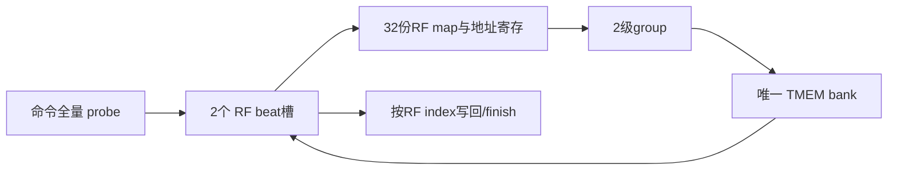

# blackwell_tmem_rf_subsystem

> 规范版本 v1.0

## 1. 模块概述

TMEM执行与管理层，包含bank、RF map/group、方向wait tracker、SHIFT和CP。执行LD/ST的streaming RF数据流，并将MMA bank请求接入同一bank。CONTEXTS=32、TAG_W=16；每命令两个1024bit RF beat槽，不建立第二RF。

顶层对MMA/LDST/CP/SHIFT按命令轮询分配独占权；本模块提供可接受性和bank routing。方向wait及TC completion独立于数据独占权，能够释放等待依赖。

子模块规范：[blackwell_tmem_bank](blackwell_tmem_bank.md)、[blackwell_tmem_rf_map](blackwell_tmem_rf_map.md)、[blackwell_tmem_rf_group](blackwell_tmem_rf_group.md)、[blackwell_tmem_wait_tracker](blackwell_tmem_wait_tracker.md)、[blackwell_tmem_shift_engine](blackwell_tmem_shift_engine.md)、[blackwell_tmem_cp_engine](blackwell_tmem_cp_engine.md)。

### 微架构与资源



RF beat两槽、每槽1024bit数据和32bit pending/selected bitmap，合计256B数据；两槽对应当前bank处理与下一RF beat准备。group2级、bank3级、scatter1级，外部RF握手1级计入模型：无冲突单组beat往返7拍，默认均匀发射II=ceil(7/2)=4；允许两槽突发时总速率不超过2/7 beat/cycle；每次每方向最多1个bank请求，LD/ST方向不会同时执行。多组冲突和pack16按实际G倍增加服务。

地址向量仅在当前beat槽保存，32份组合map输出由parent寄存1次；group请求接受后保存selected，bank成功响应才清pending。bank响应按已接受请求顺序关联beat槽，两个slot的RF结果按index顺序送出；ST跨beat同字节写保持beat及thread顺序。

MMA/CP/SHIFT/probe复用bank的稳定owner；每个通道仅保存必要held grant，普通DONE各1槽，内部完成不复制。management_status输入非零时，管理请求接受后用1个error-only控制响应槽返回错误，不向bank发请求；正常bank ctrl_rsp直接透传，不另存副本。

全命令preflight先按shape计算精确lane集合和连续column区间，直接用probe，不逐reg读TMEM。令R=repeat、P=pack16?2:1：shape0跨度P*R、32lane；shape1/2/3跨度P*(2/4/8)*R、16lane；shape4为16lane的两段P*R，第二段从half_offset开始。重叠/相邻段可合为一段，否则2次probe；区间均无未访问cell空洞。完整base/末地址、partition和512上界先检查，预检L=2*Gprobe加背压，Gprobe≤2；失败不请求ST RF源、不写目标。

所有资源与时序的默认值见[微架构配置](../common/interfaces.md#微架构配置与性能约束)。周期从接受边沿计至结果首次有效；延迟式另加实际背压和外部响应等待。payload 不复位，valid、credit 和身份有效性复位；clock enable 随实际推进，SRAM 仅启用有效 bank。

## 2. 接口定义

MMA owner的bank read返回保持透明；MMA普通源按16B片段、旧C按32-bank的512B组合消费同一稳定输出，最后目的交付才接受整个响应。RF层不增加分组缓存、不提前吸收或复制该2KiB数据；owner及read credit保持至完整握手。

全部握手、身份、完成、错误和复位遵循[公共规则](../common/interfaces.md#握手身份与生命周期)；表内位宽单位为 bit，符号见[公用位宽配置](../common/interfaces.md#公用位宽配置)，参数项注明默认配置。无握手的组合输出随输入变化；有握手的流水输出按所属通道保持。

RF command、source/destination beat、DONE、wait、管理及 MMA bank 通道按下表定义。`cmd_pack16_i` 在 LD 为 pack16，在 ST 为 unpack16；寄存器总数由 map 决定，source last 必须匹配最后 beat。ST 先验证全部 footprint，成功后才接受 source beat；LD 在每个完整 vector 组装后写外部 RF。

CP/SHIFT 命令携带完整 key；顶层在实际 cmd_fire 统一登记 TC tracker，本模块只输出各自内部 complete 与独立普通 DONE。mma_active 表示 MMA 持有数据执行权直到内部完成；mma_idle 不包含未消费普通 DONE，parent grant 仍须检查通知资源。stop 禁止新数据接受，全后端排空后 management_enable 允许管理握手；completion、RF destination 与 wait 响应继续推进。

CP/SHIFT只进入TC tracker，由顶层登记；LD/ST只进入方向tracker，由本模块在cmd_fire登记一次。内部完成按[唯一归属规则](../common/interfaces.md#状态登记与缓冲归属)：CP/SHIFT保持在各自引擎并直接转发，LD/ST finish保持在本模块。本模块各保留一个LD/ST、CP、SHIFT普通DONE槽，命令接受时预留对应槽；顶层不复制这些完成或DONE。preflight失败不消耗ST RF源也不写TMEM；执行中错误停止后续操作、排空已发请求，无回滚。管理等待已接受数据及相关响应排空，但等待无空间alloc不能阻塞free。

执行权由顶层唯一授予；本模块保存当前RF子操作的路由选择，不能独立授予第二条数据命令。bank唯一维护对象权限及allocation，wait tracker唯一维护LD/ST依赖；idle/drained引用bank、wait tracker和CP/SHIFT的状态输出，不复制子模块表或内部执行状态。正常管理和ctrl_rsp直接连接bank；namespace管理失败由error-only槽返回，不能覆盖bank正常响应。

### Probe 路由及管理失败

bank probe只有一个实际通道：当前MMA、RF preflight、CP或SHIFT按稳定执行owner路由，响应按接受序号/原tag匹配。probe成功不代替后续bank逐请求权限检查。management_status非零只在对应ctx destroy/create前置失败有效，alloc/free/relinquish为0；外部管理请求仍只在vld/rdy时登记一次。error-only ctrl_rsp与正常bank ctrl_rsp互斥，held失败响应也计入drained。

probe仅覆盖实际源/目标cell，排除padding和禁用lane；不连续footprint拆成精确连续段，不能以包含未访问cell的保守范围拒绝合法命令。

### 输入信号

| 接口名 | 位宽 | 说明 |
| --- | --- | --- |
| `clk` | 1 | 公共上升沿时钟。 |
| `rst_n` | 1 | 低有效异步复位，释放同步；控制状态与外部旧响应隔离见共享规则。 |
| `ctx_vld_i` | 1 | `ctx` 通道有效；握手通道遵循共享 vld/rdy 规则。 |
| `ctx_id_i` | `CTX_ID_W` | 物理 context 槽编号；与 epoch 共同检查权限。 |
| `ctx_epoch_i` | `EPOCH_W` | context 生命周期编号；须与 live context 及 owner 记录匹配。 |
| `ctx_tag_i` | `TAG_W`（默认 `ASYNC_TAG_W`） | 请求 tag；响应原样恢复，不能单独作为跨 epoch 唯一身份。 |
| `ctx_create_i` | 1 | 1 创建 context，0 销毁；销毁前必须排空且无 owned 列。 |
| `alloc_vld_i` | 1 | `alloc` 通道有效；握手通道遵循共享 vld/rdy 规则。 |
| `alloc_ctx_i` | `CTX_ID_W` | 物理 context 槽编号；与 epoch 共同检查权限。 |
| `alloc_epoch_i` | `EPOCH_W` | context 生命周期编号；须与 live context 及 owner 记录匹配。 |
| `alloc_tag_i` | `TAG_W`（默认 `ASYNC_TAG_W`） | 请求 tag；响应原样恢复，不能单独作为跨 epoch 唯一身份。 |
| `alloc_columns_i` | `TMEM_COLUMNS_COUNT_W` | 列数，单位 column；alloc 为 32/64/128/256/512，free 范围按 32 对齐。 |
| `free_vld_i` | 1 | `free` 通道有效；握手通道遵循共享 vld/rdy 规则。 |
| `free_ctx_i` | `CTX_ID_W` | 物理 context 槽编号；与 epoch 共同检查权限。 |
| `free_epoch_i` | `EPOCH_W` | context 生命周期编号；须与 live context 及 owner 记录匹配。 |
| `free_tag_i` | `TAG_W`（默认 `ASYNC_TAG_W`） | 请求 tag；响应原样恢复，不能单独作为跨 epoch 唯一身份。 |
| `free_base_i` | `TMEM_COLUMN_INDEX_W` | TMEM column 起点，单位 column；alloc 成功响应返回分配起点。 |
| `free_columns_i` | `TMEM_COLUMNS_COUNT_W` | 列数，单位 column；alloc 为 32/64/128/256/512，free 范围按 32 对齐。 |
| `relinquish_vld_i` | 1 | `relinquish` 通道有效；握手通道遵循共享 vld/rdy 规则。 |
| `relinquish_ctx_i` | `CTX_ID_W` | 物理 context 槽编号；与 epoch 共同检查权限。 |
| `relinquish_epoch_i` | `EPOCH_W` | context 生命周期编号；须与 live context 及 owner 记录匹配。 |
| `relinquish_tag_i` | `TAG_W`（默认 `ASYNC_TAG_W`） | 请求 tag；响应原样恢复，不能单独作为跨 epoch 唯一身份。 |
| `ctrl_rsp_rdy_i` | 1 | `ctrl_rsp` 通道接受能力；仅与对应 vld 同拍为 1 时接受。 |
| `cmd_vld_i` | 1 | `cmd` 通道有效；握手通道遵循共享 vld/rdy 规则。 |
| `cmd_store_i` | 1 | 1 为 ST 方向，0 为 LD 方向；wait/finish/DONE 按此匹配。 |
| `cmd_ctx_i` | `CTX_ID_W` | 物理 context 槽编号；与 epoch 共同检查权限。 |
| `cmd_epoch_i` | `EPOCH_W` | context 生命周期编号；须与 live context 及 owner 记录匹配。 |
| `cmd_warp_i` | `WARP_ID_W` | warp 编号；RF 方向 wait 按 warp 匹配，数据路径低 2 bit 选 TMEM 分区。 |
| `cmd_shape_i` | 3 | RF shape：0=32x32b，1=16x64b，2=16x128b，3=16x256b，4=16x32bx2。 |
| `cmd_repeat_i` | `RF_REPEAT_W` | 重复次数，1..128 的 2 次幂；shape2 最大 64，shape3 最大 32。 |
| `cmd_pack16_i` | 1 | LD 为 pack16，ST 为 unpack16；决定双 cell 访问和低 16 bit 写 mask。 |
| `cmd_half_offset_i` | `TMEM_HALF_OFFSET_W` | 16x32bx2 的 column 偏移；不乘 4，也不随 pack16 再乘 2。 |
| `cmd_tag_i` | `TAG_W`（默认 `ASYNC_TAG_W`） | 请求 tag；响应原样恢复，不能单独作为跨 epoch 唯一身份。 |
| `cmd_base_addr_i` | `TMEM_ADDR_W` | TMEM 地址，[31:16]=lane，[15:0]=column；完整检查后取物理索引。 |
| `rf_src_vld_i` | 1 | `rf_src` 通道有效；握手通道遵循共享 vld/rdy 规则。 |
| `rf_src_data_i` | `RF_BEAT_W` | 32 thread × 32 bit RF 寄存器向量；低位为 thread0。 |
| `rf_src_last_i` | 1 | 最后 RF beat 标志，必须与命令规定的向量数一致。 |
| `rf_dst_rdy_i` | 1 | `rf_dst` 通道接受能力；仅与对应 vld 同拍为 1 时接受。 |
| `done_rdy_i` | 1 | `done` 通道接受能力；仅与对应 vld 同拍为 1 时接受。 |
| `shift_cmd_vld_i` | 1 | `shift_cmd` 通道有效；握手通道遵循共享 vld/rdy 规则。 |
| `shift_cmd_i` | `SHIFT_CMD_A1_W` | SHIFT 命令；packed `shift_cmd_a1_t`，见[共享字段](../common/interfaces.md#shift-命令)。 |
| `shift_complete_rdy_i` | 1 | `shift_complete` 通道接受能力；仅与对应 vld 同拍为 1 时接受。 |
| `shift_done_rdy_i` | 1 | `shift_done` 通道接受能力；仅与对应 vld 同拍为 1 时接受。 |
| `wait_vld_i` | 1 | `wait` 通道有效；握手通道遵循共享 vld/rdy 规则。 |
| `wait_ctx_i` | `CTX_ID_W` | 物理 context 槽编号；与 epoch 共同检查权限。 |
| `wait_epoch_i` | `EPOCH_W` | context 生命周期编号；须与 live context 及 owner 记录匹配。 |
| `wait_warp_i` | `WARP_ID_W` | warp 编号；RF 方向 wait 按 warp 匹配，数据路径低 2 bit 选 TMEM 分区。 |
| `wait_store_i` | 1 | 1 为 ST 方向，0 为 LD 方向；wait/finish/DONE 按此匹配。 |
| `wait_tag_i` | `TAG_W`（默认 `ASYNC_TAG_W`） | 请求 tag；响应原样恢复，不能单独作为跨 epoch 唯一身份。 |
| `wait_rsp_rdy_i` | 1 | `wait_rsp` 通道接受能力；仅与对应 vld 同拍为 1 时接受。 |
| `mma_active_i` | 1 | MMA 持有 TMEM 命令执行权，直到内部完成被接受。 |
| `mma_rd_vld_i` | 1 | `mma_rd` 通道有效；握手通道遵循共享 vld/rdy 规则。 |
| `mma_rd_ctx_i` | `CTX_ID_W` | 物理 context 槽编号；与 epoch 共同检查权限。 |
| `mma_rd_epoch_i` | `EPOCH_W` | context 生命周期编号；须与 live context 及 owner 记录匹配。 |
| `mma_rd_lane_mask_i` | `TMEM_LANE_MASK_W` | 128 个 TMEM lane 的读使能；bit j 选择 lane j。 |
| `mma_rd_column_i` | `TMEM_COLUMN_BUS_W` | 128 × 16 bit TMEM word 起始 column；低位对应 lane0，各有效 lane 按 4 column 对齐。 |
| `mma_rd_tag_i` | `TAG_W`（默认 `ASYNC_TAG_W`） | 请求 tag；响应原样恢复，不能单独作为跨 epoch 唯一身份。 |
| `mma_rd_rsp_rdy_i` | 1 | `mma_rd_rsp` 通道接受能力；仅与对应 vld 同拍为 1 时接受。 |
| `mma_wr_vld_i` | 1 | `mma_wr` 通道有效；握手通道遵循共享 vld/rdy 规则。 |
| `mma_wr_ctx_i` | `CTX_ID_W` | 物理 context 槽编号；与 epoch 共同检查权限。 |
| `mma_wr_epoch_i` | `EPOCH_W` | context 生命周期编号；须与 live context 及 owner 记录匹配。 |
| `mma_wr_column_i` | `TMEM_COLUMN_BUS_W` | 128 × 16 bit TMEM word 起始 column；低位对应 lane0，各有效 lane 按 4 column 对齐。 |
| `mma_wr_data_i` | `TMEM_DATA_W` | 128 lane × 128 bit TMEM word 数据；低位为 lane0，word 内低位为低地址 byte。 |
| `mma_wr_byte_mask_i` | `TMEM_BYTE_MASK_W` | 128 × 16 bit TMEM byte mask；bit 16*l+b 选择 lane l 的 word byte b，0 保持。 |
| `mma_wr_tag_i` | `TAG_W`（默认 `ASYNC_TAG_W`） | 请求 tag；响应原样恢复，不能单独作为跨 epoch 唯一身份。 |
| `mma_wr_rsp_rdy_i` | 1 | `mma_wr_rsp` 通道接受能力；仅与对应 vld 同拍为 1 时接受。 |
| `cp_cmd_vld_i` | 1 | `cp_cmd` 通道有效；握手通道遵循共享 vld/rdy 规则。 |
| `cp_cmd_i` | `CP_CMD_A1_W` | CP 命令；packed `cp_cmd_a1_t`，见[共享字段](../common/interfaces.md#cp-命令)。 |
| `cp_complete_rdy_i` | 1 | `cp_complete` 通道接受能力；仅与对应 vld 同拍为 1 时接受。 |
| `cp_done_rdy_i` | 1 | `cp_done` 通道接受能力；仅与对应 vld 同拍为 1 时接受。 |
| `cp_smem_req_rdy_i` | 1 | `cp_smem_req` 通道接受能力；仅与对应 vld 同拍为 1 时接受。 |
| `cp_smem_rsp_vld_i` | 1 | `cp_smem_rsp` 通道有效；握手通道遵循共享 vld/rdy 规则。 |
| `cp_smem_rsp_data_i` | `SMEM_DATA_W` | memory 读返回行数据；data[8*j+:8] 对应请求 addr+j，未选读 byte 返回 0。 |
| `cp_smem_rsp_id_i` | `TENSOR_SMEM_ID_W` | 所属 memory 通道事务 ID；live ID 未退休前不复用，响应按 ID 匹配。 |
| `cp_smem_rsp_status_i` | `MEM_STATUS_W` | memory 状态，0 成功、非 0 失败。 |
| `stop_i` | 1 | 置 1 停止新的外部命令或登记；已接受工作、生产者完成和响应继续推进。 |
| `management_enable_i` | 1 | 顶层全后端 drained 时置 1，允许 ctx/alloc/free/relinquish 握手。 |
| `mma_probe_vld_i` | 1 | probe 请求有效。 |
| `mma_probe_ctx_i` | `CTX_ID_W` | 对象context身份，随请求保存。 |
| `mma_probe_epoch_i` | `EPOCH_W` | 对象生命周期，与bank live身份精确比较。 |
| `mma_probe_lane_mask_i` | `TMEM_LANE_MASK_W` | 启用lane位图；禁用lane不访问也不报其地址错误。 |
| `mma_probe_column_i` | `TMEM_COLUMN_BUS_W` | 各lane完整16bit起始column；probe允许非word对齐。 |
| `mma_probe_columns_i` | `TMEM_COLUMNS_COUNT_W` | 每个enabled lane的连续column数量，1..512；先加宽检查末地址。 |
| `mma_probe_tag_i` | `ASYNC_TAG_W` | 原命令tag，随probe响应运输。 |
| `mma_probe_rsp_rdy_i` | 1 | MMA接收已匹配probe响应。 |
| `management_status_i` | `STATUS_W` | management_enable有效时的namespace管理前置状态；0转发bank，非0接受管理请求后仅返回错误。 |

### 输出信号

| 接口名 | 位宽 | 说明 |
| --- | --- | --- |
| `ctx_rdy_o` | 1 | `ctx` 通道接受能力；仅与对应 vld 同拍为 1 时接受。 |
| `alloc_rdy_o` | 1 | `alloc` 通道接受能力；仅与对应 vld 同拍为 1 时接受。 |
| `free_rdy_o` | 1 | `free` 通道接受能力；仅与对应 vld 同拍为 1 时接受。 |
| `relinquish_rdy_o` | 1 | `relinquish` 通道接受能力；仅与对应 vld 同拍为 1 时接受。 |
| `ctrl_rsp_vld_o` | 1 | `ctrl_rsp` 通道有效；握手通道遵循共享 vld/rdy 规则。 |
| `ctrl_rsp_tag_o` | `TAG_W`（默认 `ASYNC_TAG_W`） | 请求 tag；响应原样恢复，不能单独作为跨 epoch 唯一身份。 |
| `ctrl_rsp_status_o` | `STATUS_W` | 模块诊断状态，0 成功、非 0 失败；错误完成不得伪装成功。 |
| `ctrl_rsp_base_o` | `TMEM_COLUMN_INDEX_W` | TMEM column 起点，单位 column；alloc 成功响应返回分配起点。 |
| `cmd_rdy_o` | 1 | `cmd` 通道接受能力；仅与对应 vld 同拍为 1 时接受。 |
| `rf_src_rdy_o` | 1 | `rf_src` 通道接受能力；仅与对应 vld 同拍为 1 时接受。 |
| `rf_dst_vld_o` | 1 | `rf_dst` 通道有效；握手通道遵循共享 vld/rdy 规则。 |
| `rf_dst_data_o` | `RF_BEAT_W` | 32 thread × 32 bit RF 寄存器向量；低位为 thread0。 |
| `rf_dst_index_o` | `RF_INDEX_W` | RF 寄存器向量索引，范围 0..127，起始为 0，逐 beat 递增；vector 数量最大 128。 |
| `rf_dst_last_o` | 1 | 最后 RF beat 标志，必须与命令规定的向量数一致。 |
| `done_vld_o` | 1 | `done` 通道有效；握手通道遵循共享 vld/rdy 规则。 |
| `done_tag_o` | `TAG_W`（默认 `ASYNC_TAG_W`） | 请求 tag；响应原样恢复，不能单独作为跨 epoch 唯一身份。 |
| `done_store_o` | 1 | 1 为 ST 方向，0 为 LD 方向；wait/finish/DONE 按此匹配。 |
| `done_status_o` | `STATUS_W` | 模块诊断状态，0 成功、非 0 失败；错误完成不得伪装成功。 |
| `shift_cmd_rdy_o` | 1 | `shift_cmd` 通道接受能力；仅与对应 vld 同拍为 1 时接受。 |
| `shift_complete_vld_o` | 1 | `shift_complete` 通道有效；握手通道遵循共享 vld/rdy 规则。 |
| `shift_complete_o` | `ASYNC_EVENT_A1_W` | TC 内部完成，独立于普通 DONE；packed `async_event_a1_t`，见[共享字段](../common/interfaces.md#身份与事件字段)。 |
| `shift_done_vld_o` | 1 | `shift_done` 通道有效；握手通道遵循共享 vld/rdy 规则。 |
| `shift_done_o` | `ASYNC_EVENT_A1_W` | 普通完成通知，独立响应槽保持到握手；packed `async_event_a1_t`，见[共享字段](../common/interfaces.md#身份与事件字段)。 |
| `wait_rdy_o` | 1 | `wait` 通道接受能力；仅与对应 vld 同拍为 1 时接受。 |
| `wait_protocol_error_o` | 1 | 协议错误指示：未知/重复完成、身份或域不匹配；不得退休其他操作。 |
| `wait_rsp_vld_o` | 1 | `wait_rsp` 通道有效；握手通道遵循共享 vld/rdy 规则。 |
| `wait_rsp_ctx_o` | `CTX_ID_W` | 物理 context 槽编号；与 epoch 共同检查权限。 |
| `wait_rsp_epoch_o` | `EPOCH_W` | context 生命周期编号；须与 live context 及 owner 记录匹配。 |
| `wait_rsp_warp_o` | `WARP_ID_W` | warp 编号；RF 方向 wait 按 warp 匹配，数据路径低 2 bit 选 TMEM 分区。 |
| `wait_rsp_store_o` | 1 | 1 为 ST 方向，0 为 LD 方向；wait/finish/DONE 按此匹配。 |
| `wait_rsp_tag_o` | `TAG_W`（默认 `ASYNC_TAG_W`） | 请求 tag；响应原样恢复，不能单独作为跨 epoch 唯一身份。 |
| `wait_rsp_status_o` | `STATUS_W` | 模块诊断状态，0 成功、非 0 失败；错误完成不得伪装成功。 |
| `mma_idle_o` | 1 | 本地数据路径可授予 MMA；未消费普通 DONE 不计入，父层另检查通知资源。 |
| `mma_rd_rdy_o` | 1 | `mma_rd` 通道接受能力；仅与对应 vld 同拍为 1 时接受。 |
| `mma_rd_rsp_vld_o` | 1 | `mma_rd_rsp` 通道有效；握手通道遵循共享 vld/rdy 规则。 |
| `mma_rd_rsp_data_o` | `TMEM_DATA_W` | 128 lane × 128 bit TMEM word 数据；低位为 lane0，word 内低位为低地址 byte。 |
| `mma_rd_rsp_status_o` | `STATUS_W` | 模块诊断状态，0 成功、非 0 失败；错误完成不得伪装成功。 |
| `mma_wr_rdy_o` | 1 | `mma_wr` 通道接受能力；仅与对应 vld 同拍为 1 时接受。 |
| `mma_wr_rsp_vld_o` | 1 | `mma_wr_rsp` 通道有效；握手通道遵循共享 vld/rdy 规则。 |
| `mma_wr_rsp_status_o` | `STATUS_W` | 模块诊断状态，0 成功、非 0 失败；错误完成不得伪装成功。 |
| `cp_cmd_rdy_o` | 1 | `cp_cmd` 通道接受能力；仅与对应 vld 同拍为 1 时接受。 |
| `cp_complete_vld_o` | 1 | `cp_complete` 通道有效；握手通道遵循共享 vld/rdy 规则。 |
| `cp_complete_o` | `ASYNC_EVENT_A1_W` | TC 内部完成，独立于普通 DONE；packed `async_event_a1_t`，见[共享字段](../common/interfaces.md#身份与事件字段)。 |
| `cp_done_vld_o` | 1 | `cp_done` 通道有效；握手通道遵循共享 vld/rdy 规则。 |
| `cp_done_o` | `ASYNC_EVENT_A1_W` | 普通完成通知，独立响应槽保持到握手；packed `async_event_a1_t`，见[共享字段](../common/interfaces.md#身份与事件字段)。 |
| `cp_smem_req_vld_o` | 1 | `cp_smem_req` 通道有效；握手通道遵循共享 vld/rdy 规则。 |
| `cp_smem_req_addr_o` | `SMEM_BYTE_ADDR_W` | SMEM/backing byte 地址，32B 行对齐；禁止截断 overflow。 |
| `cp_smem_req_byte_mask_o` | `SMEM_MASK_W` | memory byte mask；bit j 选择 addr+j 的实际访问，未选读 byte 返回 0。 |
| `cp_smem_req_id_o` | `TENSOR_SMEM_ID_W` | 所属 memory 通道事务 ID；live ID 未退休前不复用，响应按 ID 匹配。 |
| `cp_smem_rsp_rdy_o` | 1 | `cp_smem_rsp` 通道接受能力；仅与对应 vld 同拍为 1 时接受。 |
| `idle_o` | 1 | 无本模块执行或在途访问；具体统计范围见本节规则。 |
| `drained_o` | 1 | 本模块已接受工作及请求、响应保持槽全部排空；具体范围见本节规则。 |
| `mma_probe_rdy_o` | 1 | MMA probe请求接受能力。 |
| `mma_probe_rsp_vld_o` | 1 | 当前MMA owner对应的probe响应。 |
| `mma_probe_rsp_status_o` | `STATUS_W` | bank权限结果原样返回，tag错误映射为协议错误。 |

## 3. 伪代码

```text
on granted RF cmd_fire:
    atomically register direction op using next_seq; next_seq++
    preflight every mapped cell with full address and owner checks
    if failed: hold finish(error); skip source/data accesses
    else for register j:
        ST: accept one RF source vector only after preflight
        pending=all_threads
        for each first/second cell pass:
            while pending!=0:
                selected,request=group(pending,map(j),vector)
                issue bank request; hold selected; wait response
                if success: pending-=selected else terminate with error
        LD: present gathered vector/index/last; wait rf_dst_fire
    ST finish after last write ack; LD finish after last rf_dst_fire
    hold finish until finish_fire; then enqueue reserved DONE and release owner
    finish_rdy never depends on ordinary DONE consumption

on granted CP/SHIFT cmd_fire: reserve corresponding DONE; start child; TC registration occurs once in top
forward child complete valid/payload to TC tracker without another completion slot
on child_complete_fire: enqueue exactly one reserved CP/SHIFT DONE; finish local execution routing
route bank requests only from granted command owner; do not issue another data grant
on pending management: stop new data grants; continue all prior work
when top authorizes drained management window: apply bank control; return ctrl response
when ctrl_rsp_fire: keep stopped for CTA exit, or resume grants if external stop=0
idle=no active LD/ST && wait_tracker.idle && cp.idle && shift.idle && bank.idle
drained=idle && wait_tracker.drained && bank.drained && no LD/ST,CP,SHIFT DONE
        && no held local data request/response routing
// bank.drained包含控制响应；不另存bank或wait tracker的在途计数
```

### 流水、资源与排空

```text
preflight all RF command vectors with parallel map + bank probe before accepting any ST source
use2 beat slots; ST source only writes a free validated slot; LD fills free slot in register-index order
capture map outputs; submit pending snapshot to pipelined group only when that slot has no group in flight
on group_rsp_fire: send bank request from held group result; reserve response route to beat slot
on bank success: clear saved selected bits; LD scatter to that slot; ST retire covered source bytes
RF destination only offers lowest complete index; final LD finishes at final rf_dst_fire
ST finishes only when all groups and bank confirmations retire
management_status!=0: accept matching control command into error-only slot, do not issue bank control
```
