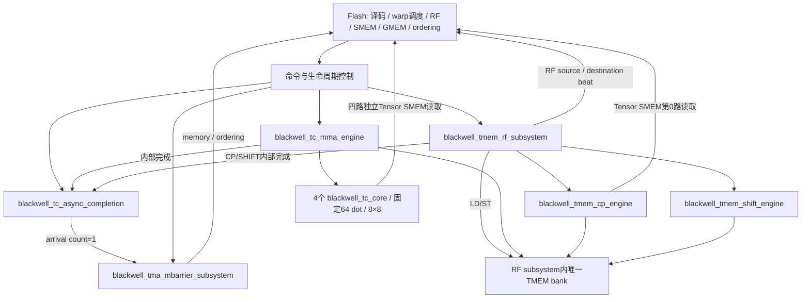

# blackwell_async_subsystem_top

> 规范版本 v1.0

## 1. 模块概述

单CTA异步执行后端顶层：MMA engine、TMEM RF subsystem（含CP/SHIFT）、TC async completion和TMA/mbarrier subsystem。它接受Flash已译码命令，执行完整后端状态与数据操作；不是PTX/SASS decoder。物理TMEM和mbarrier各唯一。



MMA/LDST/CP/SHIFT中只允许一个数据命令拥有TMEM执行权，命令轮询、不抢占；TMA独立执行，共用Flash SMEM。Flash负责predication、warp到齐、跨线程同步、RF依赖、地址空间、cache/DRAM及ordering兑现；成功alloc响应的base由Flash组装为lane=0的taddr并写入PTX要求的SMEM结果地址，RTL保留唯一allocation/owner状态；descriptor/layout取数、TMEM、barrier和完成跟踪在RTL。Flash通过本接口驱动后端，不另行维护TMEM/barrier状态。

子模块规范：[blackwell_tc_mma_engine](../tensor_core/blackwell_tc_mma_engine.md)、[blackwell_tmem_rf_subsystem](../tmem/blackwell_tmem_rf_subsystem.md)、[blackwell_tc_async_completion](../tensor_core/blackwell_tc_async_completion.md)、[blackwell_tma_mbarrier_subsystem](blackwell_tma_mbarrier_subsystem.md)。

### 微架构与资源

默认只有1个TMEM数据命令owner，MMA/LDST/CP/SHIFT四路有界round-robin，eligible向量选index而非宽payload旋转；新命令接受时同时预留tracker单槽、执行槽与通知槽。数据独占权到内部complete/finish退休后释放。无竞争且资源可用dispatch L=0、II最小1，完整命令吞吐受对应执行/通知credit限制。

一个CTA SMEM namespace由成功ctx create响应绑定ctx/epoch，切换前完成flush/invalidate与旧响应隔离；bank仍保留32个编码context槽和唯一权限状态。top只保存namespace及执行route，不保存对象状态镜像。TMA/bar有一个32B口；Tensor SMEM有四个独立32B读口；MMA按M128/M64/M32仅启用TC0–3/TC0–1/TC0的对应端口，其余请求valid为0；CP只使用第0路，其余三路无请求。默认五路共享一个32B/cycle公平服务，另测四Tensor口无冲突各32B/cycle；均由Flash对同一份SMEM按真实bank/端口仲裁。

生命周期控制分QUIESCE→FLUSH→MANAGE：停止新发射、继续producer退休；确认所有外部/内部已接受任务排空后请求barrier flush；成功后允许ctx回收。flush失败仍退休请求并记录status，drained可为1，但destroy通过RF管理错误路径返回失败且context不释放。全后端静默复位可以丢弃faulted cache控制状态，前提是Flash隔离所有旧响应并重新INIT对象。普通alloc/free管理不改变SMEM namespace；新CTA创建绑定不得越过旧namespace回收。

所有资源与时序的默认值见[微架构配置](../common/interfaces.md#微架构配置与性能约束)。周期从接受边沿计至结果首次有效；延迟式另加实际背压和外部响应等待。payload 不复位，valid、credit 和身份有效性复位；clock enable 随实际推进，SRAM 仅启用有效 bank。

## 2. 接口定义

全部握手、身份、完成、错误和复位遵循[公共规则](../common/interfaces.md#握手身份与生命周期)；表内位宽单位为 bit，符号见[公用位宽配置](../common/interfaces.md#公用位宽配置)，参数项注明默认配置。无握手的组合输出随输入变化；有握手的流水输出按所属通道保持。

四路Tensor读口各7bit本地ID原样传递，以(端口编号,本地ID)匹配，可同时使用相同ID；端口i为`[i*W+:W]`、端口0在低位。MMA/CP命令级互斥，全部在途请求属于稳定的执行owner，响应按该owner路由，不按瞬时请求grant路由。活动引擎唯一维护live ID及阶段检查，ID退休前不复用；顶层不建立逐ID owner表或live ID镜像。完成及owner切换必须等待全部已发请求和held请求／响应退休；无owner或非法响应按公共协议错误处理。TMA/bar的独立并发口仍按聚合ID来源位路由。

MMA仅启动并汇总M/32个活动core，未启动实例保持idle且不产生局部done；各活动core保存完整32行A，以8列N块为外层、四个8行块为内层。B双槽供当前N复用／下一N预取；独立1024B旧C以两笔512B直接返回装满，第四行块dot接受后才复用B/C。A原始数据在最后N消费及必要ashift读取后释放。父MMA使用同一bank口按布局合并32-bank请求，顶层不新增存储或端口。core局部done不释放全局执行权；父MMA还须排空全部写ACK、交付及ashift，产生指令级complete后才能切owner。

MMA owner时四路直接连接各core；CP owner时CP接第0路，端口1..3请求valid=0，响应仍依公共规则检查而不能静默丢弃。owner切换等待四路held/在途响应全部退休。

完整 packed payload 见[共享接口](../common/interfaces.md)，规范端口逐项定义如下。request/response地址和data分别GMEM64/1024、SMEM32/256；TMA/bar口和Tensor读口最终访问同一个SMEM，Flash必须按真实端口占用仲裁，不能按payload宽度额外复制memory状态。

登记、完成槽、DONE及对象状态遵循[唯一归属规则](../common/interfaces.md#状态登记与缓冲归属)。LD/ST登记随RF cmd_fire由RF subsystem执行，顶层只授予命令；CP/SHIFT内部完成及DONE直接连接RF输出，顶层不再保存通知副本。MMA DONE由顶层唯一保存。

### 仲裁与生命周期

轮询候选仅为实际eligible的MMA、LDST、CP、SHIFT；授予时同时预留执行、完成tracker和通知槽，外部命令fire与内部登记/dispatch原子发生。不允许仅凭外部valid提前登记。TC commit和方向wait不被TMEM数据独占阻塞。

management_pending包含外部管理请求及已接受但ctrl_rsp未消费的控制事务；按stop规则先禁止新的外部发射，继续完成与响应。管理valid/payload直通RF，RF以management_enable_i=MANAGE限制ready，management_status_i携带匹配的flush结果，避免撤回被反压的valid。管理窗口需生产者和返回排空，namespace回收还需flush成功；alloc无空间时不给它独占pending窗口，仍允许free。普通通知长时间反压可阻塞后续同类接受，但不阻塞已接受操作的commit/wait依赖退休。stop停止新的外部执行命令/登记；全后端drained后仍开放TMEM管理与ctrl_rsp。内部TC arrival、TMA tx和普通async completion始终开放。idle不代表安全销毁，drained才覆盖held通知及所有外部在途访问。

thread fence由Flash执行线程侧顺序约束：before防止该线程此前访问越过后续tcgen05；after防止后续访问越过此前tcgen05访问。它们不是隐式等待MMA完成：Flash须先使用commit+mbarrier wait或方向wait满足所需完成，再建立fence与跨线程同步。SMEM generic→async发布使用真实proxy ordering服务，不能只等MMA done。前端保证官方隐式pipelined指令对的程序序；命令串行执行满足所需数据依赖。

### 输入信号

| 接口名 | 位宽 | 说明 |
| --- | --- | --- |
| `clk` | 1 | 公共上升沿时钟。 |
| `rst_n` | 1 | 低有效异步复位，释放同步；控制状态与外部旧响应隔离见共享规则。 |
| `mma_cmd_vld_i` | 1 | `mma_cmd` 通道有效；握手通道遵循共享 vld/rdy 规则。 |
| `mma_cmd_i` | `MMA_CMD_A1_W` | MMA 命令；packed `mma_cmd_a1_t`，见[共享字段](../common/interfaces.md#mma-命令)。 |
| `mma_done_rdy_i` | 1 | `mma_done` 通道接受能力；仅与对应 vld 同拍为 1 时接受。 |
| `tc_commit_vld_i` | 1 | `tc_commit` 通道有效；握手通道遵循共享 vld/rdy 规则。 |
| `tc_commit_i` | `TC_COMMIT_A1_W` | TC commit；packed `tc_commit_a1_t`，见[共享字段](../common/interfaces.md#身份与事件字段)。 |
| `tc_event_rdy_i` | 1 | `tc_event` 通道接受能力；仅与对应 vld 同拍为 1 时接受。 |
| `ctx_vld_i` | 1 | `ctx` 通道有效；握手通道遵循共享 vld/rdy 规则。 |
| `ctx_id_i` | `CTX_ID_W` | 物理 context 槽编号；与 epoch 共同检查权限。 |
| `ctx_epoch_i` | `EPOCH_W` | context 生命周期编号；须与 live context 及 owner 记录匹配。 |
| `ctx_tag_i` | `ASYNC_TAG_W` | 请求 tag；响应原样恢复，不能单独作为跨 epoch 唯一身份。 |
| `ctx_create_i` | 1 | 1 创建 context，0 销毁；销毁前必须排空且无 owned 列。 |
| `alloc_vld_i` | 1 | `alloc` 通道有效；握手通道遵循共享 vld/rdy 规则。 |
| `alloc_ctx_i` | `CTX_ID_W` | 物理 context 槽编号；与 epoch 共同检查权限。 |
| `alloc_epoch_i` | `EPOCH_W` | context 生命周期编号；须与 live context 及 owner 记录匹配。 |
| `alloc_tag_i` | `ASYNC_TAG_W` | 请求 tag；响应原样恢复，不能单独作为跨 epoch 唯一身份。 |
| `alloc_columns_i` | `TMEM_COLUMNS_COUNT_W` | 列数，单位 column；alloc 为 32/64/128/256/512，free 范围按 32 对齐。 |
| `free_vld_i` | 1 | `free` 通道有效；握手通道遵循共享 vld/rdy 规则。 |
| `free_ctx_i` | `CTX_ID_W` | 物理 context 槽编号；与 epoch 共同检查权限。 |
| `free_epoch_i` | `EPOCH_W` | context 生命周期编号；须与 live context 及 owner 记录匹配。 |
| `free_tag_i` | `ASYNC_TAG_W` | 请求 tag；响应原样恢复，不能单独作为跨 epoch 唯一身份。 |
| `free_base_i` | `TMEM_COLUMN_INDEX_W` | TMEM column 起点，单位 column；alloc 成功响应返回分配起点。 |
| `free_columns_i` | `TMEM_COLUMNS_COUNT_W` | 列数，单位 column；alloc 为 32/64/128/256/512，free 范围按 32 对齐。 |
| `relinquish_vld_i` | 1 | `relinquish` 通道有效；握手通道遵循共享 vld/rdy 规则。 |
| `relinquish_ctx_i` | `CTX_ID_W` | 物理 context 槽编号；与 epoch 共同检查权限。 |
| `relinquish_epoch_i` | `EPOCH_W` | context 生命周期编号；须与 live context 及 owner 记录匹配。 |
| `relinquish_tag_i` | `ASYNC_TAG_W` | 请求 tag；响应原样恢复，不能单独作为跨 epoch 唯一身份。 |
| `ctrl_rsp_rdy_i` | 1 | `ctrl_rsp` 通道接受能力；仅与对应 vld 同拍为 1 时接受。 |
| `rf_cmd_vld_i` | 1 | `rf_cmd` 通道有效；握手通道遵循共享 vld/rdy 规则。 |
| `rf_cmd_store_i` | 1 | 1 为 ST 方向，0 为 LD 方向；wait/finish/DONE 按此匹配。 |
| `rf_cmd_ctx_i` | `CTX_ID_W` | 物理 context 槽编号；与 epoch 共同检查权限。 |
| `rf_cmd_epoch_i` | `EPOCH_W` | context 生命周期编号；须与 live context 及 owner 记录匹配。 |
| `rf_cmd_warp_i` | `WARP_ID_W` | warp 编号；RF 方向 wait 按 warp 匹配，数据路径低 2 bit 选 TMEM 分区。 |
| `rf_cmd_shape_i` | 3 | RF shape：0=32x32b，1=16x64b，2=16x128b，3=16x256b，4=16x32bx2。 |
| `rf_cmd_repeat_i` | `RF_REPEAT_W` | 重复次数，1..128 的 2 次幂；shape2 最大 64，shape3 最大 32。 |
| `rf_cmd_pack16_i` | 1 | LD 为 pack16，ST 为 unpack16；决定双 cell 访问和低 16 bit 写 mask。 |
| `rf_cmd_half_offset_i` | `TMEM_HALF_OFFSET_W` | 16x32bx2 的 column 偏移；不乘 4，也不随 pack16 再乘 2。 |
| `rf_cmd_tag_i` | `ASYNC_TAG_W` | 请求 tag；响应原样恢复，不能单独作为跨 epoch 唯一身份。 |
| `rf_cmd_base_addr_i` | `TMEM_ADDR_W` | TMEM 地址，[31:16]=lane，[15:0]=column；完整检查后取物理索引。 |
| `rf_src_vld_i` | 1 | `rf_src` 通道有效；握手通道遵循共享 vld/rdy 规则。 |
| `rf_src_data_i` | `RF_BEAT_W` | 32 thread × 32 bit RF 寄存器向量；低位为 thread0。 |
| `rf_src_last_i` | 1 | 最后 RF beat 标志，必须与命令规定的向量数一致。 |
| `rf_dst_rdy_i` | 1 | `rf_dst` 通道接受能力；仅与对应 vld 同拍为 1 时接受。 |
| `rf_done_rdy_i` | 1 | `rf_done` 通道接受能力；仅与对应 vld 同拍为 1 时接受。 |
| `rf_wait_vld_i` | 1 | `rf_wait` 通道有效；握手通道遵循共享 vld/rdy 规则。 |
| `rf_wait_ctx_i` | `CTX_ID_W` | 物理 context 槽编号；与 epoch 共同检查权限。 |
| `rf_wait_epoch_i` | `EPOCH_W` | context 生命周期编号；须与 live context 及 owner 记录匹配。 |
| `rf_wait_warp_i` | `WARP_ID_W` | warp 编号；RF 方向 wait 按 warp 匹配，数据路径低 2 bit 选 TMEM 分区。 |
| `rf_wait_store_i` | 1 | 1 为 ST 方向，0 为 LD 方向；wait/finish/DONE 按此匹配。 |
| `rf_wait_tag_i` | `ASYNC_TAG_W` | 请求 tag；响应原样恢复，不能单独作为跨 epoch 唯一身份。 |
| `rf_wait_rsp_rdy_i` | 1 | `rf_wait_rsp` 通道接受能力；仅与对应 vld 同拍为 1 时接受。 |
| `tma_cmd_vld_i` | 1 | `tma_cmd` 通道有效；握手通道遵循共享 vld/rdy 规则。 |
| `tma_cmd_i` | `TMA_CMD_W` | TMA/descriptor 控制命令；packed `tma_cmd_t`，见[共享字段](../common/interfaces.md#tma-命令与响应)。 |
| `tma_rsp_rdy_i` | 1 | `tma_rsp` 通道接受能力；仅与对应 vld 同拍为 1 时接受。 |
| `bar_cmd_vld_i` | 1 | `bar_cmd` 通道有效；握手通道遵循共享 vld/rdy 规则。 |
| `bar_cmd_i` | `BAR_CMD_W` | barrier 命令；TC 路径仅 count=1 ARRIVE 或 FAULT；packed `bar_cmd_t`，见[共享字段](../common/interfaces.md#barrier-命令与响应)。 |
| `bar_rsp_rdy_i` | 1 | `bar_rsp` 通道接受能力；仅与对应 vld 同拍为 1 时接受。 |
| `tma_order_req_rdy_i` | 1 | `tma_order_req` 通道接受能力；仅与对应 vld 同拍为 1 时接受。 |
| `tma_order_rsp_vld_i` | 1 | `tma_order_rsp` 通道有效；握手通道遵循共享 vld/rdy 规则。 |
| `tma_order_rsp_i` | `BW_ORDER_RSP_W` | ordering 确认，ID 精确匹配；packed `bw_order_rsp_t`，见[共享字段](../common/interfaces.md#内存属性与-ordering)。 |
| `bar_order_req_rdy_i` | 1 | `bar_order_req` 通道接受能力；仅与对应 vld 同拍为 1 时接受。 |
| `bar_order_rsp_vld_i` | 1 | `bar_order_rsp` 通道有效；握手通道遵循共享 vld/rdy 规则。 |
| `bar_order_rsp_i` | `BW_ORDER_RSP_W` | ordering 确认，ID 精确匹配；packed `bw_order_rsp_t`，见[共享字段](../common/interfaces.md#内存属性与-ordering)。 |
| `gmem_req_rdy_i` | 1 | `gmem_req` 通道接受能力；仅与对应 vld 同拍为 1 时接受。 |
| `gmem_rsp_vld_i` | 1 | `gmem_rsp` 通道有效；握手通道遵循共享 vld/rdy 规则。 |
| `gmem_rsp_data_i` | `GMEM_DATA_W` | memory 读返回行数据；data[8*j+:8] 对应请求 addr+j，未选读 byte 返回 0。 |
| `gmem_rsp_status_i` | `MEM_STATUS_W` | memory 状态，0 成功、非 0 失败。 |
| `gmem_rsp_id_i` | `GMEM_ID_DEFAULT_W` | 所属 memory 通道事务 ID；live ID 未退休前不复用，响应按 ID 匹配。 |
| `smem_req_rdy_i` | 1 | `smem_req` 通道接受能力；仅与对应 vld 同拍为 1 时接受。 |
| `smem_rsp_vld_i` | 1 | `smem_rsp` 通道有效；握手通道遵循共享 vld/rdy 规则。 |
| `smem_rsp_data_i` | `SMEM_DATA_W` | memory 读返回行数据；data[8*j+:8] 对应请求 addr+j，未选读 byte 返回 0。 |
| `smem_rsp_status_i` | `MEM_STATUS_W` | memory 状态，0 成功、非 0 失败。 |
| `smem_rsp_id_i` | `SUBSYSTEM_SMEM_ID_DEFAULT_W` | 所属 memory 通道事务 ID；live ID 未退休前不复用，响应按 ID 匹配。 |
| `mma_smem_req_rdy_i` | `TC_COUNT * 1` | 四路独立切片；`mma_smem_req` 通道接受能力；仅与对应 vld 同拍为 1 时接受。 |
| `mma_smem_rsp_vld_i` | `TC_COUNT * 1` | 四路独立切片；`mma_smem_rsp` 通道有效；握手通道遵循共享 vld/rdy 规则。 |
| `mma_smem_rsp_data_i` | `TC_COUNT * SMEM_DATA_W` | 四路独立切片；memory 读返回行数据；data[8*j+:8] 对应请求 addr+j，未选读 byte 返回 0。 |
| `mma_smem_rsp_id_i` | `TC_COUNT * TENSOR_SMEM_ID_W` | 四路独立切片；所属 memory 通道事务 ID；live ID 未退休前不复用，响应按 ID 匹配。 |
| `mma_smem_rsp_status_i` | `TC_COUNT * MEM_STATUS_W` | 四路独立切片；memory 状态，0 成功、非 0 失败。 |
| `cp_cmd_vld_i` | 1 | `cp_cmd` 通道有效；握手通道遵循共享 vld/rdy 规则。 |
| `cp_cmd_i` | `CP_CMD_A1_W` | CP 命令；packed `cp_cmd_a1_t`，见[共享字段](../common/interfaces.md#cp-命令)。 |
| `shift_cmd_vld_i` | 1 | `shift_cmd` 通道有效；握手通道遵循共享 vld/rdy 规则。 |
| `shift_cmd_i` | `SHIFT_CMD_A1_W` | SHIFT 命令；packed `shift_cmd_a1_t`，见[共享字段](../common/interfaces.md#shift-命令)。 |
| `cp_done_rdy_i` | 1 | `cp_done` 通道接受能力；仅与对应 vld 同拍为 1 时接受。 |
| `shift_done_rdy_i` | 1 | `shift_done` 通道接受能力；仅与对应 vld 同拍为 1 时接受。 |
| `async_req_vld_i` | 1 | `async_req` 通道有效；握手通道遵循共享 vld/rdy 规则。 |
| `async_req_i` | `BW_ASYNC_REQ_W` | 普通 cp.async 登记/完成请求；packed `bw_async_req_t`，见[共享字段](../common/interfaces.md#普通-async-登记与完成)。 |
| `async_cpl_req_vld_i` | 1 | `async_cpl_req` 通道有效；握手通道遵循共享 vld/rdy 规则。 |
| `async_cpl_req_i` | `BW_ASYNC_REQ_W` | 普通 cp.async 独立完成入口，不受登记表满阻塞；packed `bw_async_req_t`，见[共享字段](../common/interfaces.md#普通-async-登记与完成)。 |
| `async_rsp_rdy_i` | 1 | `async_rsp` 通道接受能力；仅与对应 vld 同拍为 1 时接受。 |
| `report_req_vld_i` | 1 | `report_req` 通道有效；握手通道遵循共享 vld/rdy 规则。 |
| `report_req_i` | `BAR_REPORT_REQ_W` | 独立 report-on 请求；packed `bar_report_req_t`，见[共享字段](../common/interfaces.md#barrier-命令与响应)。 |
| `report_rsp_rdy_i` | 1 | `report_rsp` 通道接受能力；仅与对应 vld 同拍为 1 时接受。 |
| `stop_i` | 1 | 置 1 停止新的外部命令或登记；已接受工作、生产者完成和响应继续推进。 |

### 输出信号

| 接口名 | 位宽 | 说明 |
| --- | --- | --- |
| `mma_cmd_rdy_o` | 1 | `mma_cmd` 通道接受能力；仅与对应 vld 同拍为 1 时接受。 |
| `mma_done_vld_o` | 1 | `mma_done` 通道有效；握手通道遵循共享 vld/rdy 规则。 |
| `mma_done_o` | `ASYNC_EVENT_A1_W` | 普通完成通知，独立响应槽保持到握手；packed `async_event_a1_t`，见[共享字段](../common/interfaces.md#身份与事件字段)。 |
| `tc_commit_rdy_o` | 1 | `tc_commit` 通道接受能力；仅与对应 vld 同拍为 1 时接受。 |
| `tc_event_vld_o` | 1 | `tc_event` 通道有效；握手通道遵循共享 vld/rdy 规则。 |
| `tc_event_o` | `ASYNC_EVENT_A1_W` | barrier 缓存状态提交后的 TC 通知；packed `async_event_a1_t`，见[共享字段](../common/interfaces.md#身份与事件字段)。 |
| `tc_protocol_error_o` | 1 | 协议错误指示：未知/重复完成、身份或域不匹配；不得退休其他操作。 |
| `ctx_rdy_o` | 1 | `ctx` 通道接受能力；仅与对应 vld 同拍为 1 时接受。 |
| `alloc_rdy_o` | 1 | `alloc` 通道接受能力；仅与对应 vld 同拍为 1 时接受。 |
| `free_rdy_o` | 1 | `free` 通道接受能力；仅与对应 vld 同拍为 1 时接受。 |
| `relinquish_rdy_o` | 1 | `relinquish` 通道接受能力；仅与对应 vld 同拍为 1 时接受。 |
| `ctrl_rsp_vld_o` | 1 | `ctrl_rsp` 通道有效；握手通道遵循共享 vld/rdy 规则。 |
| `ctrl_rsp_tag_o` | `ASYNC_TAG_W` | 请求 tag；响应原样恢复，不能单独作为跨 epoch 唯一身份。 |
| `ctrl_rsp_status_o` | `STATUS_W` | 模块诊断状态，0 成功、非 0 失败；错误完成不得伪装成功。 |
| `ctrl_rsp_base_o` | `TMEM_COLUMN_INDEX_W` | TMEM column 起点，单位 column；alloc 成功响应返回分配起点。 |
| `rf_cmd_rdy_o` | 1 | `rf_cmd` 通道接受能力；仅与对应 vld 同拍为 1 时接受。 |
| `rf_src_rdy_o` | 1 | `rf_src` 通道接受能力；仅与对应 vld 同拍为 1 时接受。 |
| `rf_dst_vld_o` | 1 | `rf_dst` 通道有效；握手通道遵循共享 vld/rdy 规则。 |
| `rf_dst_data_o` | `RF_BEAT_W` | 32 thread × 32 bit RF 寄存器向量；低位为 thread0。 |
| `rf_dst_index_o` | `RF_INDEX_W` | RF 寄存器向量索引，范围 0..127，起始为 0，逐 beat 递增；vector 数量最大 128。 |
| `rf_dst_last_o` | 1 | 最后 RF beat 标志，必须与命令规定的向量数一致。 |
| `rf_done_vld_o` | 1 | `rf_done` 通道有效；握手通道遵循共享 vld/rdy 规则。 |
| `rf_done_tag_o` | `ASYNC_TAG_W` | 请求 tag；响应原样恢复，不能单独作为跨 epoch 唯一身份。 |
| `rf_done_store_o` | 1 | 1 为 ST 方向，0 为 LD 方向；wait/finish/DONE 按此匹配。 |
| `rf_done_status_o` | `STATUS_W` | 模块诊断状态，0 成功、非 0 失败；错误完成不得伪装成功。 |
| `rf_wait_rdy_o` | 1 | `rf_wait` 通道接受能力；仅与对应 vld 同拍为 1 时接受。 |
| `rf_wait_protocol_error_o` | 1 | 协议错误指示：未知/重复完成、身份或域不匹配；不得退休其他操作。 |
| `rf_wait_rsp_vld_o` | 1 | `rf_wait_rsp` 通道有效；握手通道遵循共享 vld/rdy 规则。 |
| `rf_wait_rsp_ctx_o` | `CTX_ID_W` | 物理 context 槽编号；与 epoch 共同检查权限。 |
| `rf_wait_rsp_epoch_o` | `EPOCH_W` | context 生命周期编号；须与 live context 及 owner 记录匹配。 |
| `rf_wait_rsp_warp_o` | `WARP_ID_W` | warp 编号；RF 方向 wait 按 warp 匹配，数据路径低 2 bit 选 TMEM 分区。 |
| `rf_wait_rsp_store_o` | 1 | 1 为 ST 方向，0 为 LD 方向；wait/finish/DONE 按此匹配。 |
| `rf_wait_rsp_tag_o` | `ASYNC_TAG_W` | 请求 tag；响应原样恢复，不能单独作为跨 epoch 唯一身份。 |
| `rf_wait_rsp_status_o` | `STATUS_W` | 模块诊断状态，0 成功、非 0 失败；错误完成不得伪装成功。 |
| `tma_cmd_rdy_o` | 1 | `tma_cmd` 通道接受能力；仅与对应 vld 同拍为 1 时接受。 |
| `tma_rsp_vld_o` | 1 | `tma_rsp` 通道有效；握手通道遵循共享 vld/rdy 规则。 |
| `tma_rsp_o` | `TMA_RSP_W` | TMA 响应，bytes 为逻辑 payload 字节数；packed `tma_rsp_t`，见[共享字段](../common/interfaces.md#tma-命令与响应)。 |
| `bar_cmd_rdy_o` | 1 | `bar_cmd` 通道接受能力；仅与对应 vld 同拍为 1 时接受。 |
| `bar_rsp_vld_o` | 1 | `bar_rsp` 通道有效；握手通道遵循共享 vld/rdy 规则。 |
| `bar_rsp_o` | `BAR_RSP_W` | barrier 响应，成功 wait 还需 wait_complete=1；packed `bar_rsp_t`，见[共享字段](../common/interfaces.md#barrier-命令与响应)。 |
| `tma_order_req_vld_o` | 1 | `tma_order_req` 通道有效；握手通道遵循共享 vld/rdy 规则。 |
| `tma_order_req_o` | `BW_ORDER_REQ_W` | ordering 请求，确认须兑现对应 seq/proxy/scope 可见性；packed `bw_order_req_t`，见[共享字段](../common/interfaces.md#内存属性与-ordering)。 |
| `tma_order_rsp_rdy_o` | 1 | `tma_order_rsp` 通道接受能力；仅与对应 vld 同拍为 1 时接受。 |
| `bar_order_req_vld_o` | 1 | `bar_order_req` 通道有效；握手通道遵循共享 vld/rdy 规则。 |
| `bar_order_req_o` | `BW_ORDER_REQ_W` | ordering 请求，确认须兑现对应 seq/proxy/scope 可见性；packed `bw_order_req_t`，见[共享字段](../common/interfaces.md#内存属性与-ordering)。 |
| `bar_order_rsp_rdy_o` | 1 | `bar_order_rsp` 通道接受能力；仅与对应 vld 同拍为 1 时接受。 |
| `gmem_req_vld_o` | 1 | `gmem_req` 通道有效；握手通道遵循共享 vld/rdy 规则。 |
| `gmem_req_addr_o` | `GMEM_ADDR_W` | GMEM byte 地址，128B 对齐；禁止截断 overflow。 |
| `gmem_req_data_o` | `GMEM_DATA_W` | memory 行数据；data[8*j+:8] 对应 addr+j，写 mask 为 0 的 byte 保持。 |
| `gmem_req_byte_mask_o` | `GMEM_MASK_W` | memory byte mask；bit j 选择 addr+j 的实际访问，未选读 byte 返回 0。 |
| `gmem_req_id_o` | `GMEM_ID_DEFAULT_W` | 所属 memory 通道事务 ID；live ID 未退休前不复用，响应按 ID 匹配。 |
| `gmem_req_write_o` | 1 | 1 为写请求，0 为读请求；访问语义同时受 attr.kind 约束。 |
| `gmem_req_attr_o` | `BW_MEM_ATTR_W` | 内存访问属性，随请求保持；packed `bw_mem_attr_t`，见[共享字段](../common/interfaces.md#内存属性与-ordering)。 |
| `gmem_rsp_rdy_o` | 1 | `gmem_rsp` 通道接受能力；仅与对应 vld 同拍为 1 时接受。 |
| `smem_req_vld_o` | 1 | `smem_req` 通道有效；握手通道遵循共享 vld/rdy 规则。 |
| `smem_req_addr_o` | `SMEM_BYTE_ADDR_W` | SMEM/backing byte 地址，32B 行对齐；禁止截断 overflow。 |
| `smem_req_data_o` | `SMEM_DATA_W` | memory 行数据；data[8*j+:8] 对应 addr+j，写 mask 为 0 的 byte 保持。 |
| `smem_req_byte_mask_o` | `SMEM_MASK_W` | memory byte mask；bit j 选择 addr+j 的实际访问，未选读 byte 返回 0。 |
| `smem_req_id_o` | `SUBSYSTEM_SMEM_ID_DEFAULT_W` | 所属 memory 通道事务 ID；live ID 未退休前不复用，响应按 ID 匹配。 |
| `smem_req_write_o` | 1 | 1 为写请求，0 为读请求；访问语义同时受 attr.kind 约束。 |
| `smem_req_attr_o` | `BW_MEM_ATTR_W` | 内存访问属性，随请求保持；packed `bw_mem_attr_t`，见[共享字段](../common/interfaces.md#内存属性与-ordering)。 |
| `smem_rsp_rdy_o` | 1 | `smem_rsp` 通道接受能力；仅与对应 vld 同拍为 1 时接受。 |
| `mma_smem_req_vld_o` | `TC_COUNT * 1` | 四路独立切片；`mma_smem_req` 通道有效；握手通道遵循共享 vld/rdy 规则。 |
| `mma_smem_req_addr_o` | `TC_COUNT * SMEM_BYTE_ADDR_W` | 四路独立切片；SMEM/backing byte 地址，32B 行对齐；禁止截断 overflow。 |
| `mma_smem_req_id_o` | `TC_COUNT * TENSOR_SMEM_ID_W` | 四路独立切片；所属 memory 通道事务 ID；live ID 未退休前不复用，响应按 ID 匹配。 |
| `mma_smem_req_byte_mask_o` | `TC_COUNT * SMEM_MASK_W` | 四路独立切片；memory byte mask；bit j 选择 addr+j 的实际访问，未选读 byte 返回 0。 |
| `mma_smem_rsp_rdy_o` | `TC_COUNT * 1` | 四路独立切片；`mma_smem_rsp` 通道接受能力；仅与对应 vld 同拍为 1 时接受。 |
| `cp_cmd_rdy_o` | 1 | `cp_cmd` 通道接受能力；仅与对应 vld 同拍为 1 时接受。 |
| `shift_cmd_rdy_o` | 1 | `shift_cmd` 通道接受能力；仅与对应 vld 同拍为 1 时接受。 |
| `cp_done_vld_o` | 1 | `cp_done` 通道有效；握手通道遵循共享 vld/rdy 规则。 |
| `cp_done_o` | `ASYNC_EVENT_A1_W` | 普通完成通知，独立响应槽保持到握手；packed `async_event_a1_t`，见[共享字段](../common/interfaces.md#身份与事件字段)。 |
| `shift_done_vld_o` | 1 | `shift_done` 通道有效；握手通道遵循共享 vld/rdy 规则。 |
| `shift_done_o` | `ASYNC_EVENT_A1_W` | 普通完成通知，独立响应槽保持到握手；packed `async_event_a1_t`，见[共享字段](../common/interfaces.md#身份与事件字段)。 |
| `async_req_rdy_o` | 1 | `async_req` 通道接受能力；仅与对应 vld 同拍为 1 时接受。 |
| `async_cpl_req_rdy_o` | 1 | `async_cpl_req` 通道接受能力；仅与对应 vld 同拍为 1 时接受。 |
| `async_rsp_vld_o` | 1 | `async_rsp` 通道有效；握手通道遵循共享 vld/rdy 规则。 |
| `async_rsp_o` | `BW_ASYNC_RSP_W` | 普通 cp.async 请求响应；packed `bw_async_rsp_t`，见[共享字段](../common/interfaces.md#普通-async-登记与完成)。 |
| `report_req_rdy_o` | 1 | `report_req` 通道接受能力；仅与对应 vld 同拍为 1 时接受。 |
| `report_rsp_vld_o` | 1 | `report_rsp` 通道有效；握手通道遵循共享 vld/rdy 规则。 |
| `report_rsp_o` | `BAR_RSP_W` | barrier 响应，成功 wait 还需 wait_complete=1；packed `bar_rsp_t`，见[共享字段](../common/interfaces.md#barrier-命令与响应)。 |
| `idle_o` | 1 | 无本模块执行或在途访问；具体统计范围见本节规则。 |
| `drained_o` | 1 | 本模块已接受工作及请求、响应保持槽全部排空；具体范围见本节规则。 |

## 3. 伪代码

### 发射与内部完成

```text
if management pending or stop: block new external execution/registration; keep completion paths running
rf.management_enable = (state==MANAGE); preserve external management valid/payload until fire
rf.management_status = matched flush status for destroy/namespace switch, otherwise OK
else when TMEM owner free:
    choose eligible MMA/LDST/CP/SHIFT by round-robin
    on external_cmd_fire:
        reserve all required credits; capture payload; grant owner
        if MMA/CP/SHIFT: register TC op exactly once in top
        dispatch once; RF registers LD/ST direction op on matching RF cmd_fire
on MMA_complete_fire: retire TC dependency; enqueue reserved MMA DONE; release owner
on CP/SHIFT_complete_fire: retire TC dependency; RF enqueues its DONE; release owner
on LD/ST_finish_fire in RF: retire direction dependency; RF enqueues its DONE; release owner
forward RF DONE/wait/control outputs without another response buffer
TC commit snapshots tracker → local commit control → barrier dedicated arrival → TC event
direction wait snapshots RF ops → wait response
idle = mma.idle && rf.idle && tc.idle && tma_bar.idle
drained = mma.idle && rf.drained && tc.drained && tma_bar.drained
          && no MMA DONE/held port grant or execution owner
// RF.drained包含其LD/ST、CP、SHIFT DONE及bank/wait tracker状态；不再次保存这些状态
```

### 端到端合法流程

```text
create; alloc TMEM; init/publish mbarrier
publish generic SMEM producers to async proxy
barrier arrive_expect_tx(bytes); TMA load
TMA: source read → target write ack → release ack → complete_tx cache commit ack
Flash successful acquire mbarrier wait; issue MMA using completed SMEM tile
optional CP(A) → MMA(A from TMEM); optional SHIFT → later MMA using affected region
MMA/CP/SHIFT full writes ack → internal TC completion
TC commit → one barrier arrival; successful wait → after_thread_sync fence
TMEM LD → actual RF destination handshake → direction finish → wait::ld response
Flash uses released RF result for GMEM store
finish software barriers/groups; consume responses; stop; retire producers and notifications
flush current barrier namespace; require successful flush result for namespace reuse
dealloc all owned columns in management window; destroy; quiescent reset
```

### 异常和同拍规则

```text
invalid preflight: return one error; do not consume ST source or modify target
execution/backend/order failure: stop new requests; drain issued IDs; propagate failure
same-edge register+commit/wait: exclude newly registered op; frontend preserves program order
same-edge finish+snapshot: clear matching dependency and retain matching failure
stalled external DONE: preserve notification; internal commit/wait may still progress
old response after reset: frontend isolates it; never attach it to a reused ID
```

### 流水、资源与排空

```text
QUIESCE: stop external admission; keep TC/TMA/async completion and external responses running
when admitted operations/producer arrivals/outputs all retired: request flush(current_namespace,invalidate)
FLUSH: consume real flush result; retain failure status; no silent retry and no old dirty write after reuse
MANAGE: enable RF control handshake with management_status for matching lifecycle operation
        on flush failure: return error, do not destroy bank context or bind new namespace
        on success: process dealloc/destroy; bind new namespace only after successful create
drained means all admitted transactions and flush output retired; sticky failure does not count as work
```
