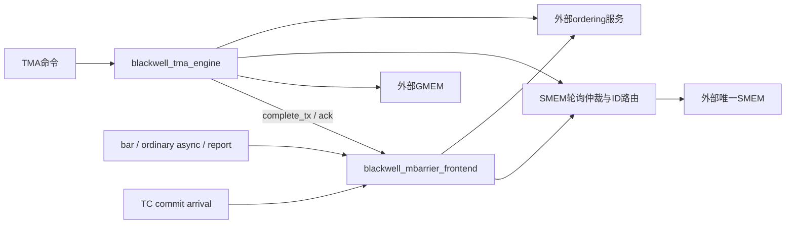

# blackwell_tma_mbarrier_subsystem

> 规范版本 v1.0

## 1. 模块概述

集成TMA engine与mbarrier frontend，把TMA complete_tx接到同一个barrier unit，并仲裁其SMEM请求。向子模块传递TMA queue8/cache4/MSHR16、bar cache4/writeback2/wait32/async16，资源各由权威子模块实例化一次；本层只承担连接、SMEM grant和ID来源编码，不增加FIFO、cache或响应副本。GMEM地址64/ID5、SMEM地址32/外部ID5，bar clock10ns/default-wait64。

TMA和barrier可独立推进；SMEM地址空间来自同一个Flash后端。模块不实现cache/DRAM/通用LSU，也不复制mbarrier状态。



子模块规范：[blackwell_tma_engine](../tma/blackwell_tma_engine.md)、[blackwell_mbarrier_frontend](../mbarrier/blackwell_mbarrier_frontend.md)。

### 微架构与资源

资源仅由TMA/data/bar子层实例化；本层1个held SMEM grant，producer bit与local ID组合编码。仲裁L=0、II=1，连续双方均eligible时每方最多等待1个实际SMEM request_fire；外部ready=0的等待不计该界。held grant的payload仍由选中子层保持，本层只锁索引。

flush与namespace从top传入frontend；accepted TMA工作继续发complete_tx直到TMA drained，不能因stop提前flush。tx response在cache commit后返回。idle/drained聚合子层，另外计算flush held请求/响应，flush status单独返回，不以drained代替成功。

所有资源与时序的默认值见[微架构配置](../common/interfaces.md#微架构配置与性能约束)。周期从接受边沿计至结果首次有效；延迟式另加实际背压和外部响应等待。payload 不复位，valid、credit 和身份有效性复位；clock enable 随实际推进，SRAM 仅启用有效 bank。

## 2. 接口定义

全部握手、身份、完成、错误和复位遵循[公共规则](../common/interfaces.md#握手身份与生命周期)；表内位宽单位为 bit，符号见[公用位宽配置](../common/interfaces.md#公用位宽配置)，参数项注明默认配置。无握手的组合输出随输入变化；有握手的流水输出按所属通道保持。

stop 限制 TMA engine 与 bar frontend 的外部新发射；已接受 ticket 向 child 的 dispatch、生产者完成及外部 response 继续运行。idle 只统计执行，drained 聚合 child 全部生命周期状态。

SMEM外部ID的最高bit为来源：0=TMA、1=barrier，其余bit零扩展local ID；默认TMA local4bit、bar local1bit，外部5bit足够。参数必须满足`SMEM_ID_W>=1+max(max(1,clog2(MSHR_ENTRIES)),BARRIER_MEM_ID_DEFAULT_W)`；barrier 的 ADDR_W 绑定 SMEM_ADDR_W。请求被反压时grant锁住且payload稳定，握手后轮询另一请求者；response按ID拆分，不因请求grant的owner而误路由。

bar memory 地址与聚合 SMEM byte 地址同为32bit；检查完整地址和访问范围后直接连接。bar attr为generic proxy、普通read/write、CTA scope；TMA attr原样传递。bar读mask直接转发unit的8B选择mask。tx_cpl/rsp为内部连接，不对外重复通知；TMA response必须等bar缓存提交确认。TMA/bar ordering分别独立通道，ID各自匹配。

### Namespace 与 flush

ctx/epoch同时传给TMA engine和bar frontend，父层仅在旧engine与barrier排空并flush/invalidate成功后切换；ctx/epoch在请求接受时绑定，top只在旧namespace flush/invalidate及响应隔离后切换。flush是stop/回收控制路径，前提为此前TC、TMA、ordinary async、deferred arrival和ordering均已退休。unit逐个写回dirty对象，flush结果保持到握手；frontend/subsystem只运输该通道。INVAL软件命令针对单对象，flush针对全部驻留对象。flush失败不撤销过去cache提交；保留sticky fault，后续相关操作失败，正常context回收被拒绝。故障本身不计作在途，失败flush退休后drained仍可成立。

### 输入信号

| 接口名 | 位宽 | 说明 |
| --- | --- | --- |
| `clk` | 1 | 公共上升沿时钟。 |
| `rst_n` | 1 | 低有效异步复位，释放同步；控制状态与外部旧响应隔离见共享规则。 |
| `tma_cmd_vld_i` | 1 | `tma_cmd` 通道有效；握手通道遵循共享 vld/rdy 规则。 |
| `tma_cmd_i` | `TMA_CMD_W` | TMA/descriptor 控制命令；packed `tma_cmd_t`，见[共享字段](../common/interfaces.md#tma-命令与响应)。 |
| `tma_rsp_rdy_i` | 1 | `tma_rsp` 通道接受能力；仅与对应 vld 同拍为 1 时接受。 |
| `gmem_req_rdy_i` | 1 | `gmem_req` 通道接受能力；仅与对应 vld 同拍为 1 时接受。 |
| `smem_req_rdy_i` | 1 | `smem_req` 通道接受能力；仅与对应 vld 同拍为 1 时接受。 |
| `tma_order_req_rdy_i` | 1 | `tma_order_req` 通道接受能力；仅与对应 vld 同拍为 1 时接受。 |
| `tma_order_rsp_vld_i` | 1 | `tma_order_rsp` 通道有效；握手通道遵循共享 vld/rdy 规则。 |
| `tma_order_rsp_i` | `BW_ORDER_RSP_W` | ordering 确认，ID 精确匹配；packed `bw_order_rsp_t`，见[共享字段](../common/interfaces.md#内存属性与-ordering)。 |
| `tc_arrive_vld_i` | 1 | `tc_arrive` 通道有效；握手通道遵循共享 vld/rdy 规则。 |
| `tc_arrive_i` | `BAR_CMD_W` | barrier 命令；TC 路径仅 count=1 ARRIVE 或 FAULT；packed `bar_cmd_t`，见[共享字段](../common/interfaces.md#barrier-命令与响应)。 |
| `tc_arrive_rsp_rdy_i` | 1 | `tc_arrive_rsp` 通道接受能力；仅与对应 vld 同拍为 1 时接受。 |
| `bar_cmd_vld_i` | 1 | `bar_cmd` 通道有效；握手通道遵循共享 vld/rdy 规则。 |
| `bar_cmd_i` | `BAR_CMD_W` | barrier 命令；TC 路径仅 count=1 ARRIVE 或 FAULT；packed `bar_cmd_t`，见[共享字段](../common/interfaces.md#barrier-命令与响应)。 |
| `bar_rsp_rdy_i` | 1 | `bar_rsp` 通道接受能力；仅与对应 vld 同拍为 1 时接受。 |
| `async_cpl_req_vld_i` | 1 | `async_cpl_req` 通道有效；握手通道遵循共享 vld/rdy 规则。 |
| `async_cpl_req_i` | `BW_ASYNC_REQ_W` | 普通 cp.async 独立完成入口，不受登记表满阻塞；packed `bw_async_req_t`，见[共享字段](../common/interfaces.md#普通-async-登记与完成)。 |
| `async_req_vld_i` | 1 | `async_req` 通道有效；握手通道遵循共享 vld/rdy 规则。 |
| `async_req_i` | `BW_ASYNC_REQ_W` | 普通 cp.async 登记/完成请求；packed `bw_async_req_t`，见[共享字段](../common/interfaces.md#普通-async-登记与完成)。 |
| `async_rsp_rdy_i` | 1 | `async_rsp` 通道接受能力；仅与对应 vld 同拍为 1 时接受。 |
| `report_req_vld_i` | 1 | `report_req` 通道有效；握手通道遵循共享 vld/rdy 规则。 |
| `report_req_i` | `BAR_REPORT_REQ_W` | 独立 report-on 请求；packed `bar_report_req_t`，见[共享字段](../common/interfaces.md#barrier-命令与响应)。 |
| `report_rsp_rdy_i` | 1 | `report_rsp` 通道接受能力；仅与对应 vld 同拍为 1 时接受。 |
| `bar_order_req_rdy_i` | 1 | `bar_order_req` 通道接受能力；仅与对应 vld 同拍为 1 时接受。 |
| `bar_order_rsp_vld_i` | 1 | `bar_order_rsp` 通道有效；握手通道遵循共享 vld/rdy 规则。 |
| `bar_order_rsp_i` | `BW_ORDER_RSP_W` | ordering 确认，ID 精确匹配；packed `bw_order_rsp_t`，见[共享字段](../common/interfaces.md#内存属性与-ordering)。 |
| `gmem_rsp_vld_i` | 1 | `gmem_rsp` 通道有效；握手通道遵循共享 vld/rdy 规则。 |
| `gmem_rsp_data_i` | `GMEM_DATA_W` | memory 读返回行数据；data[8*j+:8] 对应请求 addr+j，未选读 byte 返回 0。 |
| `gmem_rsp_status_i` | `MEM_STATUS_W` | memory 状态，0 成功、非 0 失败。 |
| `gmem_rsp_id_i` | `GMEM_ID_W`（默认 `GMEM_ID_DEFAULT_W`） | 所属 memory 通道事务 ID；live ID 未退休前不复用，响应按 ID 匹配。 |
| `smem_rsp_vld_i` | 1 | `smem_rsp` 通道有效；握手通道遵循共享 vld/rdy 规则。 |
| `smem_rsp_data_i` | `SMEM_DATA_W` | memory 读返回行数据；data[8*j+:8] 对应请求 addr+j，未选读 byte 返回 0。 |
| `smem_rsp_status_i` | `MEM_STATUS_W` | memory 状态，0 成功、非 0 失败。 |
| `smem_rsp_id_i` | `SMEM_ID_W`（默认 `SUBSYSTEM_SMEM_ID_DEFAULT_W`） | 所属 memory 通道事务 ID；live ID 未退休前不复用，响应按 ID 匹配。 |
| `stop_i` | 1 | 置 1 停止新的外部命令或登记；已接受工作、生产者完成和响应继续推进。 |
| `ctx_i` | `CTX_ID_W` | 当前CTA SMEM namespace，切换前旧namespace须安全退休。 |
| `epoch_i` | `EPOCH_W` | namespace生命周期；同一请求/返回保存接受时身份。 |
| `flush_req_vld_i` | 1 | 生命周期flush请求；此前producer必须已退休。 |
| `flush_req_ctx_i` | `CTX_ID_W` | 要flush的namespace，须匹配当前绑定。 |
| `flush_req_epoch_i` | `EPOCH_W` | flush目标生命周期。 |
| `flush_req_invalidate_i` | 1 | 1在写回成功后失效cache；0保留干净驻留对象。 |
| `flush_rsp_rdy_i` | 1 | 接收flush最终状态；响应未消费前不重复接受。 |

### 输出信号

| 接口名 | 位宽 | 说明 |
| --- | --- | --- |
| `tma_cmd_rdy_o` | 1 | `tma_cmd` 通道接受能力；仅与对应 vld 同拍为 1 时接受。 |
| `tma_rsp_vld_o` | 1 | `tma_rsp` 通道有效；握手通道遵循共享 vld/rdy 规则。 |
| `tma_rsp_o` | `TMA_RSP_W` | TMA 响应，bytes 为逻辑 payload 字节数；packed `tma_rsp_t`，见[共享字段](../common/interfaces.md#tma-命令与响应)。 |
| `gmem_req_vld_o` | 1 | `gmem_req` 通道有效；握手通道遵循共享 vld/rdy 规则。 |
| `gmem_req_attr_o` | `BW_MEM_ATTR_W` | 内存访问属性，随请求保持；packed `bw_mem_attr_t`，见[共享字段](../common/interfaces.md#内存属性与-ordering)。 |
| `gmem_req_addr_o` | `ADDR_W`（默认 `GMEM_ADDR_W`） | GMEM byte 地址，128B 对齐；禁止截断 overflow。 |
| `gmem_req_data_o` | `GMEM_DATA_W` | memory 行数据；data[8*j+:8] 对应 addr+j，写 mask 为 0 的 byte 保持。 |
| `gmem_req_byte_mask_o` | `GMEM_MASK_W` | memory byte mask；bit j 选择 addr+j 的实际访问，未选读 byte 返回 0。 |
| `gmem_req_id_o` | `GMEM_ID_W`（默认 `GMEM_ID_DEFAULT_W`） | 所属 memory 通道事务 ID；live ID 未退休前不复用，响应按 ID 匹配。 |
| `gmem_req_write_o` | 1 | 1 为写请求，0 为读请求；访问语义同时受 attr.kind 约束。 |
| `smem_req_vld_o` | 1 | `smem_req` 通道有效；握手通道遵循共享 vld/rdy 规则。 |
| `smem_req_attr_o` | `BW_MEM_ATTR_W` | 内存访问属性，随请求保持；packed `bw_mem_attr_t`，见[共享字段](../common/interfaces.md#内存属性与-ordering)。 |
| `smem_req_addr_o` | `SMEM_ADDR_W`（默认 `SMEM_BYTE_ADDR_W`） | SMEM/backing byte 地址，32B 行对齐；禁止截断 overflow。 |
| `smem_req_data_o` | `SMEM_DATA_W` | memory 行数据；data[8*j+:8] 对应 addr+j，写 mask 为 0 的 byte 保持。 |
| `smem_req_byte_mask_o` | `SMEM_MASK_W` | memory byte mask；bit j 选择 addr+j 的实际访问，未选读 byte 返回 0。 |
| `smem_req_id_o` | `SMEM_ID_W`（默认 `SUBSYSTEM_SMEM_ID_DEFAULT_W`） | 所属 memory 通道事务 ID；live ID 未退休前不复用，响应按 ID 匹配。 |
| `smem_req_write_o` | 1 | 1 为写请求，0 为读请求；访问语义同时受 attr.kind 约束。 |
| `tma_order_req_vld_o` | 1 | `tma_order_req` 通道有效；握手通道遵循共享 vld/rdy 规则。 |
| `tma_order_req_o` | `BW_ORDER_REQ_W` | ordering 请求，确认须兑现对应 seq/proxy/scope 可见性；packed `bw_order_req_t`，见[共享字段](../common/interfaces.md#内存属性与-ordering)。 |
| `tma_order_rsp_rdy_o` | 1 | `tma_order_rsp` 通道接受能力；仅与对应 vld 同拍为 1 时接受。 |
| `tc_arrive_rdy_o` | 1 | `tc_arrive` 通道接受能力；仅与对应 vld 同拍为 1 时接受。 |
| `tc_arrive_rsp_vld_o` | 1 | `tc_arrive_rsp` 通道有效；握手通道遵循共享 vld/rdy 规则。 |
| `tc_arrive_rsp_o` | `BAR_RSP_W` | barrier 响应，成功 wait 还需 wait_complete=1；packed `bar_rsp_t`，见[共享字段](../common/interfaces.md#barrier-命令与响应)。 |
| `bar_cmd_rdy_o` | 1 | `bar_cmd` 通道接受能力；仅与对应 vld 同拍为 1 时接受。 |
| `bar_rsp_vld_o` | 1 | `bar_rsp` 通道有效；握手通道遵循共享 vld/rdy 规则。 |
| `bar_rsp_o` | `BAR_RSP_W` | barrier 响应，成功 wait 还需 wait_complete=1；packed `bar_rsp_t`，见[共享字段](../common/interfaces.md#barrier-命令与响应)。 |
| `async_cpl_req_rdy_o` | 1 | `async_cpl_req` 通道接受能力；仅与对应 vld 同拍为 1 时接受。 |
| `async_req_rdy_o` | 1 | `async_req` 通道接受能力；仅与对应 vld 同拍为 1 时接受。 |
| `async_rsp_vld_o` | 1 | `async_rsp` 通道有效；握手通道遵循共享 vld/rdy 规则。 |
| `async_rsp_o` | `BW_ASYNC_RSP_W` | 普通 cp.async 请求响应；packed `bw_async_rsp_t`，见[共享字段](../common/interfaces.md#普通-async-登记与完成)。 |
| `report_req_rdy_o` | 1 | `report_req` 通道接受能力；仅与对应 vld 同拍为 1 时接受。 |
| `report_rsp_vld_o` | 1 | `report_rsp` 通道有效；握手通道遵循共享 vld/rdy 规则。 |
| `report_rsp_o` | `BAR_RSP_W` | barrier 响应，成功 wait 还需 wait_complete=1；packed `bar_rsp_t`，见[共享字段](../common/interfaces.md#barrier-命令与响应)。 |
| `bar_order_req_vld_o` | 1 | `bar_order_req` 通道有效；握手通道遵循共享 vld/rdy 规则。 |
| `bar_order_req_o` | `BW_ORDER_REQ_W` | ordering 请求，确认须兑现对应 seq/proxy/scope 可见性；packed `bw_order_req_t`，见[共享字段](../common/interfaces.md#内存属性与-ordering)。 |
| `bar_order_rsp_rdy_o` | 1 | `bar_order_rsp` 通道接受能力；仅与对应 vld 同拍为 1 时接受。 |
| `gmem_rsp_rdy_o` | 1 | `gmem_rsp` 通道接受能力；仅与对应 vld 同拍为 1 时接受。 |
| `smem_rsp_rdy_o` | 1 | `smem_rsp` 通道接受能力；仅与对应 vld 同拍为 1 时接受。 |
| `idle_o` | 1 | 无本模块执行或在途访问；具体统计范围见本节规则。 |
| `drained_o` | 1 | 本模块已接受工作及请求、响应保持槽全部排空；具体范围见本节规则。 |
| `flush_req_rdy_o` | 1 | 停止新对象操作且旧访问退休后接受一次flush。 |
| `flush_rsp_vld_o` | 1 | 所有相关writeback退休后的最终返回。 |
| `flush_rsp_status_o` | `STATUS_W` | 0为成功；backing/身份失败为非0，drained不能替代此结果。 |

## 3. 伪代码

```text
connect tma.tx_cpl → bar.tx_cpl; connect bar.tx_rsp → tma.tx_rsp
connect TC arrival to frontend dedicated TC path
when no held SMEM grant: select ready requester by round-robin
hold grant and full request while external ready=0
on request_fire: encode producer bit/local ID; advance arbitration pointer
on SMEM response: decode producer bit; route original local ID/data/status
forward GMEM and both ordering channels without synthetic success acknowledgment
idle = tma.idle && bar.idle
drained = tma.drained && bar.drained && no held routing transaction
```

### 流水、资源与排空

```text
connect top namespace/flush -> frontend -> unit without a second cache or flush controller
TMA remains allowed to deliver admitted complete_tx during stop
accept flush only after upstream producer-drained precondition; return unit status, not synthetic success
```
